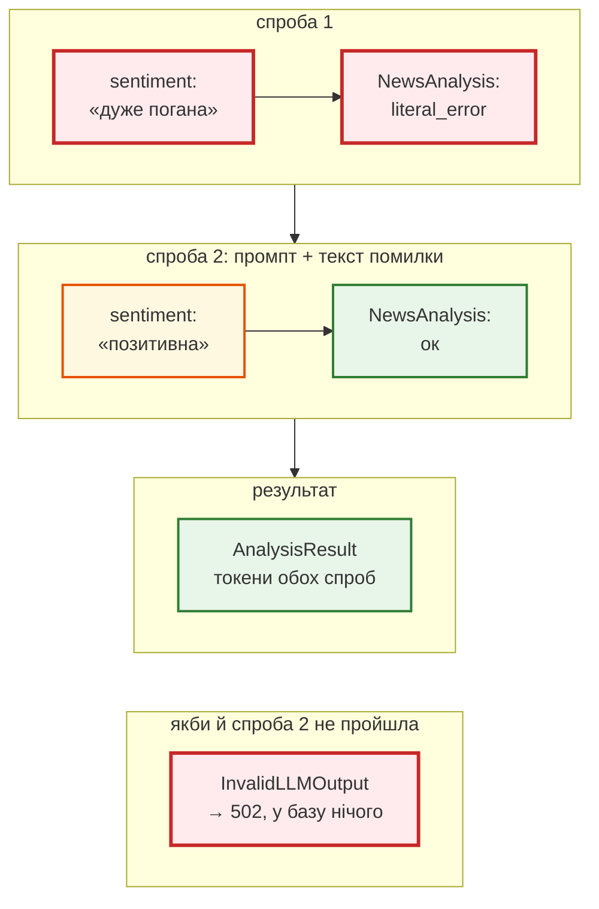

# JSON за схемою + Pydantic

> Крок 7 · розділ 3 з 7. Код: [`news_hub/analysis.py`](https://github.com/NikoriakViktor/news_hub/blob/main/steps/07_llm_api/news_hub/analysis.py), [`news_hub/llm.py`](https://github.com/NikoriakViktor/news_hub/blob/main/steps/07_llm_api/news_hub/llm.py) (`GenerateContentConfig`).
> Теорія: [`ConfigDict`: `extra`](../../02_typing_and_pydantic/config_dict.md#extra), [`ValidationError`: усі ключі](../../02_typing_and_pydantic/validation_error.md#structure).

## Задача { #task }

Модель відповідає **текстом**. Навіть коли її просять JSON, вона може додати «Звісно! Ось аналіз:», вигадати тональність «дуже погана», повернути зайве поле або обрізати відповідь на ліміті токенів. У базу ж має потрапити рівно чотири поля з дозволеними значеннями — або нічого.

## Зміна 1: схема — звичайна модель Pydantic { #schema }

```python title="news_hub/analysis.py (фрагмент)"
# Теми для моделі. «Новини» з URL rbc.ua — це розділ сайту, а не тема, тому його тут немає.
Topic = Literal["Політика", "Економіка", "Суспільство", "Спорт", "Світ", "Технології", "Інше"]
Sentiment = Literal["позитивна", "нейтральна", "негативна"]


class NewsAnalysis(BaseModel):
    """Що повертає модель — і що ми перевіряємо. Схему бачить і модель (JSON Schema у запиті)."""
    model_config = ConfigDict(extra="forbid", str_strip_whitespace=True)

    summary: str = Field(min_length=5, max_length=300)
    category: Topic
    sentiment: Sentiment
    keywords: list[str] = Field(max_length=5)
```

Одна модель працює двічі: її бачить **і модель** (як JSON Schema у запиті), **і наш код** (як перевірку відповіді). Ось що отримує провайдер — `NewsAnalysis.model_json_schema()` (вивід стиснуто до кількох рядків):

```json
{
  "additionalProperties": false,
  "description": "Що повертає модель — і що ми перевіряємо. Схему бачить і модель (JSON Schema у запиті).",
  "properties": {
    "summary": {"maxLength": 300, "minLength": 5, "title": "Summary", "type": "string"},
    "category": {
      "enum": ["Політика", "Економіка", "Суспільство", "Спорт", "Світ", "Технології", "Інше"],
      "title": "Category", "type": "string"
    },
    "sentiment": {"enum": ["позитивна", "нейтральна", "негативна"], "title": "Sentiment", "type": "string"},
    "keywords": {"items": {"type": "string"}, "maxItems": 5, "title": "Keywords", "type": "array"}
  },
  "required": ["summary", "category", "sentiment", "keywords"],
  "title": "NewsAnalysis",
  "type": "object"
}
```

| У Pydantic | У JSON Schema | Що це дає |
|---|---|---|
| `Literal[...]` | `enum` | модель обирає з переліку, а не вигадує |
| `extra="forbid"` | `"additionalProperties": false` | інших полів не буває |
| `Field(max_length=5)` для списку | `maxItems: 5` | не більше 5 ключових слів |
| `Field(min_length=5, max_length=300)` | `minLength`, `maxLength` | підсумок — речення, а не абзац |
| `str_strip_whitespace=True` | — | пробіли по краях прибирає Pydantic, до перевірки довжини |

Тему `Topic` зведено з розділами сайту: тест `test_topics_are_site_categories_except_news` перевіряє, що всі теми, крім «Інше», є серед `CATEGORIES` з `models.py`, а «Новини» серед них немає.

## Зміна 2: схема в запиті { #request }

```python title="news_hub/llm.py — GeminiClient.generate (фрагмент)"
        config = genai_types.GenerateContentConfig(
            system_instruction=system,
            response_mime_type="application/json",   # лише JSON…
            # …і саме такої структури. response_json_schema — повна JSON Schema; старіше поле response_schema
            # приймає лише підмножину OpenAPI і відхиляє схему з additionalProperties (extra="forbid") — 400
            response_json_schema=schema.model_json_schema(),
            temperature=0.2,                         # класифікація, а не творчість: менше випадковості
            max_output_tokens=self.max_tokens,
            automatic_function_calling=genai_types.AutomaticFunctionCallingConfig(disable=True),  # інструментів немає
        )
```

Тест `test_gemini_first_model_answers` перевіряє, що саме пішло в SDK: `response_mime_type == "application/json"`, `response_json_schema == NewsAnalysis.model_json_schema()`, а старе поле `response_schema` — `None`. Чому це важливо — [«Знайди помилку»](checkpoint.md#find-bug).

## Зміна 3: перевірка відповіді й один повтор { #retry }

Схема в запиті **зменшує** ймовірність поганої відповіді, але не скасовує перевірку: відповідь може обрізатись на `max_output_tokens`, бути порожньою (заблокована політикою провайдера), а обмеження на кшталт `max_length` провайдер може не застосувати. Тому відповідь проходить `NewsAnalysis` — так само, як дані з парсера проходять `NewsItem` у кроці 1:

```python title="news_hub/analysis.py — analyze_news (фрагмент)"
def _parse(reply: LLMReply) -> NewsAnalysis:
    return NewsAnalysis.model_validate_json(reply.text)

    ...
    prompt = build_prompt(title)
    reply = await llm.generate(prompt, system=SYSTEM_PROMPT, schema=NewsAnalysis)
    tokens_in, tokens_out = reply.input_tokens, reply.output_tokens
    try:
        analysis = _parse(reply)
    except ValidationError as error:
        # Одна повторна спроба: показуємо моделі, що саме не так. Більше — лише витрата токенів.
        logger.warning("%s: невалідна відповідь (%s помилок) — повтор", reply.model, error.error_count())
        problems = "; ".join(f"{'.'.join(map(str, e['loc'])) or 'json'}: {e['msg']}" for e in error.errors())
        retry_prompt = f"{prompt}\n\nПопередня відповідь не пройшла перевірку: {problems}. Поверни лише JSON за схемою."
        reply = await llm.generate(retry_prompt, system=SYSTEM_PROMPT, schema=NewsAnalysis)
        tokens_in, tokens_out = tokens_in + reply.input_tokens, tokens_out + reply.output_tokens
        try:
            analysis = _parse(reply)
        except ValidationError as again:
            raise InvalidLLMOutput(f"{reply.model}: відповідь не пройшла перевірку двічі: "
                                   f"{again.error_count()} помилок") from again
```

Покроково — перша відповідь невалідна, друга проходить:



## Результат { #result }

Що каже `NewsAnalysis` на типові погані відповіді (`e.error_count()`, тип, `loc`, `msg` першої помилки):

```text
не JSON: 1 | json_invalid | loc=() | Invalid JSON: expected value at line 1 column 1
не з переліку: 1 | literal_error | loc=('sentiment',) | Input should be 'позитивна', 'нейтральна' or 'негативна'
розділ сайту: 1 | literal_error | loc=('category',) | Input should be 'Політика', 'Економіка', 'Суспільство', 'Спорт', 'Світ', 'Технології' or 'Інше'
зайве поле: 1 | extra_forbidden | loc=('mood',) | Extra inputs are not permitted
порожньо: 1 | json_invalid | loc=() | Invalid JSON: EOF while parsing a value at line 1 column 0
6 слів: 1 | too_long | loc=('keywords',) | List should have at most 5 items after validation, not 6
пробіли: summary='НБУ знизив ставку.' category='Економіка' sentiment='нейтральна' keywords=[]
```

У «не JSON» і «порожньо» `loc` порожній — тому в тексті для повтору стоїть `json` (`'.'.join(...) or 'json'`).

Повтор з `FakeLLM(["…дуже погана…", OK])`:

```text
WARNING news_hub: fake: невалідна відповідь (1 помилок) — повтор
AnalysisResult(analysis=NewsAnalysis(summary='НБУ знизив облікову ставку.', category='Економіка', sentiment='позитивна', keywords=['НБУ', 'облікова ставка']), model='fake', cached=False, input_tokens=71, output_tokens=66)
```

Другий промпт, який отримала модель, — перший плюс конкретна помилка:

```text
Проаналізуй новину.
<news>
Нацбанк знизив облікову ставку до 13%
</news>

Попередня відповідь не пройшла перевірку: sentiment: Input should be 'позитивна', 'нейтральна' or 'негативна'. Поверни лише JSON за схемою.
```

Дві невалідні відповіді поспіль — `FakeLLM(["не json", '…"category": "Новини"…'])`:

```text
WARNING news_hub: fake: невалідна відповідь (1 помилок) — повтор
InvalidLLMOutput : fake: відповідь не пройшла перевірку двічі: 1 помилок
calls: 2
```

- **Одна повторна спроба — компроміс.** Модель часто виправляється, коли бачить помилку; третя й далі — здебільшого витрачені токени. Третьої спроби немає (`calls: 2`).
- **Токени обох спроб додаються** (`input_tokens=71` — це сума двох промптів): платимо за обидві.
- **Невалідна двічі — явна помилка.** `InvalidLLMOutput` → API відповідає `502`, а в базу нічого не пишеться. Не «якось збережемо».

Так відповіла справжня модель Gemini (запуск з ключем) на заголовок зі знімка; відповідь щоразу трохи інша:

```json
{
  "summary": "Україна випробувала турель зі штучним інтелектом для збивання російських дронів.",
  "category": "Технології",
  "sentiment": "позитивна",
  "keywords": ["ШІ-турель", "дрони", "ППО", "Федоров"]
}
```

Порівняй з `nlp.py` з [огляду кроку](index.md#problem): там ця новина отримала «−1» через слово «дронів». Колонка `category` (розділ сайту) лишається як була; тема від моделі йде в нову колонку `ai_category`.

## Правило { #rule }

!!! tip "Правило"
    Відповідь моделі — це зовнішні дані, як HTML з парсера. Схема в запиті (`Literal` → `enum`, `extra="forbid"`) зменшує брак, а `model_validate_json` у твоєму коді його ловить. Невалідна відповідь — одна повторна спроба з текстом помилки, потім явний виняток.

**Далі:** [Промпт: інструкція окремо, новина — як дані](prompt_injection.md).
