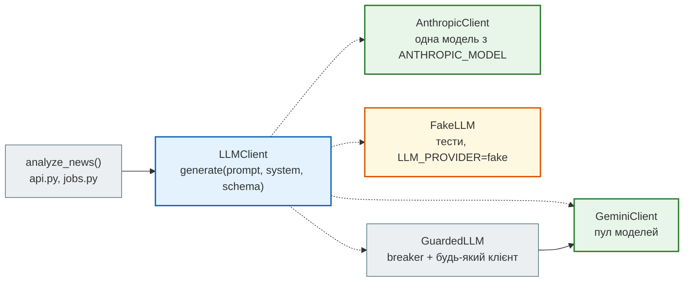
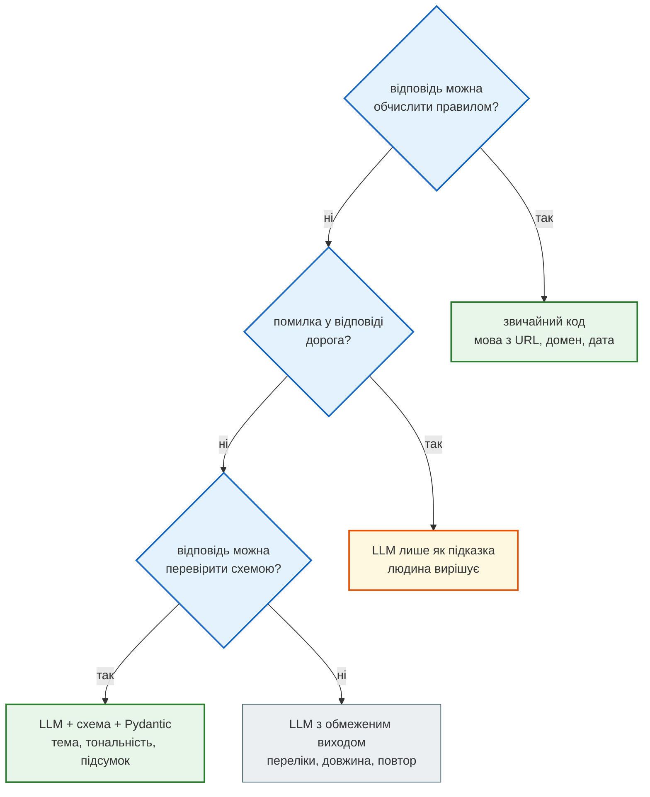

# Один інтерфейс `LLMClient`

> Крок 7 · розділ 1 з 7. Код: [`news_hub/llm.py`](https://github.com/NikoriakViktor/news_hub/blob/main/steps/07_llm_api/news_hub/llm.py).
> Теорія: [Частина IX. Інтеграції: AI, LLM, Telegram](../../09_integrations/README.md).

## Задача { #task }

Аналіз новин має працювати з Gemini (безкоштовний ключ), з Anthropic (інший провайдер, та сама роль) і **без жодного провайдера** — у тестах і під час розробки. Ендпоінт, фонова задача й бот не повинні знати, хто саме відповідає.

Стартовий код бота мав одну функцію `ask(messages, system_prompt, redis_client)` лише для Gemini. Вона повертала рядок, і збій **теж** був рядком («AI сервіс недоступний…»). Такий «збій» легко зберегти в базу як відповідь моделі.

## Як виглядає виклик LLM API { #anatomy }

Запит до моделі — звичайний HTTP POST з JSON; SDK лише загортає його в Python. Частини запиту однакові в усіх провайдерів, різняться лише назви:

| Частина запиту | Що це | У `news_hub` |
|---|---|---|
| модель | назва: `gemini-2.5-flash` тощо; моделі з'являються й зникають | `MODEL_POOL`, `GEMINI_MODELS`, `ANTHROPIC_MODEL` |
| системна інструкція | роль і правила — окремо від даних | `SYSTEM_PROMPT` |
| вміст (`contents` / `messages`) | те, що аналізуємо | `build_prompt(title)` |
| формат відповіді | `application/json` + JSON Schema — модель відповідає саме такою структурою | `NewsAnalysis` |
| `max_output_tokens`, `temperature` | стеля відповіді; випадковість (0 — майже однаково щоразу) | `LLM_MAX_TOKENS=2048`, `0.2` |

**Токен** — шматок тексту (частина слова). За вхідні й вихідні токени провайдер виставляє рахунок, і ліміти квоти теж рахуються в токенах і запитах за хвилину. Кирилиця ділиться на токени дрібніше за англійську: той самий зміст коштує більше.

Ключ API — секрет: лише змінна середовища, ніколи в коді чи git.

## Зміна 1: протокол замість функції { #protocol }

| Було (`ask()` у стартовому коді) | Стало (`llm.py`) | Навіщо |
|---|---|---|
| функція лише для Gemini | протокол `LLMClient`: `generate(prompt, *, system, schema) → LLMReply` | Gemini, Anthropic і фейк взаємозамінні; решта коду про провайдера не знає |
| відповідь — рядок | `LLMReply`: текст, модель, вхідні й вихідні токени | видно, хто відповів і скільки це коштувало |
| збій — теж рядок | винятки `LLMUnavailable`, `CircuitOpen` | збій неможливо сплутати з відповіддю й зберегти як відповідь |
| breaker усередині `ask()` | `GuardedLLM` обгортає будь-який клієнт | breaker однаковий для всіх провайдерів ([розділ 5](circuit_breaker.md)) |

```python title="news_hub/llm.py (фрагмент)"
class LLMError(Exception):
    """Базова помилка шару LLM."""


class LLMUnavailable(LLMError):
    """Провайдер не відповів (усі моделі пулу або помилка запиту) → API повертає 502."""


@dataclass(frozen=True)
class LLMReply:
    """Відповідь моделі + те, що потрібно для журналу й рахунку: яка модель, скільки токенів."""
    text: str
    model: str
    input_tokens: int = 0
    output_tokens: int = 0


class LLMClient(Protocol):
    """Будь-який провайдер: промпт + системна інструкція + схема відповіді → JSON-текст."""

    name: str

    async def generate(self, prompt: str, *, system: str, schema: type[BaseModel]) -> LLMReply: ...

    async def aclose(self) -> None:
        """Закрити HTTP-з'єднання клієнта (lifespan при зупинці застосунку)."""
```

`Protocol` — «качина типізація» для mypy: клас **не успадковує** `LLMClient`, достатньо мати `name`, `generate` і `aclose` з такими сигнатурами. `mypy --strict` перевіряє це там, де клієнт передається як `LLMClient`. Чотири реалізації:



Ієрархія винятків теж частина контракту: усе, що летить із шару LLM, — підклас `LLMError`. API ловить його одним обробником і перетворює на `502` або `503` ([розділ 7](endpoints_and_tests.md#errors)).

## Зміна 2: `make_llm` — провайдер зі змінних середовища { #make-llm }

```python title="news_hub/llm.py (фрагмент)"
def make_llm(provider: str | None = None) -> LLMClient | None:
    """Клієнт за змінними середовища; None — ключа немає (API відповідатиме 503 «LLM не налаштовано»)."""
    provider = provider or os.getenv("LLM_PROVIDER", "gemini")
    if provider == "fake":
        return FakeLLM()
    if provider == "gemini":
        if not (key := os.getenv("GEMINI_API_KEY")):
            return None
        models = [m.strip() for m in os.getenv("GEMINI_MODELS", "").split(",") if m.strip()] or MODEL_POOL
        return GeminiClient(key, models)
    if provider == "anthropic":
        key, model = os.getenv("ANTHROPIC_API_KEY"), os.getenv("ANTHROPIC_MODEL")
        return AnthropicClient(key, model) if key and model else None
    raise ValueError(f"невідомий LLM_PROVIDER: {provider!r} (gemini, anthropic або fake)")
```

`make_llm()` викликається **один раз** у `lifespan`, а клієнт живе в `app.state.llm`, як Redis з кроку 4:

```python title="news_hub/api.py — lifespan (фрагмент)"
    app.state.redis = make_redis()       # таблиці створює міграція: alembic upgrade head
    app.state.llm = make_llm()           # None — немає ключа: аналіз відповідатиме 503
    yield
    if app.state.llm is not None:
        await app.state.llm.aclose()     # HTTP-сесія клієнта LLM
```

## Результат { #result }

Що повертає `make_llm` за різних змінних (скрипт без мережі; `GeminiClient` при створенні лише зберігає ключ):

```text
без ключа: None
fake: FakeLLM
gemini: GeminiClient ['gemini-2.5-flash', 'gemini-2.5-flash-lite', 'gemini-2.0-flash', 'gemini-2.0-flash-lite']
ValueError: невідомий LLM_PROVIDER: 'openai' (gemini, anthropic або fake)
```

- **Немає ключа — застосунок стартує.** Стрічка, пошук і збір працюють, а аналіз відповідає `503` з підказкою, яку змінну задати.
- **Невідомий провайдер — застосунок не стартує.** Помилка в назві (`LLM_PROVIDER=gemeni`) видна одразу при запуску, а не з першим запитом на аналіз.
- **Модель Anthropic — лише зі змінної `ANTHROPIC_MODEL`.** Назви моделей змінюються частіше за код; без моделі клієнта немає (`None`), як і без ключа.

Так виглядає «немає ключа» з боку клієнта (сервер запущено без `GEMINI_API_KEY`):

```text
$ curl -i -X POST localhost:8000/api/news/50/analyze
HTTP/1.1 503 Service Unavailable
x-ratelimit-limit: 10
x-ratelimit-remaining: 9

{"detail":"LLM не налаштовано: задай GEMINI_API_KEY (або LLM_PROVIDER=anthropic + ANTHROPIC_API_KEY і ANTHROPIC_MODEL)"}
$ curl localhost:8000/health
{"status":"ok"}
```

## `FakeLLM`: провайдер без мережі { #fake-llm }

`FakeLLM` реалізує той самий протокол. Він відповідає **за сценарієм** — рядки й винятки по черзі — і запам'ятовує всі промпти:

```python title="news_hub/llm.py (фрагмент)"
class FakeLLM:
    """Відповідає за сценарієм: FakeLLM(['{…}', LLMUnavailable('…')]) — по черзі; черга порожня → demo_reply.

    `calls` — усі промпти, які отримав клієнт: тест перевіряє, що саме пішло б у модель і скільки разів.
    """

    name = "fake"

    def __init__(self, replies: Iterable[str | Exception] = (),
                 fallback: Callable[[str], str] = demo_reply) -> None:
        self.replies: deque[str | Exception] = deque(replies)
        self.fallback = fallback
        self.calls: list[str] = []
        self.systems: list[str] = []

    async def generate(self, prompt: str, *, system: str, schema: type[BaseModel]) -> LLMReply:
        self.calls.append(prompt)
        self.systems.append(system)
        reply = self.replies.popleft() if self.replies else self.fallback(prompt)
        if isinstance(reply, Exception):
            raise reply
        return LLMReply(text=reply, model="fake", input_tokens=len(prompt) // 4, output_tokens=len(reply) // 4)
```

Сценарій «відповідь, збій, далі без сценарію»:

```python
fake = FakeLLM([OK, LLMUnavailable("503")])
await fake.generate(build_prompt(TITLE), system=SYSTEM_PROMPT, schema=NewsAnalysis)   # 1
await fake.generate(...)                                                               # 2
await fake.generate(...)                                                               # 3
```

```text
LLMReply(text='{"summary": "НБУ знизив облікову ставку.", "category": "Економіка", "sentiment": "позитивна", "keywords": ["НБУ", "облікова ставка"]}', model='fake', input_tokens=18, output_tokens=33)
LLMUnavailable: 503
demo_reply: {"summary": "Нацбанк знизив облікову ставку до 13%", "category": "Інше", "sentiment": "нейтральна", "keywords": ["нацбанк", "знизив", "облікову", "ставку"]}
calls: 3
```

- Токени фейк рахує як `len(text) // 4` — грубо, але досить, щоб тест перевірив, що токени **обох** спроб додаються ([розділ 3](json_schema.md#retry)).
- Коли сценарій закінчився, відповідає `demo_reply`: «Інше / нейтральна», ключові слова — довгі слова заголовка. Тест `test_demo_reply_is_valid_for_every_snapshot_title` перевіряє, що така відповідь проходить `NewsAnalysis` для кожного з 168 заголовків знімка. Тому `LLM_PROVIDER=fake` годиться для розробки фронтенду й бота без ключа.

## Коли LLM, а коли звичайний код { #when-llm }

LLM — не заміна всім правилам. У `news_hub` мова й джерело лишаються правилами (`NewsItem` виводить їх з URL): там модель лише додала б витрат і помилок.



## Правило { #rule }

!!! tip "Правило"
    Зовнішню модель ховай за власним інтерфейсом: один метод, власна відповідь (`LLMReply`), власні винятки. Провайдер обирається змінною середовища в одному місці (`make_llm` у `lifespan`). Збій — завжди виняток, ніколи не рядок, схожий на відповідь.

**Далі:** [Асинхронний клієнт і пул моделей](gemini_pool.md).
