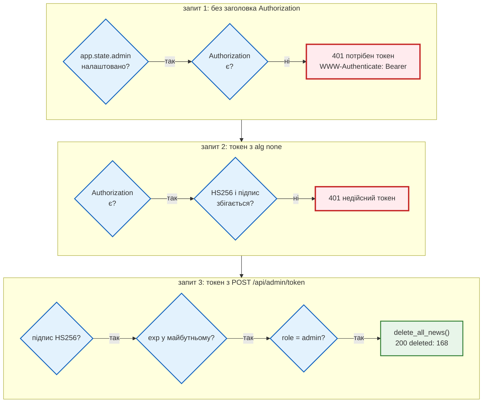

# Адмін і JWT

> Крок 8 · розділ 1 з 4. Код: [`news_hub/security.py`](https://github.com/NikoriakViktor/news_hub/blob/main/steps/08_security/news_hub/security.py), [`news_hub/api.py`](https://github.com/NikoriakViktor/news_hub/blob/main/steps/08_security/news_hub/api.py), [`news_hub/middleware.py`](https://github.com/NikoriakViktor/news_hub/blob/main/steps/08_security/news_hub/middleware.py).
> Теорія: [Частина VIII. Безпека API](../../08_security/README.md); секрети в середовищі — [Налаштування з середовища](../../02_typing_and_pydantic/settings.md).

## Задача { #task }

Читати новини може будь-хто. Змінювати, збирати, аналізувати й додавати джерела — лише адмін. Адмін входить за паролем і отримує токен, а кожен ендпоінт запису перевіряє токен і відповідає:

- `401` — ми не знаємо, хто це: токена немає, він підроблений чи прострочений;
- `403` — знаємо, хто це, але прав немає;
- `503` — адмін-доступ не налаштовано (немає секретів у середовищі).

Основа — стартовий шаблон бекенду: хеш пароля, `create_access_token`, `decode_token`, залежність `get_current_admin` і `POST /admin/auth/token`. Переносимо його в `news_hub/security.py` і виправляємо те, що ламається або пропускає атаку.

| Звідки (стартовий шаблон) | Що там | Куди в `news_hub` |
|---|---|---|
| `backend/core/security.py` | хеш пароля, `create_access_token`, `decode_token` | `news_hub/security.py` |
| `backend/api/deps.py`, `api/admin/auth.py` | `get_current_admin` (401 / 403), `POST /admin/auth/token` | `require_admin`, `POST /api/admin/token` |
| `backend/core/config.py` | `JWT_SECRET`, `ADMIN_PASSWORD` зі змінних середовища | `load_admin_settings` |

## Зміна 1: хеш пароля — bcrypt без passlib { #bcrypt }

Шаблон хешує пароль через `passlib`, ще й **при імпорті модуля**:

```python title="backend/api/admin/auth.py (стартовий шаблон)"
_ADMIN_PASSWORD_HASH = hash_password(settings.ADMIN_PASSWORD)
```

`passlib` не оновлювався з 2020 року, а `bcrypt` 5 змінив поведінку. Чиста установка `passlib 1.7.4` + `bcrypt 5.0.0`, хеш короткого пароля `"change-me"`:

```text
(trapped) error reading bcrypt version
AttributeError: module 'bcrypt' has no attribute '__about__'
...
ValueError: password cannot be longer than 72 bytes, truncate manually if necessary (e.g. my_password[:72])
```

Пароль короткий, а помилка — про 72 байти: `passlib` при першому виклику сам перевіряє bcrypt довгим тестовим паролем, і `bcrypt` 5 цей пароль відкидає. Помилка трапляється при імпорті, тож застосунок не стартує взагалі. Тепер `bcrypt` напряму:

```python title="news_hub/security.py"
BCRYPT_MAX_BYTES = 72


def hash_password(password: str, rounds: int = 12) -> str:
    """bcrypt: сіль у самому хеші, 2^rounds ітерацій — навмисно повільно (~0,2 с при 12)."""
    data = password.encode()
    if len(data) > BCRYPT_MAX_BYTES:
        raise ValueError(f"пароль довший за {BCRYPT_MAX_BYTES} байти: bcrypt його не прийме")
    return bcrypt.hashpw(data, bcrypt.gensalt(rounds)).decode()


def verify_password(password: str, password_hash: str) -> bool:
    data = password.encode()
    if len(data) > BCRYPT_MAX_BYTES:        # bcrypt ≥ 5 кидає ValueError — для нас це просто «не той пароль»
        return False
    return bcrypt.checkpw(data, password_hash.encode())
```

Як це поводиться:

```python
h = hash_password("пароль", rounds=12)
print(h[:7], len(h))                                   # префікс: алгоритм і кількість раундів
t = time.perf_counter(); verify_password("пароль", h); print(f"verify rounds=12: {time.perf_counter() - t:.3f} s")
h4 = hash_password("пароль", rounds=4)
t = time.perf_counter(); verify_password("пароль", h4); print(f"verify rounds=4: {time.perf_counter() - t:.4f} s")
print("same password, different hashes:", hash_password("пароль", rounds=4) != h4)
print("100 × 'я':", verify_password("я" * 100, h4))   # 200 байт UTF-8
hash_password("я" * 37)                                # 74 байти
```

```text
$2b$12$ 60
verify rounds=12: 0.231 s
verify rounds=4: 0.0012 s
same password, different hashes: True
100 × 'я': False
ValueError: пароль довший за 72 байти: bcrypt його не прийме
```

- **Сіль у самому хеші.** Той самий пароль двічі дає різні хеші, тож готові таблиці «пароль → хеш» не допоможуть.
- **Навмисно повільно.** 12 раундів — 0,23 с на одну перевірку. Для входу непомітно, для перебору мільйонів паролів — дорого. Тести беруть 4 раунди (0,001 с), щоб не чекати.
- **72 байти** — межа самого алгоритму bcrypt. Старі версії мовчки обрізали довший пароль, `bcrypt` 5 кидає `ValueError` і в `checkpw`. Без перевірки довжини вхід з довгим паролем закінчувався б `500`. Кирилиця — 2 байти на літеру, тож 37 літер «я» — уже 74 байти.

У середовищі лежить **хеш**, а не пароль. `python -m news_hub.security` питає пароль (через `getpass`, не видно на екрані) і друкує два рядки для `.env`:

```text
ADMIN_PASSWORD_HASH='$2b$12$…'
JWT_SECRET='…'                    # secrets.token_urlsafe(48) — 64 випадкові символи
```

У хеші є `$`, тому в shell і в `.env` — одинарні лапки. Чому `$` у `.env` — пастка, пояснено в [Налаштуваннях з середовища](../../02_typing_and_pydantic/settings.md#dollar).

## Зміна 2: налаштування без «change-me» { #settings }

```python title="backend/core/config.py (стартовий шаблон)"
JWT_SECRET: str = os.getenv("JWT_SECRET", "change-me-in-production")
ADMIN_PASSWORD: str = os.getenv("ADMIN_PASSWORD", "change-me")
```

`validate()` шаблону перевіряє лише «не порожній», тож значення за замовчуванням проходить. Хто прочитав код (а він публічний), той підпише токен сам:

```python
JWT_SECRET = "change-me-in-production"
print("validate() пропускає:", bool(JWT_SECRET))
forged = jwt.encode({"sub": "admin", "role": "admin", "exp": ...}, JWT_SECRET, algorithm="HS256")
print("підроблений токен приймається:", jwt.decode(forged, JWT_SECRET, algorithms=["HS256"]))
```

```text
validate() пропускає: True
підроблений токен приймається: {'sub': 'admin', 'role': 'admin'}
InsecureKeyLengthWarning: The HMAC key is 23 bytes long, which is below the minimum recommended length of 32 bytes for SHA256. See RFC 7518 Section 3.2.
```

PyJWT сам попереджає про короткий ключ, але попередження ніхто не читає. Тепер налаштування — `AdminSettings` з середовища і **без** значень за замовчуванням для секретів:

```python title="news_hub/security.py"
JWT_ALGORITHM = "HS256"          # у коді, а не з env: алгоритм — не налаштування
MIN_SECRET_LENGTH = 32


@dataclass(frozen=True)
class AdminSettings:
    jwt_secret: str
    username: str
    password_hash: str
    expire_minutes: int = 30


def load_admin_settings(env: Mapping[str, str] = os.environ) -> AdminSettings | None:
    """None — адмінку не налаштовано (ендпоінти запису → 503). Налаштовано погано — RuntimeError при старті."""
    secret, password_hash = env.get("JWT_SECRET", ""), env.get("ADMIN_PASSWORD_HASH", "")
    if not secret and not password_hash:
        return None
    if len(secret) < MIN_SECRET_LENGTH:
        raise RuntimeError(f"JWT_SECRET має бути не коротшим за {MIN_SECRET_LENGTH} символи; "
                           "згенеруй: python -m news_hub.security")
    if not password_hash.startswith("$2"):
        raise RuntimeError("ADMIN_PASSWORD_HASH — bcrypt-хеш ($2b$…), а не пароль; "
                           "згенеруй: python -m news_hub.security")
    return AdminSettings(jwt_secret=secret, username=env.get("ADMIN_USERNAME", "admin"),
                         password_hash=password_hash,
                         expire_minutes=int(env.get("JWT_EXPIRE_MINUTES", "30")))
```

`lifespan` викликає її при старті й кладе результат в `app.state.admin`. Три стани, і жоден не «працює з дефолтним секретом»:

| Стан | Що відбувається |
|---|---|
| нічого не задано | `None`: читати можна, запис відповідає `503 адмін-доступ не налаштовано` |
| задано погано | `RuntimeError`, застосунок не стартує |
| задано добре | працює |

Запуск з секретом зі стартового шаблону:

```text
$ JWT_SECRET=change-me-in-production ADMIN_PASSWORD_HASH='$2b$04$…' uvicorn news_hub.api:app
INFO:     Waiting for application startup.
ERROR:    Traceback (most recent call last):
RuntimeError: JWT_SECRET має бути не коротшим за 32 символи; згенеруй: python -m news_hub.security

ERROR:    Application startup failed. Exiting.
```

А пароль замість хешу:

```text
RuntimeError: ADMIN_PASSWORD_HASH — bcrypt-хеш ($2b$…), а не пароль; згенеруй: python -m news_hub.security
```

Помилка при старті краща за помилку о третій ночі: сервер з поганим секретом не запуститься взагалі, а не працюватиме «майже безпечно».

## Зміна 3: токен і перевірка { #token }

```python title="news_hub/security.py"
def create_access_token(settings: AdminSettings, subject: str, now: datetime | None = None) -> str:
    now = now or datetime.now(timezone.utc)
    payload = {"sub": subject, "role": "admin", "iat": now,
               "exp": now + timedelta(minutes=settings.expire_minutes)}
    return jwt.encode(payload, settings.jwt_secret, algorithm=JWT_ALGORITHM)


def decode_token(settings: AdminSettings, token: str) -> dict[str, Any]:
    """Підпис, строк дії і обов'язкові поля. Помилки — jwt.ExpiredSignatureError / jwt.InvalidTokenError."""
    payload: dict[str, Any] = jwt.decode(token, settings.jwt_secret, algorithms=[JWT_ALGORITHM],
                                         options={"require": ["exp", "sub", "role"]})
    return payload
```

JWT — це `header.payload.signature`, кожна частина в base64url. Розберемо токен, який повернув `POST /api/admin/token`:

```text
header : {'alg': 'HS256', 'typ': 'JWT'}
payload keys: ['sub', 'role', 'iat', 'exp'] exp-iat = 1800
signature length: 43
```

Підпис — HMAC-SHA256 від `header.payload` ключем `JWT_SECRET`. Payload **не зашифрований**: прочитати його може будь-хто, змінити без секрету — ні. Сервер нічого не зберігає, тож будь-хто, хто знає секрет, може випустити токен. Тому секрет довгий, випадковий і лише в середовищі.

Що змінено проти шаблону:

| Було (стартовий шаблон) | Стало (`news_hub/security.py`) | Чому |
|---|---|---|
| `JWT_ALGORITHM` зі змінної середовища | `JWT_ALGORITHM = "HS256"` у коді | алгоритм — не налаштування; `decode` приймає лише його |
| `jwt.decode(token, secret, algorithms=[...])` | + `options={"require": ["exp", "sub", "role"]}` | токен без `exp` жив би вічно |
| `if body.username != settings.ADMIN_USERNAME: raise 401` — пароль уже не перевіряється | `hmac.compare_digest` для імені, bcrypt — **завжди** | інакше чуже ім'я відповідає за мілісекунду, а своє — за 0,2 с: за часом видно, що ім'я вгадали |
| `HTTPBearer()` — кидає помилку сам | `HTTPBearer(auto_error=False)` + свої `401` з `WWW-Authenticate: Bearer` | зрозумілі причини: «потрібен токен», «прострочений», «недійсний» |
| без обмеження спроб | 5 спроб входу за 300 с з однієї адреси → `429`; 20 невдач на одне ім'я з усіх адрес за 900 с → `429` | bcrypt сповільнює кожну спробу, ліміти — їхню кількість ([нижче](#login-lockout)) |
| `verify_password` прямо в `async def` | bcrypt — у пулі потоків (`run_in_threadpool`) | 0,2 с bcrypt інакше зупиняють цикл подій для всіх запитів ([нижче](#threadpool)) |

Перевірка імені й пароля — завжди обидві:

```python title="news_hub/security.py"
def authenticate(settings: AdminSettings, username: str, password: str) -> bool:
    name_ok = hmac.compare_digest(username.encode(), settings.username.encode())
    password_ok = verify_password(password, settings.password_hash)     # завжди — однаковий час
    return name_ok and password_ok
```

І залежність, яку отримує кожен ендпоінт запису:

```python title="news_hub/security.py"
bearer_scheme = HTTPBearer(auto_error=False, description="POST /api/admin/token → access_token")


def require_admin(settings: AdminSettingsDep,
                  credentials: Annotated[HTTPAuthorizationCredentials | None, Depends(bearer_scheme)]) -> str:
    """401 — немає токена, підроблений чи прострочений; 403 — токен справжній, але не адміна."""
    if credentials is None:
        raise _unauthorized("потрібен токен: Authorization: Bearer <access_token>")
    try:
        payload = decode_token(settings, credentials.credentials)
    except jwt.ExpiredSignatureError as error:
        raise _unauthorized("токен прострочений") from error
    except jwt.InvalidTokenError as error:
        raise _unauthorized("недійсний токен") from error
    if payload["role"] != "admin":
        raise HTTPException(status.HTTP_403_FORBIDDEN, detail="потрібні права адміністратора")
    subject: str = payload["sub"]
    return subject


AdminDep = Depends(require_admin)
```

`AdminSettingsDep` сам по собі — залежність `get_admin_settings`: якщо `app.state.admin is None`, вона відповідає `503` ще до перевірки токена.

Шлях запиту `DELETE /api/news` через `require_admin` — покроково, на трьох запитах:



## Зміна 4: хто може писати { #admin-dep }

Захист — `dependencies=[AdminDep]` у декораторі. Функції ендпоінта не треба знати, хто адмін, — вона просто не виконається без токена:

```python title="news_hub/api.py (фрагмент)"
@app.delete("/api/news", tags=["news"], dependencies=[AdminDep])
async def delete_all_news(repo: RepoDep) -> dict[str, int]:
    return {"deleted": await repo.clear()}
```

`AdminDep` стоїть на 10 наявних ендпоінтах (запис, збір, аналіз, статуси задач) і на 4 нових `/api/sources` — разом 14 операцій. Їх видно в `/openapi.json`, бо `HTTPBearer` описує схему безпеки:

```text
{'HTTPBearer': {'type': 'http', 'description': 'POST /api/admin/token → access_token', 'scheme': 'bearer'}}
закритих операцій: 14
   DELETE /api/news
   DELETE /api/news/{news_id}
   DELETE /api/sources/{source_id}
   GET /api/analyze/jobs/{job_id}
   GET /api/scrape/jobs/{job_id}
   GET /api/sources
   PATCH /api/news/{news_id}
   POST /api/analyze/jobs
   POST /api/news
   POST /api/news/{news_id}/analyze
   POST /api/scrape
   POST /api/scrape/jobs
   POST /api/sources
   POST /api/sources/{source_id}/fetch
```

У Swagger (`/docs`) з'явилась кнопка **Authorize**, а закриті ендпоінти позначено замком: вставив `access_token` — і запити з `/docs` ідуть із заголовком. Публічними лишились `GET /health`, читання новин (`/api/news`, `/search`, `/count`, `/stats`, `/{news_id}`), сам вхід і webhook (у нього свій захист — [підпис](webhooks.md)).

Вхід — звичайний ендпоінт з однією відповіддю на «немає такого імені» і «не той пароль»:

```python title="news_hub/api.py (фрагмент)"
class TokenRequest(BaseModel):
    username: str = Field(max_length=100)
    password: str = Field(max_length=1000)


@app.post("/api/admin/token", response_model=TokenResponse, tags=["admin"], summary="Вхід адміна → JWT",
          responses={401: {"description": "неправильне ім'я або пароль"},
                     429: {"description": "забагато спроб входу"}})
async def admin_token(body: TokenRequest, settings: AdminSettingsDep, redis: RedisDep,
                      response: Response) -> TokenResponse:
    """Одна відповідь на «немає такого імені» і «не той пароль» — не підказуємо, що саме не так.

    Два ліміти: middleware — спроби з однієї адреси, LoginGuard — невдачі на одне ім'я з усіх адрес.
    bcrypt (~0,2 с) — у пулі потоків: інакше кожна спроба входу зупиняла б цикл подій для всіх запитів.
    """
    guard = LoginGuard(redis)
    wait = await guard.retry_after(body.username)
    if wait:
        raise HTTPException(status.HTTP_429_TOO_MANY_REQUESTS, headers={"Retry-After": str(wait)},
                            detail=f"забагато невдалих входів під цим іменем; спробуй через {wait} с")
    if not await run_in_threadpool(authenticate, settings, body.username, body.password):
        await guard.failed(body.username)
        raise HTTPException(status.HTTP_401_UNAUTHORIZED, detail="неправильне ім'я або пароль")
    await guard.succeeded(body.username)
    response.headers["Cache-Control"] = "no-store"           # токен не кешують ні браузер, ні проксі
    return TokenResponse(access_token=create_access_token(settings, body.username),
                         expires_in=settings.expire_minutes * 60)
```

`LoginGuard` і `run_in_threadpool` розібрано [нижче](#login-lockout). `Cache-Control: no-store` — бо відповідь з токеном не має осідати ні в кеші браузера, ні в кеші проксі між клієнтом і сервером: там її прочитав би наступний, хто отримає ту саму сторінку з кешу. Тест — рядок `assert response.headers["Cache-Control"] == "no-store"` у `test_login_and_use_token`. Без заголовка цей тест падає з `KeyError` (перевірено поломкою в копії кроку).

## Результат: від анонімного запиту до адміна { #result }

Через `TestClient`, одноразові секрети згенеровано в скрипті:

```python
r = api.delete("/api/news")                                                             # 1
print(r.status_code, r.headers.get("www-authenticate"), r.json())
for u, p in (("admin", "guess"), ("root", ADMIN_PASSWORD)):                             # 2
    r = api.post("/api/admin/token", json={"username": u, "password": p})
    print(r.status_code, r.json())
body = api.post("/api/admin/token", json={"username": "admin", "password": ADMIN_PASSWORD}).json()   # 3
H = {"Authorization": f"Bearer {body['access_token']}"}
r = api.post("/api/scrape", json={"source": "snapshot"}, headers=H)                     # 4
print(r.status_code, {k: r.json()[k] for k in ("news_saved", "news_total")})
r = api.delete("/api/news", headers=H)
print(r.status_code, r.json())
```

```text
--- 1. без токена
401 Bearer {'detail': 'потрібен токен: Authorization: Bearer <access_token>'}
--- 2. неправильний пароль / чуже ім'я
401 {'detail': "неправильне ім'я або пароль"}
401 {'detail': "неправильне ім'я або пароль"}
--- 3. вхід
200 {'access_token': 'eyJhbGciOiJIUzI1…', 'token_type': 'bearer', 'expires_in': 1800}
--- 4. з токеном
200 {'news_saved': 168, 'news_total': 168}
200 {'deleted': 168}
```

Підробки й чужі ролі на тому самому `DELETE /api/news`:

```text
alg none: {'detail': 'недійсний токен'}
expired: {'detail': 'токен прострочений'}
changed payload: {'detail': 'недійсний токен'}
role user: 403 {'detail': 'потрібні права адміністратора'}
no exp: {'detail': 'недійсний токен'}
```

- **`alg: none`** — токен «без підпису». `algorithms=["HS256"]` у `decode` його не приймає.
- **Змінений payload** (`sub: hacker` з чужим підписом) — підпис не збігається.
- **Без `exp`** — справжній підпис, але `require` вимагає поле: такий токен жив би вічно.
- **`role: user`** — підпис справжній, токен живий, але прав немає: `403`, а не `401`.

Без налаштувань:

```text
503 {'detail': 'адмін-доступ не налаштовано: задай JWT_SECRET і ADMIN_PASSWORD_HASH'}
GET /api/news: 200
```

## Ліміт спроб входу { #login-limit }

bcrypt сповільнює кожну спробу, а ліміт обмежує їхню кількість. Вхід — ще одна «дорога» дія в rate limit кроку 4, зі своїм вікном:

```python title="news_hub/middleware.py (фрагмент)"
LOGIN_RATE_LIMIT = int(os.getenv("LOGIN_RATE_LIMIT", "5"))         # крок 8: спроб входу за вікно
LOGIN_RATE_WINDOW = int(os.getenv("LOGIN_RATE_WINDOW", "300"))     # секунд


def limited_action(request: Request) -> str | None:
    path = request.url.path
    if request.method != "POST":
        return None
    if path == "/api/admin/token":
        return "login"
    ...

# дія → (запитів, за скільки секунд); ключ лічильника — rate:<дія>:<клієнт>
LIMITS = {"scrape": (RATE_LIMIT_REQUESTS, RATE_LIMIT_WINDOW), "analyze": (ANALYZE_RATE_LIMIT, RATE_LIMIT_WINDOW),
          "login": (LOGIN_RATE_LIMIT, LOGIN_RATE_WINDOW)}
```

`LIMITS` — одна таблиця на рівні модуля, а не словник усередині `rate_limit`: з кроку 9 ліміт збору звідси бере й Telegram-бот.

Тест `test_login_brute_force_is_rate_limited`: сім неправильних паролів дають `[401] * 5 + [429, 429]`, а потім навіть **правильний** пароль — `429`. Лічильник рахує всі спроби, і вдалі теж. Шоста спроба:

```text
429 {'detail': 'забагато запитів: 5 за 300 с; спробуй через 300 с'} Retry-After: 300 X-RateLimit-Limit: 5
```

Ключ ліміту — адреса клієнта (`request.client.host`). За проксі всі запити приходять з адреси проксі, а заголовок `X-Forwarded-For` клієнт може підробити. Як nginx передає справжню адресу — [крок 11](../11_compose_deploy/index.md).

## Невдалі входи на одне ім'я { #login-lockout }

**Задача.** Ліміт вище рахує спроби з **однієї адреси**. Адмін у `news_hub` один, його ім'я за замовчуванням — `admin`. Атакувальник з тисячею адрес (ботнет, пул проксі) має по 5 спроб на кожну за 5 хвилин — 1000 паролів за 5 хвилин, і ліміт на адресу цього не бачить. Перша версія кроку мала лише його; знайшла це рецензія безпеки, а не тест: тести перевіряли одну адресу.

**Зміна.** Другий лічильник — на **ім'я**, з усіх адрес разом. Рахуються лише невдалі входи; вдалий скидає лічильник:

```python title="news_hub/security.py (фрагмент)"
LOGIN_FAIL_LIMIT = int(os.getenv("LOGIN_FAIL_LIMIT", "20"))       # невдалих входів на одне ім'я за вікно
LOGIN_FAIL_WINDOW = int(os.getenv("LOGIN_FAIL_WINDOW", "900"))    # секунд


class LoginGuard:
    def __init__(self, redis: Redis, limit: int = LOGIN_FAIL_LIMIT, window: int = LOGIN_FAIL_WINDOW) -> None:
        self._redis, self.limit, self.window = redis, limit, window

    @staticmethod
    def key(username: str) -> str:
        return "login:fail:" + hashlib.sha256(username.casefold().encode()).hexdigest()[:32]

    async def retry_after(self, username: str) -> int:
        """0 — можна пробувати; інакше — скільки секунд вхід під цим іменем закритий."""
        key = self.key(username)
        count = await self._redis.get(key)
        if count is None or int(count) < self.limit:
            return 0
        return max(int(await self._redis.ttl(key)), 1)

    async def failed(self, username: str) -> None:
        async with self._redis.pipeline(transaction=True) as pipe:      # INCR + EXPIRE NX — разом, як у RateLimiter
            pipe.incr(self.key(username))
            pipe.expire(self.key(username), self.window, nx=True)
            await pipe.execute()

    async def succeeded(self, username: str) -> None:
        await self._redis.delete(self.key(username))
```

- **Перевірка — до bcrypt.** Закрите ім'я відповідає `429` одразу: перебір не витрачає навіть процесорного часу сервера.
- **Ім'я в ключі — хешем, після `casefold()`.** У Redis не потрапляє довільний рядок від клієнта, а `ADMIN` і `admin` — той самий лічильник: регістром ліміт не обійти.
- **Чуже ім'я рахується так само.** Відповідь для `editor` і для `admin` однакова, тож за лімітом не вгадаєш, яке ім'я справжнє.

**Результат.** `TestClient`, у другій частині ліміт на адресу піднято до 1000 — так одна адреса тесту імітує тисячу:

```text
--- 1. одна адреса: ліміт middleware
[401, 401, 401, 401, 401, 429, 429]
--- 2. «тисяча адрес»: ліміт на адресу знято, лишається лічильник на ім'я
20 невдалих: [401] × 20
429 {'detail': 'забагато невдалих входів під цим іменем; спробуй через 900 с'} Retry-After: 900
ADMIN: 429
editor: 401 {'detail': "неправильне ім'я або пароль"}
ключ у Redis: ['login:fail:8c6976e5b5410415bde908bd4dee15df', 'login:fail:1553cc62ff246044c683a61e203e6554']
--- 3. вікно минуло: вдалий вхід скидає лічильник
після 1 невдачі: 1
200 Cache-Control: no-store
після успіху: None
```

Двадцять перша спроба — з **правильним** паролем, і все одно `429`: інакше підбір просто чекав би на вгаданий пароль. Тести — `test_login_lockout_counts_failures_per_name_from_any_address` (API: 20 × `401`, потім `429` з `Retry-After`, інше ім'я не закрите) і `test_login_guard_counts_per_name_and_resets_on_success` (unit: регістр, скидання, хеш у ключі). Якщо в копії кроку прибрати `await guard.failed(...)`, падає перший: `1 failed, 293 passed`.

**Ціна.** Атакувальник може навмисно закрити вхід і справжньому адміну — на 15 хвилин, поки живе ключ. Для єдиного адміна це краще, ніж необмежений підбір; `LOGIN_FAIL_LIMIT` і `LOGIN_FAIL_WINDOW` — змінні середовища.

| Ліміт | Ключ | Що рахує | За замовчуванням |
|---|---|---|---|
| middleware `login` | `rate:login:<адреса>` | усі спроби з однієї адреси | 5 за 300 с |
| `LoginGuard` | `login:fail:<sha256(ім'я)[:32]>` | невдалі входи під одним ім'ям з усіх адрес | 20 за 900 с |

## bcrypt у пулі потоків { #threadpool }

**Задача.** `admin_token` — `async def`, а `bcrypt.checkpw` — звичайна функція, що 0,2 с рахує на процесорі. Викликана прямо, вона зупиняє **цикл подій**: поки йде перевірка пароля, uvicorn не обслуговує жодного іншого запиту. П'ять одночасних спроб входу — секунда, коли застосунок не відповідає навіть на `GET /health`.

**Зміна.** `await run_in_threadpool(authenticate, settings, body.username, body.password)`: bcrypt іде в пул потоків, а цикл подій вільний (дослід з bcrypt у циклі подій — [Блокуючий код](../../04_async/blocking_code.md#bcrypt)).

**Результат.** uvicorn, хеш з 12 раундами, 5 входів одночасно і `GET /health` через 50 мс після них; по 5 запусків:

```text
до (bcrypt у циклі подій):
входи: [401, 401, 401, 401, 401]; GET /health → 200 за 1.091 с
входи: [401, 401, 401, 401, 401]; GET /health → 200 за 0.158 с
входи: [401, 401, 401, 401, 401]; GET /health → 200 за 1.051 с
входи: [401, 401, 401, 401, 401]; GET /health → 200 за 0.159 с
входи: [401, 401, 401, 401, 401]; GET /health → 200 за 0.978 с
після (run_in_threadpool):
входи: [401, 401, 401, 401, 401]; GET /health → 200 за 0.003 с
входи: [401, 401, 401, 401, 401]; GET /health → 200 за 0.003 с
входи: [401, 401, 401, 401, 401]; GET /health → 200 за 0.003 с
входи: [401, 401, 401, 401, 401]; GET /health → 200 за 0.004 с
входи: [429, 429, 429, 429, 429]; GET /health → 200 за 0.002 с
```

До — від 0,16 до 1,09 с очікування (залежно від того, скільки перевірок пароля встигло стати в чергу перед `/health`), після — 2–4 мс. Останній рядок — двадцять перша невдача на ім'я `admin`: спрацював `LoginGuard`.

Тестом цього не видно: якщо в копії кроку повернути прямий виклик `authenticate`, `pytest` дає `294 passed`. Як і `compare_digest`, це питання часу, а не результату, — тому правило записане в `CLAUDE.md` кроку.

## Заголовки безпеки й /docs { #security-headers }

**Задача.** API віддає JSON, але відповідь читає браузер (теорія — [Заголовки безпеки](../../08_security/secrets_and_headers.md#security-headers)). Без підказок він може «вгадати», що JSON — це HTML (і виконати скрипт з поля новини), вбудувати сторінку API в чужий фрейм або передати адресу в `Referer` стороннім сайтам. А `/docs` і `/openapi.json` на публічному сервері — карта всіх ендпоінтів для будь-кого.

**Зміна 1: заголовки на кожній відповіді.** Окремий middleware між `request_context` (зовнішній) і `rate_limit`, тож заголовки отримує і `429`, і `401`:

```python title="news_hub/middleware.py (фрагмент)"
SECURITY_HEADERS = {
    "X-Content-Type-Options": "nosniff",        # JSON — це JSON, а не «може, HTML»
    "X-Frame-Options": "DENY",                  # не вбудовувати в чужі сторінки (clickjacking)
    "Referrer-Policy": "no-referrer",
    "Cross-Origin-Opener-Policy": "same-origin",
}
API_CSP = "default-src 'none'; frame-ancestors 'none'"   # API віддає дані, а не сторінки: нічого не вантажити
DOCS_PATHS = ("/docs", "/redoc")


class SecurityHeadersMiddleware:
    def __init__(self, app: ASGIApp) -> None:
        self.app = app

    async def __call__(self, scope: Scope, receive: Receive, send: Send) -> None:
        if scope["type"] != "http":
            await self.app(scope, receive, send)
            return
        is_docs = str(scope["path"]).startswith(DOCS_PATHS)

        async def send_with_headers(message: Message) -> None:
            if message["type"] == "http.response.start":
                headers = MutableHeaders(scope=message)
                for name, value in SECURITY_HEADERS.items():
                    headers.setdefault(name, value)
                if not is_docs:
                    headers.setdefault("Content-Security-Policy", API_CSP)
            await send(message)

        await self.app(scope, receive, send_with_headers)
```

```python title="news_hub/api.py (фрагмент)"
# Middleware: останній зареєстрований — зовнішній. Запит іде request_context → SecurityHeaders → rate_limit
# → invalidate_cache → ендпоінт, відповідь — у зворотному порядку (тож і 429 отримує заголовки безпеки).
app.middleware("http")(invalidate_cache)
app.middleware("http")(rate_limit)
app.add_middleware(SecurityHeadersMiddleware)
app.middleware("http")(request_context)
```

`/docs` і `/redoc` — без CSP: Swagger UI вантажить скрипти й стилі з CDN, і `default-src 'none'` зробив би сторінку порожньою. Інші заголовки на них є.

**Чому чистий ASGI, а не ще один `@app.middleware("http")`.** Перша версія цього middleware була третім шаром `app.middleware("http")`. Кожен такий шар (`BaseHTTPMiddleware`) змінює, **коли** закінчуються фонові задачі відносно відповіді, — і тести фонового аналізу іноді почали падати з `KeyError: 'job_id'`. Виміряно на кроці 8, `pytest -m integration`: старий код — 0 падінь з 8 запусків, з третім шаром `BaseHTTPMiddleware` — 3 з 20, з чистим ASGI — 0 з 25. Це гонка за часом: на повному `pytest` кроку 12 і з `BaseHTTPMiddleware` випало 0 з 6, тож один зелений запуск нічого не доводить. Цьому шару не потрібне ні тіло запиту, ні тіло відповіді: він лише дописує заголовки в перше ASGI-повідомлення `http.response.start` і нічого не змінює в тому, як іде відповідь. Нестабільний тест тут був не «шумом», а сигналом: зміна торкнулась порядку виконання, навіть якщо кожен окремий запуск міг пройти.

**Результат.** `TestClient`, чотири відповіді:

```text
GET /api/news → 200
    x-content-type-options: nosniff
    x-frame-options: DENY
    referrer-policy: no-referrer
    cross-origin-opener-policy: same-origin
    content-security-policy: default-src 'none'; frame-ancestors 'none'
GET /api/news/999999 → 404
    x-content-type-options: nosniff
    x-frame-options: DENY
    referrer-policy: no-referrer
    cross-origin-opener-policy: same-origin
    content-security-policy: default-src 'none'; frame-ancestors 'none'
DELETE /api/news → 401
    x-content-type-options: nosniff
    x-frame-options: DENY
    referrer-policy: no-referrer
    cross-origin-opener-policy: same-origin
    content-security-policy: default-src 'none'; frame-ancestors 'none'
GET /docs → 200
    x-content-type-options: nosniff
    x-frame-options: DENY
    referrer-policy: no-referrer
    cross-origin-opener-policy: same-origin
    content-security-policy: —
```

Тест — `test_security_headers_on_every_answer`: ті самі три відповіді API і `/docs` без CSP. Без `app.add_middleware(SecurityHeadersMiddleware)` він падає: `1 failed, 293 passed`.

HSTS (`Strict-Transport-Security`) застосунок не ставить: його ставить той, хто знімає TLS (nginx, крок 11), і лише на `https`.

**Зміна 2: `/docs` вимикається змінною середовища.**

```python title="news_hub/api.py (фрагмент)"
def docs_enabled(value: str | None = None) -> bool:
    """/docs, /redoc і /openapi.json: локально — так; на публічному сервері — DOCS_ENABLED=false (Compose)."""
    value = os.getenv("DOCS_ENABLED", "true") if value is None else value
    return value.strip().lower() not in {"0", "false", "no", "off"}


DOCS = docs_enabled()

app = FastAPI(
    title="news_hub API",
    docs_url="/docs" if DOCS else None,
    redoc_url="/redoc" if DOCS else None,
    openapi_url="/openapi.json" if DOCS else None,
    ...
)
```

```text
DOCS_ENABLED не задано:
/docs           → 200
/redoc          → 200
/openapi.json   → 200
/api/news/count → 200
DOCS_ENABLED=false:
/docs           → 404
/redoc          → 404
/openapi.json   → 404
/api/news/count → 200
```

Локально документація лишається увімкненою — нею користуються весь цей крок. На сервері її вимикає Compose ([крок 11](../11_compose_deploy/env_secrets.md)). Вимкнений `/docs` — не захист сам по собі: закриті ендпоінти однаково вимагають токен. Але карта API не лежить у відкритому доступі. Тест — `test_docs_enabled` (7 значень: `true`, `1`, порожнє, `false`, `0`, ` Off `, `no`).

## Межі цього рішення { #limits }

- **Токен не відкликати.** Сервер нічого не зберігає, тож украдений токен діє до `exp` (30 хв). Захист — короткий строк дії і заміна `JWT_SECRET`, яка анулює **всі** токени одразу.
- **Блокування входу — і для справжнього адміна.** 20 невдач під ім'ям `admin` з будь-яких адрес закривають вхід на 15 хв. Це свідомий обмін: краще 15 хвилин без входу, ніж необмежений підбір.
- **Один адмін.** Ім'я і хеш — у середовищі, ролей більше нема. Для кількох користувачів потрібна таблиця користувачів; `role` у токені вже готова до цього.
- **Секрет у пам'яті процесу.** Хто прочитав змінні середовища сервера, той підпише токен. Секрети — лише в середовищі й сховищах секретів CI, не в образі й не в git (кроки 10–12).

## Правило { #rule }

!!! tip "Правило"
    Пароль — лише bcrypt-хеш у середовищі; секрет JWT — довгий, випадковий, без значення за замовчуванням; погані налаштування зупиняють старт. Алгоритм — у коді, `decode` вимагає `exp`. Перевірка — залежністю `dependencies=[AdminDep]`: `401` — не знаємо, хто це, `403` — знаємо, але не можна. Одна відповідь на чуже ім'я і чужий пароль; два ліміти — на адресу і на ім'я; bcrypt — у пулі потоків, відповідь з токеном — `no-store`. Заголовки безпеки — чистим ASGI-middleware на кожній відповіді, `/docs` на сервері вимкнено.

**Далі:** [SSRF: куди ходить сервер](ssrf.md).
