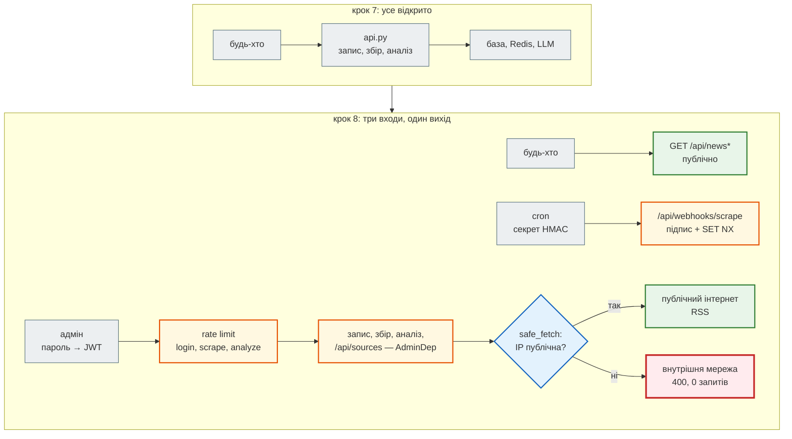

# Крок 8. Безпека: JWT, SSRF, webhook

> **Код кроку:** [`steps/08_security`](https://github.com/NikoriakViktor/news_hub/tree/main/steps/08_security).
>
> **Передумови:** [Крок 7. Аналіз новин через LLM API](../07_llm_api/index.md) — є повний CRUD, фоновий збір і аналіз новин платною моделлю.

## Де ми зараз { #where }

Після кроку 7 агрегатор уміє багато: збирає новини з rbc.ua, зберігає їх у базі, кешує в Redis, аналізує моделлю, має повний CRUD і фонові задачі. Але **будь-хто** може зробити все це за нас. Застосунок кроку 7, три запити без жодного пароля:

```python
print(api.post("/api/scrape", json={"source": "snapshot"}).json()["news_saved"])
print(api.delete("/api/news").json())
print(api.post("/api/analyze/jobs", json={"limit": 200}).status_code)
```

```text
168
{'deleted': 168}
202
```

Один запит стер базу, інший запустив аналіз 200 новин за наш рахунок.

## Проблема { #problem }

API живе в мережі серед інших систем. Звідси три окремі загрози:

1. **Хто може писати.** Читати новини може будь-хто, а змінювати, збирати, аналізувати — лише адмін. Потрібен вхід за паролем, токен і перевірка на **кожному** ендпоінті запису. І тест, який не дасть забути перевірку на новому ендпоінті.
2. **Куди ходить сервер (SSRF).** Адмін додає RSS-джерело за URL, а сервер його завантажує. Сервер стоїть **усередині** мережі: бачить localhost, Redis, базу й адресу метаданих хмари `169.254.169.254`. URL від користувача — це прохання до сервера сходити туди від свого імені.
3. **Хто нам пише (webhook).** Зовнішній планувальник запускає збір запитом до нас. Адреса публічна, тож відрізнити справжній запит від підробленого можна лише за підписом.

## Що додаємо { #what }

| Що | Де | Розділ |
|---|---|---|
| пароль адміна (bcrypt), `POST /api/admin/token` → JWT, `require_admin` (401 / 403 / 503), ліміт спроб входу | `news_hub/security.py`, `middleware.py`, `api.py` | [Адмін і JWT](admin_jwt.md) |
| RSS-джерела адміна `/api/sources`; завантаження без SSRF: схема, порт, IP після DNS, кожне перенаправлення, розмір, тип | `news_hub/safe_fetch.py`, `tables.py`, `repository.py`, міграція `0003` | [SSRF: куди ходить сервер](ssrf.md) |
| `POST /api/webhooks/scrape`: підпис HMAC-SHA256 від часу й тіла, вікно 5 хв, захист від повтору в Redis | `news_hub/webhooks.py`, `api.py` | [Підписані webhook](webhooks.md) |
| тест, що обходить усі маршрути; атаки як тести; що тести не ловлять | 6 нових файлів у `tests/` | [Тести безпеки](security_tests.md) |

## Архітектура: було → стало { #architecture }



| Модуль | Відповідає за |
|---|---|
| `security.py` | пароль (bcrypt), JWT, `require_admin`; налаштування з середовища з трьома станами |
| `safe_fetch.py` | єдиний вихід у мережу для URL ззовні: `FetchPolicy`, `check_url`, `PolicyResolver`, `safe_fetch` |
| `webhooks.py` | підпис, вікно часу, повтор; `verify_secret_token` для Telegram (крок 9) |
| `middleware.py` | + ліміт спроб входу (`login`) |
| `api.py` | лише підключає: `dependencies=[AdminDep]`, `Depends(get_fetch_policy)`, `Depends(get_webhook_secret)` |

Кожна перевірка — окрема функція без HTTP, тож її тестують unit-тести. А тести API перевіряють, що кожен ендпоінт її справді викликає.

## Файли кроку { #files }

| Файл | Що в ньому | Новий? |
|---|---|---|
| [`news_hub/security.py`](https://github.com/NikoriakViktor/news_hub/blob/main/steps/08_security/news_hub/security.py) | `AdminSettings`, `load_admin_settings`, bcrypt, `create_access_token`, `decode_token`, `require_admin`, `AdminDep`; `python -m news_hub.security` | новий |
| [`news_hub/safe_fetch.py`](https://github.com/NikoriakViktor/news_hub/blob/main/steps/08_security/news_hub/safe_fetch.py) | `is_public_ip`, `FetchPolicy`, `check_url`, `PolicyResolver`, `safe_fetch`, `UnsafeURL` / `FetchError` | новий |
| [`news_hub/webhooks.py`](https://github.com/NikoriakViktor/news_hub/blob/main/steps/08_security/news_hub/webhooks.py) | `sign`, `verify_signature`, `remember_delivery`, `verify_secret_token` | новий |
| [`news_hub/api.py`](https://github.com/NikoriakViktor/news_hub/blob/main/steps/08_security/news_hub/api.py) | `AdminDep` на 10 наявних ендпоінтах; `/api/admin/token`, 4 ендпоінти `/api/sources`, `/api/webhooks/scrape` | змінено |
| [`news_hub/middleware.py`](https://github.com/NikoriakViktor/news_hub/blob/main/steps/08_security/news_hub/middleware.py) | ліміт `login`: `LOGIN_RATE_LIMIT` спроб за `LOGIN_RATE_WINDOW` с; збір з RSS-джерела скидає кеш | змінено |
| [`news_hub/tables.py`](https://github.com/NikoriakViktor/news_hub/blob/main/steps/08_security/news_hub/tables.py), [`news_hub/repository.py`](https://github.com/NikoriakViktor/news_hub/blob/main/steps/08_security/news_hub/repository.py) | `SourceRow` (таблиця `sources`, унікальний `url`), `SourceRepository` | змінено |
| [`migrations/versions/0003_sources_table.py`](https://github.com/NikoriakViktor/news_hub/blob/main/steps/08_security/migrations/versions/0003_sources_table.py) | таблиця `sources` | новий |
| [`requirements.txt`](https://github.com/NikoriakViktor/news_hub/blob/main/steps/08_security/requirements.txt) | `PyJWT>=2.4`, `bcrypt>=4.0` | змінено |
| [`tests/integration/conftest.py`](https://github.com/NikoriakViktor/news_hub/blob/main/steps/08_security/tests/integration/conftest.py) | тестові секрети; `client` з токеном адміна, `anon` без токена | змінено |
| 6 нових файлів тестів у `tests/unit/` і `tests/integration/` | 111 тестів безпеки — [перелік](security_tests.md#files) | нові |
| [`postman/news_hub.postman_collection.json`](https://github.com/NikoriakViktor/news_hub/blob/main/steps/08_security/postman/news_hub.postman_collection.json) | + «Без токена стерти все — 401», «Вхід адміна → token»; авторизація Bearer `{{token}}`; змінна `adminPassword` | змінено |
| `parser.py`, `rss.py`, `models.py`, `scraper.py`, `db.py`, `cache.py`, `jobs.py`, `llm.py`, `analysis.py`, `snapshot.py` | з кроку 7 | без змін |

## Порядок читання { #reading-order }

1. [Адмін і JWT](admin_jwt.md) — пароль → токен → `require_admin`; три стани налаштувань.
2. [SSRF: куди ходить сервер](ssrf.md) — чому перевірка рядка URL не працює і що перевіряє `safe_fetch`.
3. [Підписані webhook](webhooks.md) — HMAC від часу й тіла, вікно, повтор.
4. [Тести безпеки](security_tests.md) — атаки як тести, тест «нічого не забули», що тести не ловлять.
5. [Контрольна точка](checkpoint.md) — чекліст, практика, самоперевірка.

Теорія до кроку — [Частина VIII. Безпека API](../../08_security/README.md); секрети в середовищі й `.env` — [Налаштування з середовища](../../02_typing_and_pydantic/settings.md).

## Запуск { #run }

З папки кроку `steps/08_security`:

```bash
pip install -r requirements.txt
pytest -q                           # 279 passed, 2 deselected
mypy --strict news_hub              # Success: no issues found in 18 source files

python -m news_hub.security         # спитає пароль → ADMIN_PASSWORD_HASH='$2b$12$…' і JWT_SECRET='…'
export ADMIN_PASSWORD_HASH='$2b$12$…' JWT_SECRET='…'      # одинарні лапки: у хеші є $
export WEBHOOK_SECRET="$(python -c 'import secrets; print(secrets.token_urlsafe(48))')"   # якщо потрібен webhook
alembic upgrade head                # + таблиця sources (0003)
uvicorn news_hub.api:app --reload   # → http://127.0.0.1:8000/docs, кнопка Authorize
```

Без `JWT_SECRET` і `ADMIN_PASSWORD_HASH` застосунок стартує, читання працює, а запис відповідає `503`. Повний перелік змінних (база, Redis, LLM) — у [README кроку](https://github.com/NikoriakViktor/news_hub/blob/main/steps/08_security/README.md).

| Змінна | За замовчуванням | Що робить |
|---|---|---|
| `JWT_SECRET` | — | ключ підпису токенів, ≥ 32 символи |
| `ADMIN_USERNAME` / `ADMIN_PASSWORD_HASH` | `admin` / — | вхід адміна; хеш — `python -m news_hub.security` |
| `JWT_EXPIRE_MINUTES` | `30` | скільки живе токен |
| `LOGIN_RATE_LIMIT` / `LOGIN_RATE_WINDOW` | `5` / `300` | спроб входу з однієї адреси за вікно, с |
| `WEBHOOK_SECRET` | — | спільний секрет для `POST /api/webhooks/scrape`, ≥ 32 символи; без нього — `503` |

## Порівняння з кроком 7 { #diff }

```bash
git diff --no-index --stat steps/07_llm_api steps/08_security
git diff --no-index steps/07_llm_api/news_hub steps/08_security/news_hub
```

Без файлів `__pycache__` — 21 змінений файл: три нові модулі (`security.py` — 156 рядків, `safe_fetch.py` — 174, `webhooks.py` — 78), `api.py` (+213 рядків), міграція `0003`, 6 нових файлів тестів. Тестів було 168, стало 279.

## Що далі { #next }

[Крок 9. Telegram-бот](../09_telegram_bot/index.md): бот на тому самому API. Telegram не підписує тіло webhook, а надсилає секретний заголовок — для нього вже є `verify_secret_token` з цього кроку.
