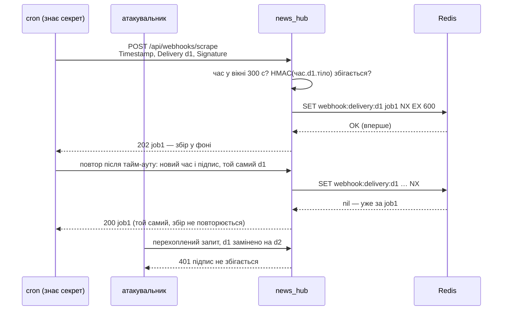

# Підписані webhook

> Крок 8 · розділ 3 з 4. Код: [`news_hub/webhooks.py`](https://github.com/NikoriakViktor/news_hub/blob/main/steps/08_security/news_hub/webhooks.py), [`news_hub/api.py`](https://github.com/NikoriakViktor/news_hub/blob/main/steps/08_security/news_hub/api.py).
> Теорія: [Частина VIII. Безпека API](../../08_security/README.md).

## Задача { #task }

`POST /api/webhooks/scrape` — зовнішній планувальник (cron на іншому сервері, GitHub Actions за розкладом) запускає збір новин. Тіло — як у `POST /api/scrape/jobs`, відповідь — `202` з `job_id`, збір іде у фоні.

JWT планувальнику не видаємо: токен живе 30 хвилин, а cron працює роками. Натомість обидві сторони знають **спільний секрет** `WEBHOOK_SECRET`. Адреса публічна, тож справжній запит треба відрізнити від підробленого, зміненого і повтореного. І ще одне: відправник сам повторює доставку, якщо не дочекався відповіді (збій мережі, тайм-аут), — і повтор не має запускати збір удруге.

## Було: секрет у шляху і в заголовку { #old }

Основа — webhook Telegram зі стартового шаблону бекенду:

```python title="backend/api/webhook.py (стартовий шаблон)"
@router.post(settings.WEBHOOK_PATH)                       # "/webhook/{WEBHOOK_SECRET}"
async def handle_webhook(request: Request) -> dict:
    secret_header = request.headers.get("X-Telegram-Bot-Api-Secret-Token")
    if secret_header != settings.WEBHOOK_SECRET:
        raise HTTPException(status_code=403, detail="Invalid webhook secret")
```

Три проблеми:

1. **Секрет у шляху** URL потрапляє туди, куди потрапляють шляхи: журнали сервера, проксі, балансувальника. Рядок журналу uvicorn для такого маршруту:

    ```text
    INFO:     127.0.0.1:45976 - "POST /webhook/s3cr3t-from-env HTTP/1.1" 200 OK
    ```

2. **Секрет у заголовку** кращий, але ходить у **кожному** запиті: хто перехопив один запит, той знає секрет назавжди і може надсилати будь-що.
3. **`!=`** порівнює до першої розбіжності, тож за часом відповіді секрет можна підбирати по символу.

## Стало: підпис HMAC, час і id доставки { #change }

Секрет не передається зовсім. Відправник дає кожній події **id доставки** і рахує **підпис** від часу, id і тіла:

```text
X-Webhook-Timestamp: <unix-час>
X-Webhook-Delivery: <id події, 8–64 символи A-Z a-z 0-9 _ ->     ← uuid4().hex
X-Webhook-Signature: sha256=<hex HMAC-SHA256(WEBHOOK_SECRET, "<час>.<id>." + тіло)>
```

Так роблять GitHub (`X-GitHub-Delivery`) і Stripe: одна подія — один id, а повтор тієї самої події має той самий id, навіть якщо його підписано заново.

```python title="news_hub/webhooks.py"
SIGNATURE_HEADER = "X-Webhook-Signature"
TIMESTAMP_HEADER = "X-Webhook-Timestamp"
DELIVERY_HEADER = "X-Webhook-Delivery"
DELIVERY_ID = re.compile(r"[A-Za-z0-9_-]{8,64}")       # uuid4().hex, secrets.token_urlsafe(16), …
TOLERANCE_SECONDS = 300
MIN_SECRET_LENGTH = 32


def sign(secret: bytes, timestamp: int, delivery: str, body: bytes) -> str:
    """Те, що рахує відправник: sha256=<hex>."""
    message = f"{timestamp}.{delivery}.".encode() + body
    return "sha256=" + hmac.new(secret, message, hashlib.sha256).hexdigest()


def verify_signature(secret: bytes, headers: Mapping[str, str], body: bytes, now: float | None = None) -> str:
    """Перевіряє час, id і підпис; повертає id доставки (для захисту від повтору). WebhookRejected — ні."""
    signature, timestamp = headers.get(SIGNATURE_HEADER, ""), headers.get(TIMESTAMP_HEADER, "")
    delivery = headers.get(DELIVERY_HEADER, "")
    if not signature or not (timestamp.isascii() and timestamp.isdigit()):   # "²".isdigit() — True, int("²") — ValueError
        raise WebhookRejected(f"потрібні заголовки {SIGNATURE_HEADER}, {TIMESTAMP_HEADER} і {DELIVERY_HEADER}")
    if not DELIVERY_ID.fullmatch(delivery):
        raise WebhookRejected(f"{DELIVERY_HEADER}: 8–64 символи A-Z a-z 0-9 _ -")
    now = time.time() if now is None else now
    if abs(now - int(timestamp)) > TOLERANCE_SECONDS:
        raise WebhookRejected(f"запит старший за {TOLERANCE_SECONDS} с (або годинник відправника не той)")
    if not hmac.compare_digest(signature.encode(), sign(secret, int(timestamp), delivery, body).encode()):
        raise WebhookRejected("підпис не збігається")
    return delivery


async def claim_delivery(redis: Redis, delivery: str, job_id: str) -> str | None:
    """None — доставка нова, тепер вона за job_id. Інакше — job_id, з яким її вже прийняли.

    SET NX — атомарно: з двох одночасних однакових доставок збір запустить лише одна. Ключ живе вдвічі
    довше за вікно часу: пізніший повтор відкине вже перевірка часу.
    """
    key = f"webhook:delivery:{delivery}"
    if await redis.set(key, job_id, nx=True, ex=2 * TOLERANCE_SECONDS):
        return None
    existing = await redis.get(key)
    return str(existing) if existing is not None else None      # ключ щойно зник — вважаємо доставку новою
```

Чому не просто `timestamp.isdigit()`: для Unicode «цифрами» є й `²`, `³`, `①`, а `int("²")` падає з `ValueError`. Перша версія кроку мала саме `isdigit()`, і заголовок `X-Webhook-Timestamp: ²` (байт `\xb2`, сирим HTTP-запитом) давав **`500` без жодної автентифікації**:

```text
old: HTTP/1.1 500 Internal Server Error
new: HTTP/1.1 401 Unauthorized
```

Будь-хто ззовні міг сипати в журнал трасування з `ValueError`. `isascii()` пропускає лише `0`–`9`, і таке значення стає звичайною відмовою `401`. Тест — випадок «час не число» в `tests/unit/test_webhooks.py` зі значенням `"²"`.

`WEBHOOK_SECRET` читає `load_webhook_secret` при старті, як і секрети адміна: не задано — webhook вимкнено (`503`), коротший за 32 символи — `RuntimeError`, застосунок не стартує.

Що дає кожна частина:

| Частина | Без неї |
|---|---|
| підпис від **тіла** | перехоплений запит можна переслати зі зміненим тілом (`"source": "live"` замість `"snapshot"`) |
| підпис від **сирих байтів**, до розбору JSON | `{"a":1}` і `{"a": 1}` — той самий JSON, але інші байти й інший підпис; розбирати чужий JSON до перевірки — зайвий ризик |
| **час** у підписі + вікно 300 с в обидва боки | перехоплений запит можна повторити завтра |
| **id доставки** в підписі + **`SET NX`** на id, ключ живе 600 с | усередині 5 хвилин ту саму подію можна запустити багато разів — і чужим перехопленим запитом, і власним повтором відправника |
| `hmac.compare_digest` | `==` порівнює до першої розбіжності, тож за часом відповіді підпис можна підбирати по символу |
| секрет **не передається** | хто перехопив запит, секрету не знає |

`SET NX` і час потрібні разом. `SET NX` без часу мусив би пам'ятати id вічно. Час без `SET NX` дозволяє повторити запит багато разів за 5 хвилин. Разом: старе відкидає час, свіже повторення — Redis, а ключі живуть лише 10 хвилин (вдвічі довше за вікно, бо вікно — в обидва боки від «зараз»).

### Було: ключ повтору — підпис { #replay-key }

Перша версія кроку підписувала лише час і тіло, а ключем повтору був сам **підпис** (`SET webhook:seen:<підпис> NX`, повтор → `409`). Чужий перехоплений запит це зупиняло. Але відправник, що повторює доставку після тайм-ауту, підписує її **заново** — з новим часом, отже з новим підписом. Для сервера це нова доставка, і збір запускається вдруге. Стара версія кроку, та сама подія двічі з різницею 30 с:

```text
перша спроба      → 202 job_id=8c560531a69d
повтор через 30 с → 202 job_id=5ca350033615
```

Два завдання на одну подію. А якби повтор пішов з тим самим підписом, відправник отримав би `409` — помилку на подію, яку сервер насправді прийняв, і став би повторювати далі.

Тепер ключ — id доставки, і повтор відповідає **`200` з тим самим завданням**: відправник бачить успіх і зупиняється, а збір іде один. `409` лишився лише для рідкісної гонки: дві однакові доставки одночасно, і друга прийшла, поки перша ще не створила завдання (`ця доставка ще обробляється`).

## Ендпоінт: спершу підпис, потім JSON { #endpoint }

```python title="news_hub/api.py (фрагмент)"
def get_webhook_secret(request: Request) -> bytes:
    secret: bytes | None = request.app.state.webhook_secret
    if secret is None:
        raise HTTPException(status.HTTP_503_SERVICE_UNAVAILABLE, detail="webhook вимкнено: задай WEBHOOK_SECRET")
    return secret


@app.post("/api/webhooks/scrape", response_model=JobStatus, status_code=status.HTTP_202_ACCEPTED,
          tags=["webhooks"], summary="Збір за підписаним запитом", ...)
async def scrape_webhook(request: Request, response: Response, background: BackgroundTasks, redis: RedisDep,
                         scrapers: ScrapersDep,
                         secret: Annotated[bytes, Depends(get_webhook_secret)],
                         session_factory: Annotated[async_sessionmaker[AsyncSession], Depends(get_session_factory)],
                         ) -> JobStatus:
    """Тіло — як у POST /api/scrape/jobs. Спершу підпис сирих байтів, лише потім розбір JSON."""
    body = await request.body()
    try:
        delivery = verify_signature(secret, request.headers, body)
    except WebhookRejected as error:
        raise HTTPException(error.status_code, detail=str(error)) from error
    try:
        scrape_request = ScrapeRequest.model_validate_json(body or b"{}")
    except ValidationError as error:         # include_input=False: сирі bytes у відповідь JSON не серіалізуються
        raise HTTPException(422, detail=error.errors(include_url=False, include_context=False,
                                                      include_input=False)) from error
    store, job_id = JobStore(redis), new_job_id()
    if (existing := await claim_delivery(redis, delivery, job_id)) is not None:
        previous = await store.get(existing)
        if previous is None:              # перша доставка ще не встигла створити завдання
            raise HTTPException(status.HTTP_409_CONFLICT, detail="ця доставка ще обробляється")
        response.status_code = status.HTTP_200_OK
        return previous
    job = await store.create(scrape_request.source, scrape_request.mode, job_id=job_id)
    background.add_task(run_scrape_job, job.job_id, lambda: collect(scrape_request, scrapers), redis, session_factory)
    return job
```

Тіло — не параметр `ScrapeRequest` у сигнатурі, а сирі байти `await request.body()`. Якби FastAPI розбирав JSON сам, він зробив би це **до** перевірки підпису, і непідписане сміття отримало б `422` замість `401`.

`job_id` створюється **до** `claim_delivery` (`new_job_id()` у `jobs.py`, а `JobStore.create` приймає готовий `job_id`): так Redis одним атомарним `SET NX` і «займає» доставку, і запам'ятовує, яке завдання їй належить. Повтор читає цей `job_id` і віддає статус того самого завдання.



## Результат { #result }

Відправник — як його написав би власник cron, лише стандартна бібліотека; `WEBHOOK_SECRET` згенеровано в скрипті, застосунок — через `TestClient`:

```python
def signed(body: bytes = BODY, secret: bytes = SECRET, ts: int | None = None,
           delivery: str | None = None) -> dict[str, str]:
    """Відправник: один id на подію; підпис — від часу, id і сирих байтів тіла."""
    ts = int(time.time()) if ts is None else ts
    delivery = delivery or uuid.uuid4().hex
    message = f"{ts}.{delivery}.".encode() + body
    signature = "sha256=" + hmac.new(secret, message, hashlib.sha256).hexdigest()
    return {"X-Webhook-Signature": signature, "X-Webhook-Timestamp": str(ts),
            "X-Webhook-Delivery": delivery, "Content-Type": "application/json"}

BODY = json.dumps({"source": "snapshot"}).encode()
h = signed()
api.post("/api/webhooks/scrape", content=BODY, headers=h)                       # підписаний
api.post("/api/webhooks/scrape", content=BODY, headers=h)                       # той самий ще раз
api.post("/api/webhooks/scrape", content=BODY,                                  # повтор: новий час і підпис
         headers=signed(ts=int(time.time()) + 5, delivery=h["X-Webhook-Delivery"]))
```

```text
заголовки: X-Webhook-Signature = sha256=62cd745e0… | X-Webhook-Timestamp = 1794459937 | X-Webhook-Delivery = 76b129032c7246e9818492369ea0b4cf
підписаний                   → 202 queued job_id=1c92056c7928
   news count: {'count': 168}
той самий ще раз             → 200 done job_id=1c92056c7928
повтор: новий час і підпис   → 200 done job_id=1c92056c7928
нова доставка                → 202 queued job_id=722ea3f27ca4
змінене тіло                 → 401 підпис не збігається
змінений id доставки         → 401 підпис не збігається
без id доставки              → 401 X-Webhook-Delivery: 8–64 символи A-Z a-z 0-9 _ -
id ../../etc/passwd          → 401 X-Webhook-Delivery: 8–64 символи A-Z a-z 0-9 _ -
інший порядок пробілів       → 401 підпис не збігається
без підпису                  → 401 потрібні заголовки X-Webhook-Signature, X-Webhook-Timestamp і X-Webhook-Delivery
чужий секрет                 → 401 підпис не збігається
годину тому                  → 401 запит старший за 300 с (або годинник відправника не той)
через 10 хв                  → 401 запит старший за 300 с (або годинник відправника не той)
підписане сміття             → 422 [{'type': 'json_invalid', 'loc': [], 'msg': 'Invalid JSON: key must be a string at line 1 column 2'}]
ключ доставки: webhook:delivery:76b12903… = 1c92056c7928, ttl 600
секрет не задано             → 503 webhook вимкнено: задай WEBHOOK_SECRET
```

- **`202` без JWT.** У webhook свій захист — підпис, тому він у списку публічних маршрутів ([тест «нічого не забули»](security_tests.md#public)).
- **Повтор — `200`, `job_id` той самий, статус уже `done`.** Збір не запускався вдруге: відповідь — статус першого завдання. Нова подія (новий id) — нове завдання.
- **«Змінений id доставки»** — заголовок `X-Webhook-Delivery` замінено, підпис старий. Id входить у підпис, тож чужий перехоплений запит не перетворити на «нову» доставку.
- **Id з `../`** відкидається ще до перевірки підпису: у ключ Redis потрапляють лише `A-Z a-z 0-9 _ -`.
- **«Інший порядок пробілів»** — той самий JSON `{"source":"snapshot"}`, але інші байти. Відправник мусить підписувати рівно ті байти, які надсилає.
- **`422` лише для підписаного сміття**: перевірка підпису йде першою, чужий запит не доходить навіть до розбору JSON.

Той самий відправник у shell — `curl` і `openssl`; перевірено проти `uvicorn news_hub.api:app` з `WEBHOOK_SECRET` у середовищі:

```bash
body='{"source": "snapshot"}'
ts=$(date +%s)
delivery=$(python3 -c 'import uuid; print(uuid.uuid4().hex)')     # один id на подію; повтор — з тим самим
sig="sha256=$(printf '%s.%s.%s' "$ts" "$delivery" "$body" | openssl dgst -sha256 -hmac "$WEBHOOK_SECRET" -r | cut -d' ' -f1)"
send() { curl -s -w ' %{http_code}\n' -X POST http://127.0.0.1:8000/api/webhooks/scrape \
    -H "Content-Type: application/json" -H "X-Webhook-Timestamp: $ts" \
    -H "X-Webhook-Delivery: $delivery" -H "X-Webhook-Signature: $sig" --data-raw "$body"; }
send
send
```

```text
{"job_id":"5f381a403581","kind":"scrape","status":"queued","source":"snapshot","mode":"async","news_found":0,"news_saved":0,"news_analyzed":0,"news_failed":0,"error":null,"created_at":"2026-11-12T05:06:10+00:00","finished_at":null} 202
{"job_id":"5f381a403581","kind":"scrape","status":"running","source":"snapshot","mode":"async","news_found":0,"news_saved":0,"news_analyzed":0,"news_failed":0,"error":null,"created_at":"2026-11-12T05:06:10+00:00","finished_at":null} 200
```

`--data-raw "$body"` надсилає рівно ті байти, що підписав `printf`; `curl -d @file` прибрав би з файлу переноси рядків, і підпис, порахований від файлу, не зійшовся б.

## Telegram: секретний заголовок { #telegram }

Telegram (крок 9) так не підписує: він надсилає лише заголовок `X-Telegram-Bot-Api-Secret-Token`. Для нього в `webhooks.py` є окрема функція — теж з `compare_digest` і теж без секрету в URL:

```python title="news_hub/webhooks.py"
def verify_secret_token(expected: bytes, received: str | None) -> bool:
    """Для Telegram (крок 9): заголовок X-Telegram-Bot-Api-Secret-Token, порівняння без витоку часу."""
    return received is not None and hmac.compare_digest(received.encode(), expected)
```

Підпис тіла кращий за секретний заголовок, але обирає відправник: приймаємо те, що він уміє, і робимо це якнайкраще.

## Правило { #rule }

!!! tip "Правило"
    Вхідний webhook перевіряється **до** розбору тіла: HMAC-SHA256 від часу, id доставки й сирих байтів, вікно часу, `SET NX` на id доставки. Повтор тієї самої доставки — `200` з тим самим завданням, а не друга робота і не помилка. Секрети порівнюються `hmac.compare_digest`, а не `==`. Секрет не кладемо в URL і, де можна, не передаємо зовсім — лише підпис.

**Далі:** [Тести безпеки](security_tests.md).
