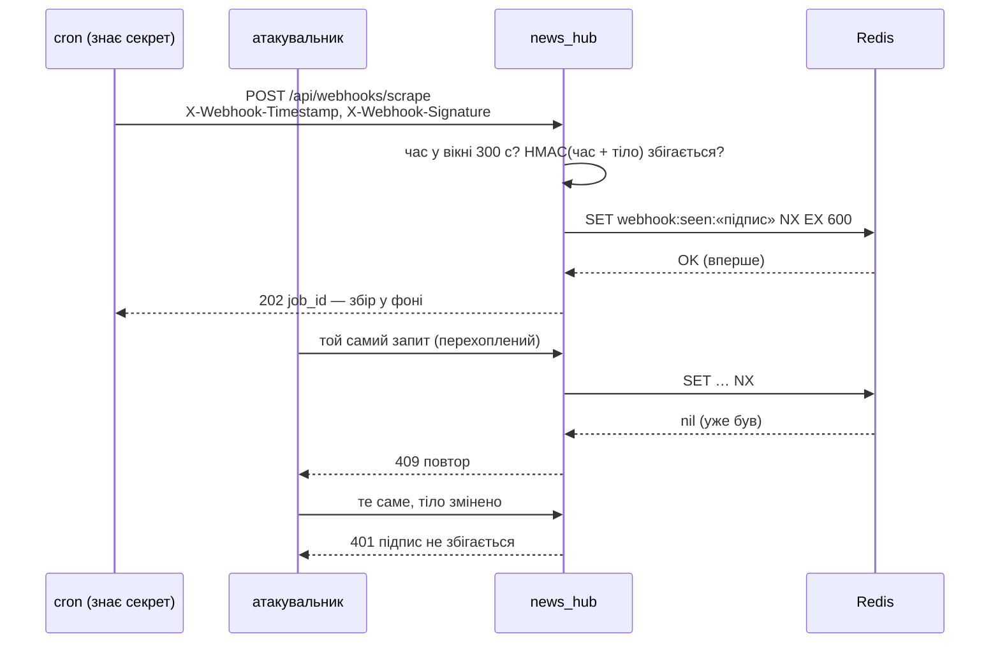

# Підписані webhook

> Крок 8 · розділ 3 з 4. Код: [`news_hub/webhooks.py`](https://github.com/NikoriakViktor/news_hub/blob/main/steps/08_security/news_hub/webhooks.py), [`news_hub/api.py`](https://github.com/NikoriakViktor/news_hub/blob/main/steps/08_security/news_hub/api.py).
> Теорія: [Частина VIII. Безпека API](../../08_security/README.md).

## Задача { #task }

`POST /api/webhooks/scrape` — зовнішній планувальник (cron на іншому сервері, GitHub Actions за розкладом) запускає збір новин. Тіло — як у `POST /api/scrape/jobs`, відповідь — `202` з `job_id`, збір іде у фоні.

JWT планувальнику не видаємо: токен живе 30 хвилин, а cron працює роками. Натомість обидві сторони знають **спільний секрет** `WEBHOOK_SECRET`. Адреса публічна, тож справжній запит треба відрізнити від підробленого, зміненого і повтореного.

## Було: секрет у шляху і в заголовку { #old }

Основа — webhook Telegram зі стартового шаблону бекенду:

```python title="backend/api/webhook.py (стартовий шаблон)"
@router.post(settings.WEBHOOK_PATH)                       # "/webhook/{WEBHOOK_SECRET}"
async def handle_webhook(request: Request) -> dict:
    secret_header = request.headers.get("X-Telegram-Bot-Api-Secret-Token")
    if secret_header != settings.WEBHOOK_SECRET:
        raise HTTPException(status_code=403, detail="Invalid webhook secret")
```

Три проблеми:

1. **Секрет у шляху** URL потрапляє туди, куди потрапляють шляхи: журнали сервера, проксі, балансувальника. Рядок журналу uvicorn для такого маршруту:

    ```text
    INFO:     127.0.0.1:45976 - "POST /webhook/s3cr3t-from-env HTTP/1.1" 200 OK
    ```

2. **Секрет у заголовку** кращий, але ходить у **кожному** запиті: хто перехопив один запит, той знає секрет назавжди і може надсилати будь-що.
3. **`!=`** порівнює до першої розбіжності, тож за часом відповіді секрет можна підбирати по символу.

## Стало: підпис HMAC, час і захист від повтору { #change }

Секрет не передається зовсім. Відправник рахує **підпис** від часу й тіла:

```text
X-Webhook-Timestamp: <unix-час>
X-Webhook-Signature: sha256=<hex HMAC-SHA256(WEBHOOK_SECRET, "<час>." + тіло)>
```

```python title="news_hub/webhooks.py"
SIGNATURE_HEADER = "X-Webhook-Signature"
TIMESTAMP_HEADER = "X-Webhook-Timestamp"
TOLERANCE_SECONDS = 300
MIN_SECRET_LENGTH = 32


def sign(secret: bytes, timestamp: int, body: bytes) -> str:
    """Те, що рахує відправник: sha256=<hex>."""
    digest = hmac.new(secret, str(timestamp).encode() + b"." + body, hashlib.sha256).hexdigest()
    return f"sha256={digest}"


def verify_signature(secret: bytes, headers: Mapping[str, str], body: bytes, now: float | None = None) -> str:
    """Перевіряє час і підпис; повертає підпис (для захисту від повтору). WebhookRejected — ні."""
    signature, timestamp = headers.get(SIGNATURE_HEADER, ""), headers.get(TIMESTAMP_HEADER, "")
    if not signature or not (timestamp.isascii() and timestamp.isdigit()):   # "²".isdigit() — True, int("²") — ValueError
        raise WebhookRejected(f"потрібні заголовки {SIGNATURE_HEADER} і {TIMESTAMP_HEADER}")
    now = time.time() if now is None else now
    if abs(now - int(timestamp)) > TOLERANCE_SECONDS:
        raise WebhookRejected(f"запит старший за {TOLERANCE_SECONDS} с (або годинник відправника не той)")
    if not hmac.compare_digest(signature.encode(), sign(secret, int(timestamp), body).encode()):
        raise WebhookRejected("підпис не збігається")
    return signature


async def remember_delivery(redis: Redis, signature: str) -> None:
    """Той самий підпис удруге за вікно — повтор. Ключ живе вдвічі довше за вікно часу."""
    fresh = await redis.set(f"webhook:seen:{signature}", "1", nx=True, ex=2 * TOLERANCE_SECONDS)
    if not fresh:
        raise WebhookRejected("цей запит уже отримано (повтор)", status_code=409)
```

Чому не просто `timestamp.isdigit()`: для Unicode «цифрами» є й `²`, `³`, `①`, а `int("²")` падає з `ValueError`. Перша версія кроку мала саме `isdigit()`, і заголовок `X-Webhook-Timestamp: ²` (байт `\xb2`, сирим HTTP-запитом) давав **`500` без жодної автентифікації**:

```text
old: HTTP/1.1 500 Internal Server Error
new: HTTP/1.1 401 Unauthorized
```

Будь-хто ззовні міг сипати в журнал трасування з `ValueError`. `isascii()` пропускає лише `0`–`9`, і таке значення стає звичайною відмовою `401`. Тест — випадок «час не число» в `tests/unit/test_webhooks.py` зі значенням `"²"`.

`WEBHOOK_SECRET` читає `load_webhook_secret` при старті, як і секрети адміна: не задано — webhook вимкнено (`503`), коротший за 32 символи — `RuntimeError`, застосунок не стартує.

Що дає кожна частина:

| Частина | Без неї |
|---|---|
| підпис від **тіла** | перехоплений запит можна переслати зі зміненим тілом (`"source": "live"` замість `"snapshot"`) |
| підпис від **сирих байтів**, до розбору JSON | `{"a":1}` і `{"a": 1}` — той самий JSON, але інші байти й інший підпис; розбирати чужий JSON до перевірки — зайвий ризик |
| **час** у підписі + вікно 300 с в обидва боки | перехоплений запит можна повторити завтра |
| **`SET NX`** на підпис, ключ живе 600 с | усередині 5 хвилин той самий запит можна повторити багато разів |
| `hmac.compare_digest` | `==` порівнює до першої розбіжності, тож за часом відповіді підпис можна підбирати по символу |
| секрет **не передається** | хто перехопив запит, секрету не знає |

`SET NX` і час потрібні разом. `SET NX` без часу мусив би пам'ятати підписи вічно. Час без `SET NX` дозволяє повторити запит багато разів за 5 хвилин. Разом: старе відкидає час, свіже повторення — Redis, а ключі живуть лише 10 хвилин (вдвічі довше за вікно, бо вікно — в обидва боки від «зараз»).

## Ендпоінт: спершу підпис, потім JSON { #endpoint }

```python title="news_hub/api.py (фрагмент)"
def get_webhook_secret(request: Request) -> bytes:
    secret: bytes | None = request.app.state.webhook_secret
    if secret is None:
        raise HTTPException(status.HTTP_503_SERVICE_UNAVAILABLE, detail="webhook вимкнено: задай WEBHOOK_SECRET")
    return secret


@app.post("/api/webhooks/scrape", response_model=JobStatus, status_code=status.HTTP_202_ACCEPTED,
          tags=["webhooks"], summary="Збір за підписаним запитом", ...)
async def scrape_webhook(request: Request, background: BackgroundTasks, redis: RedisDep, scrapers: ScrapersDep,
                         secret: Annotated[bytes, Depends(get_webhook_secret)],
                         session_factory: Annotated[async_sessionmaker[AsyncSession], Depends(get_session_factory)],
                         ) -> JobStatus:
    """Тіло — як у POST /api/scrape/jobs. Спершу підпис сирих байтів, лише потім розбір JSON."""
    body = await request.body()
    try:
        signature = verify_signature(secret, request.headers, body)
        await remember_delivery(redis, signature)
    except WebhookRejected as error:
        raise HTTPException(error.status_code, detail=str(error)) from error
    try:
        scrape_request = ScrapeRequest.model_validate_json(body or b"{}")
    except ValidationError as error:         # include_input=False: сирі bytes у відповідь JSON не серіалізуються
        raise HTTPException(422, detail=error.errors(include_url=False, include_context=False,
                                                      include_input=False)) from error
    job = await JobStore(redis).create(scrape_request.source, scrape_request.mode)
    background.add_task(run_scrape_job, job.job_id, lambda: collect(scrape_request, scrapers), redis, session_factory)
    return job
```

Тіло — не параметр `ScrapeRequest` у сигнатурі, а сирі байти `await request.body()`. Якби FastAPI розбирав JSON сам, він зробив би це **до** перевірки підпису, і непідписане сміття отримало б `422` замість `401`.



## Результат { #result }

Відправник підписує запит функцією `news_hub.webhooks.sign`, як це зробив би cron; `WEBHOOK_SECRET` згенеровано в скрипті:

```python
def signed(body: bytes = BODY, secret: bytes = SECRET, ts: int | None = None) -> dict[str, str]:
    ts = int(time.time()) if ts is None else ts
    return {SIGNATURE_HEADER: sign(secret, ts, body), TIMESTAMP_HEADER: str(ts), "Content-Type": "application/json"}

BODY = json.dumps({"source": "snapshot"}).encode()
api.post("/api/webhooks/scrape", content=BODY, headers=signed())
```

```text
заголовки: X-Webhook-Timestamp = 1794431479 | X-Webhook-Signature = sha256=a7a50d7d… довжина 71
підписаний                   → 202 queued
   news count: {'count': 168}
той самий ще раз             → 409 цей запит уже отримано (повтор)
змінене тіло                 → 401 підпис не збігається
інший порядок пробілів       → 401 підпис не збігається
без підпису                  → 401 потрібні заголовки X-Webhook-Signature і X-Webhook-Timestamp
чужий секрет                 → 401 підпис не збігається
годину тому                  → 401 запит старший за 300 с (або годинник відправника не той)
через 10 хв                  → 401 запит старший за 300 с (або годинник відправника не той)
непідписане сміття           → 401 потрібні заголовки X-Webhook-Signature і X-Webhook-Timestamp
підписане сміття             → 422 [{'type': 'json_invalid', 'loc': [], 'msg': 'Invalid JSON: key must be a string at line 1 column 2'}]
секрет не задано             → 503 webhook вимкнено: задай WEBHOOK_SECRET
ttl ключа повтору: 600
```

- **`202` без JWT.** У webhook свій захист — підпис, тому він у списку публічних маршрутів ([тест «нічого не забули»](security_tests.md#public)).
- **«Інший порядок пробілів»** — той самий JSON `{"source":"snapshot"}`, але інші байти. Відправник мусить підписувати рівно ті байти, які надсилає.
- **`422` лише для підписаного сміття**: перевірка підпису йде першою, чужий запит не доходить навіть до розбору JSON.
- **`sha256=` + 64 hex-символи** — 71 символ заголовка.

## Telegram: секретний заголовок { #telegram }

Telegram (крок 9) так не підписує: він надсилає лише заголовок `X-Telegram-Bot-Api-Secret-Token`. Для нього в `webhooks.py` є окрема функція — теж з `compare_digest` і теж без секрету в URL:

```python title="news_hub/webhooks.py"
def verify_secret_token(expected: bytes, received: str | None) -> bool:
    """Для Telegram (крок 9): заголовок X-Telegram-Bot-Api-Secret-Token, порівняння без витоку часу."""
    return received is not None and hmac.compare_digest(received.encode(), expected)
```

Підпис тіла кращий за секретний заголовок, але обирає відправник: приймаємо те, що він уміє, і робимо це якнайкраще.

## Правило { #rule }

!!! tip "Правило"
    Вхідний webhook перевіряється **до** розбору тіла: HMAC-SHA256 від часу й сирих байтів, вікно часу, `SET NX` проти повтору. Секрети порівнюються `hmac.compare_digest`, а не `==`. Секрет не кладемо в URL і, де можна, не передаємо зовсім — лише підпис.

**Далі:** [Тести безпеки](security_tests.md).
