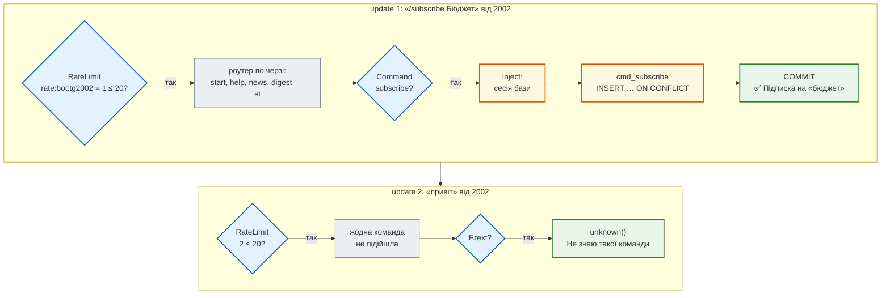

# Бот над `news_hub`: фабрики, роутер, залежності

> Крок 9 · розділ 1 з 4. Код: [`news_hub/bot/factory.py`](https://github.com/NikoriakViktor/news_hub/blob/main/steps/09_telegram_bot/news_hub/bot/factory.py), [`handlers.py`](https://github.com/NikoriakViktor/news_hub/blob/main/steps/09_telegram_bot/news_hub/bot/handlers.py), [`middlewares.py`](https://github.com/NikoriakViktor/news_hub/blob/main/steps/09_telegram_bot/news_hub/bot/middlewares.py), [`tests/telegram_twin.py`](https://github.com/NikoriakViktor/news_hub/blob/main/steps/09_telegram_bot/tests/telegram_twin.py).
> Теорія: [Частина IX. Інтеграції](../../09_integrations/README.md), [Залежності: `Depends`](../../03_fastapi_core/dependencies.md).

## Задача { #task }

Додати Telegram-бота з командами `/news`, `/digest`, `/subscribe` так, щоб він:

- брав новини з тієї самої бази тим самим `NewsRepository`, що й API;
- мав **свою** сесію бази на кожне повідомлення, як `get_db` дає сесію на кожен HTTP-запит;
- збирався однією фабрикою для трьох випадків: webhook у FastAPI, polling з консолі й тести;
- тестувався без мережі й без справжнього токена.

## Як Telegram говорить з ботом { #bot-api }

Бот — це програма, яка отримує від Telegram **update** (JSON з повідомленням користувача) і відповідає викликами HTTP API: `https://api.telegram.org/bot<TOKEN>/sendMessage`. Відповідь Bot API завжди одного формату — як помилки HTTP API з [Частини I](../../01_http_and_rest/README.md): код стану й опис.

```json
{"ok": true, "result": {...}}
{"ok": false, "error_code": 403, "description": "Forbidden: bot was blocked by the user"}
```

Update з командою виглядає так (саме такий будує двійник, `make_update`):

```json
{"update_id": 9, "message": {"message_id": 9, "date": 1794431595, "text": "/news 1",
  "chat": {"id": 2002, "type": "private", "first_name": "Tom & Jerry"},
  "from": {"id": 2002, "is_bot": false, "first_name": "Tom & Jerry", "username": "olena"},
  "entities": [{"type": "bot_command", "offset": 0, "length": 5}]}}
```

Як update потрапляє до бота (polling чи webhook) — [розділ 4](polling_webhook.md).

## «Telegram» без Telegram: двійник Bot API { #twin }

Тестам не можна ходити в мережу (правило проєкту з кроку 5), а справжнього токена в CI немає. Тому всі тести бота й запуск без мережі працюють проти **двійника**: `tests/telegram_twin.py`. Це aiohttp-сервер, як локальні сервери кроку 5: він відповідає у форматі Bot API і записує кожен виклик.

aiogram уміє ходити на інший сервер Bot API — так працює й офіційний локальний Bot API server. Фабрика бота отримує цю адресу параметром:

```python title="news_hub/bot/factory.py"
def create_bot(token: str, api_url: str | None = None) -> Bot:
    session = AiohttpSession(api=TelegramAPIServer.from_base(api_url)) if api_url else None
    return Bot(token=token, session=session, default=DefaultBotProperties(parse_mode=ParseMode.HTML))
```

Без `api_url` (`TELEGRAM_API_URL` не задано) — `session=None`, і aiogram ходить на api.telegram.org. `parse_mode=HTML` — для всіх повідомлень бота: про це [розділ 2](html_replies.md).

Двійник — **не** Telegram. Він відтворює лише задокументовані правила, потрібні тестам:

| Правило | Відповідь двійника |
|---|---|
| неправильний токен | `401 Unauthorized` |
| чат у `twin.blocked` | `403 Forbidden: bot was blocked by the user` |
| `twin.retry_after = N` | наступні N `sendMessage` → `429` з `parameters.retry_after` |
| `parse_mode=HTML`: лише дозволені теги, `<`, `>`, `&` поза тегом — помилка | `400 Bad Request: can't parse entities: …` |
| текст понад 4096 символів | `400 Bad Request: message is too long` |
| `getUpdates`, коли webhook увімкнено | `409 Conflict: can't use getUpdates method while webhook is active` |
| `setWebhook` | запам'ятовує `url` і `secret_token`; `deliver()` надсилає update туди з заголовком `X-Telegram-Bot-Api-Secret-Token` |

Плюс два «службові» маршрути, яких у Telegram немає: `POST /_twin/say` — «користувач пише боту», `GET /_twin/sent?chat_id=…` — що бот надіслав.

```text
$ python -m tests.telegram_twin --port 8081
Двійник Telegram Bot API: http://127.0.0.1:8081  (TELEGRAM_API_URL=http://127.0.0.1:8081, BOT_TOKEN=123456:TEST-TOKEN)
$ curl -s localhost:8081/botWRONG/getMe
{"ok": false, "error_code": 401, "description": "Unauthorized"}
```

Зі справжнім токеном той самий код ходить на api.telegram.org — достатньо не задавати `TELEGRAM_API_URL`.

## Зміна 1: `Bot`, `Dispatcher`, `Router` { #parts }

Бот з aiogram 3 складається з трьох частин:

| Частина | Що робить | Аналог у FastAPI |
|---|---|---|
| `Bot` | HTTP-клієнт Bot API: `send_message`, `set_webhook`, `set_my_commands` | — (клієнт, як `httpx`) |
| `Dispatcher` | отримує update і веде його крізь middleware до потрібного handler | застосунок `app` з middleware |
| `Router` | набір handler з фільтрами (`Command("news")`, `F.text`) | `APIRouter` з маршрутами |

Фабрика диспетчера отримує **всі** залежності параметрами — базу, Redis, LLM, адмінів:

```python title="news_hub/bot/factory.py"
BOT_RATE_LIMIT, BOT_RATE_WINDOW = 20, 60           # повідомлень від одного користувача за хвилину


def create_dispatcher(session_factory: async_sessionmaker[AsyncSession], redis: Redis, llm: LLMClient | None,
                      admin_ids: frozenset[int] = frozenset()) -> Dispatcher:
    dp = Dispatcher()
    dp.message.outer_middleware(RateLimitMiddleware(redis, BOT_RATE_LIMIT, BOT_RATE_WINDOW))
    dp.message.middleware(InjectMiddleware(session_factory, redis, llm, admin_ids))
    dp.include_router(handlers.build_router())
    return dp
```

Тому одна фабрика збирає бота для трьох місць:

| Хто викликає | `session_factory` | `redis` | `llm` |
|---|---|---|---|
| `start_bot` у `lifespan` FastAPI (webhook) | `SessionFactory` з `db.py` | `app.state.redis` | `app.state.llm` |
| `python -m news_hub.bot` (polling) | `SessionFactory` | `make_redis()` | `make_llm()` |
| тести (`BotHarness` у `tests/integration/conftest.py`) | SQLite у пам'яті | `fakeredis` | `FakeLLM()` або `None` |

## Зміна 2: роутер — новий на кожен диспетчер { #router }

Handler — звичайна async-функція. Реєструє їх функція `build_router()`, а не декоратор над змінною модуля:

```python title="news_hub/bot/handlers.py"
def build_router() -> Router:
    """Новий Router з усіма командами. Порядок реєстрації = порядок перевірки."""
    router = Router(name="news_hub")
    router.message(CommandStart())(cmd_start)
    router.message(Command("help"))(cmd_help)
    router.message(Command("news"))(cmd_news)
    router.message(Command("digest"))(cmd_digest)
    router.message(Command("subscribe"))(cmd_subscribe)
    router.message(Command("unsubscribe"))(cmd_unsubscribe)
    router.message(Command("subscriptions"))(cmd_subscriptions)
    router.message(Command("scrape"))(cmd_scrape)
    router.message(F.text)(unknown)
    return router
```

Чому не `router = Router()` на рівні модуля з `@router.message(...)`? aiogram прив'язує Router лише до **одного** Dispatcher, а в одному процесі диспетчерів буває кілька: API, кожен тест. Справжній вивід, якщо підключити той самий роутер удруге:

```python
from aiogram import Dispatcher, Router

router = Router(name="news_hub")
Dispatcher().include_router(router)
Dispatcher().include_router(router)
```

```text
RuntimeError: Router is already attached to <Dispatcher '0x7f0233d1cd40'>
```

**Порядок має значення.** aiogram перевіряє handler згори донизу і зупиняється на першому, чий фільтр підійшов. `F.text` («будь-який текст») пропускає й команди, тому він — останній. Порядок решти команд не важливий: їхні фільтри не перетинаються. Що буде, якщо поставити `F.text` першим, — [практика](checkpoint.md#modify).

## Зміна 3: middleware — «`Depends` для бота» { #middlewares }

Залежності доходять до handler через **параметри**. aiogram «впорскує» значення зі словника `data` за іменем параметра, як FastAPI — значення `Depends`:

```python title="news_hub/bot/handlers.py (фрагмент)"
async def cmd_news(message: Message, command: CommandObject, news: NewsRepository) -> None:
    count = NEWS_DEFAULT
    if command.args:
        if not command.args.strip().isdigit():
            await message.answer(f"Використання: /news [1–{NEWS_MAX}]")
            return
        count = max(1, min(int(command.args), NEWS_MAX))
    rows = await news.latest(count)
    if not rows:
        await message.answer("Новин поки немає.")
        return
    await answer_lines(message, [f"📰 <b>Останні новини</b> ({len(rows)})", ""] +
                       [f"• {link(row.url, row.title)} <i>{esc(row.category)}</i>" for row in rows])
```

`message` і `command` (аргументи після `/news`) дає сам aiogram, а `news` кладе в `data` middleware:

```python title="news_hub/bot/middlewares.py"
class InjectMiddleware(BaseMiddleware):
    def __init__(self, session_factory: async_sessionmaker[AsyncSession], redis: Redis,
                 llm: LLMClient | None, admin_ids: frozenset[int]) -> None:
        self._factory, self._redis, self._llm, self._admin_ids = session_factory, redis, llm, admin_ids

    async def __call__(self, handler: Handler, event: TelegramObject, data: dict[str, Any]) -> Any:
        async with self._factory() as session:
            data["news"] = NewsRepository(session)
            data["subscriptions"] = SubscriptionRepository(session)
            data["redis"] = self._redis
            data["llm"] = GuardedLLM(self._llm, CircuitBreaker(self._redis)) if self._llm else None
            data["admin_ids"] = self._admin_ids
            result = await handler(event, data)
            await session.commit()
            return result
```

| Запис | Що означає |
|---|---|
| `async with self._factory() as session` | **своя** сесія на кожен update — як `get_db` у FastAPI (крок 3). Сесію SQLAlchemy не ділять між одночасними update |
| `data["news"] = …` | handler з параметром `news: NewsRepository` отримає саме це |
| `GuardedLLM(..., CircuitBreaker(redis))` | той самий захист LLM, що в API (крок 7): відкритий запобіжник — без виклику моделі |
| `await session.commit()` після handler | зміни handler (підписка, аналіз) записуються, лише якщо handler завершився без винятку |

Поруч — **outer**-middleware ліміту. Outer виконується **до** маршрутизації, для кожного повідомлення; inner (`dp.message.middleware`) — лише коли handler знайдено, безпосередньо перед ним:

```python title="news_hub/bot/middlewares.py"
class RateLimitMiddleware(BaseMiddleware):
    def __init__(self, redis: Redis, limit: int, window: int) -> None:
        self._limiter = RateLimiter(redis, limit=limit, window=window)

    async def __call__(self, handler: Handler, event: TelegramObject, data: dict[str, Any]) -> Any:
        if not isinstance(event, Message) or event.from_user is None:
            return await handler(event, data)
        allowed, count, ttl = await self._limiter.hit(f"tg{event.from_user.id}", "bot")
        if allowed:
            return await handler(event, data)
        if count == self._limiter.limit + 1:              # лише перше перевищення — далі мовчимо
            await event.answer(f"⏳ Забагато запитів: {self._limiter.limit} за {self._limiter.window} с. "
                               f"Спробуй через {ttl} с.")
        return None
```

`RateLimiter` — той самий, що обмежує API в кроці 4 (Redis `INCR` + `EXPIRE NX`); ключ — `rate:bot:tg<user_id>`. Відповідь про ліміт — один раз за вікно: інакше бот, якого засипають повідомленнями, сам засипав би чат відповідями.

## Шлях одного update { #trace }

Два повідомлення від чату 2002 крізь диспетчер, покроково:



## Результат: команди проти двійника { #result }

Бот, диспетчер над SQLite у пам'яті, `fakeredis`, `FakeLLM` і двійник — так збирає бота фікстура `telegram` у тестах (`BotHarness.say` подає update через `dp.feed_update`, як це роблять webhook і polling). Відповіді, які записав двійник:

```text
/news                        → ['Новин поки немає.']
/subscribe Зеленськ (2002)   → ['✅ Підписка на «зеленськ»']
/scrape snapshot (2002)      → ['Ця команда — лише для адміністратора.']
/scrape snapshot (1001)      → ['Зібрано: 168, нових: 168, відхилено: 0; сповіщено чатів: 1']
/news багато                 → ['Використання: /news [1–10]']
/news 0                      → 📰 <b>Останні новини</b> (1)
/news 100                    → 📰 <b>Останні новини</b> (10)
привіт                       → ['Не знаю такої команди. /help — що я вмію']
```

`/news 3` після збору знімка — три найновіші за `id` (`NewsRepository.latest`):

```text
📰 <b>Останні новини</b> (3)

• <a href="https://www.rbc.ua/ukr/news/katar-vryatue-peregovori-ssha-ta-iranu-vens-1778281213.html">Катар спасет переговоры США и Ирана? Вэнс встретился с главным посредником</a> <i>Новини</i>
• <a href="https://www.rbc.ua/ukr/news/putina-zashkalyue-paranoya-ohorona-znimae-1778285162.html">У Путина зашкаливает паранойя: охрана снимает с чиновников РФ даже часы</a> <i>Новини</i>
• <a href="https://www.rbc.ua/ukr/news/administratsiya-trampa-oskarzhila-rishennya-1778287861.html">Администрация Трампа обжаловала решение суда, который признал тарифы незаконными</a> <i>Новини</i>
```

`/digest` бере 10 останніх новин і аналізує моделлю **не більше 3** ще не проаналізованих (`DIGEST_NEWS, DIGEST_ANALYZE = 10, 3`), щоб одна команда не витратила квоту LLM на десять викликів. Результат зберігається в базі (`save_analysis`), тож наступний `/digest` проаналізує наступні три. З `FakeLLM`:

```text
🧭 <b>Дайджест</b>: 3 з 10 останніх новин
Тональність: нейтральна — 3

• <b>Інше</b>: Катар спасет переговоры США и Ирана? Вэнс встретился с главным посредником — <a href="https://www.rbc.ua/ukr/news/katar-vryatue-peregovori-ssha-ta-iranu-vens-1778281213.html">джерело</a>
• <b>Інше</b>: У Путина зашкаливает паранойя: охрана снимает с чиновников РФ даже часы — <a href="…">джерело</a>
• <b>Інше</b>: Администрация Трампа обжаловала решение суда, который признал тарифы незаконными — <a href="…">джерело</a>
```

Без LLM (`make_llm()` повернув `None`, ключа немає) — `LLM не налаштовано — у дайджесті лише вже проаналізовані новини.`

Ліміт — 22 повідомлення `/help` поспіль від одного користувача:

```text
1–20  → <b>Команди</b> …
21    → ['⏳ Забагато запитів: 20 за 60 с. Спробуй через 60 с.']
22    → []                     ← далі мовчки
```

Інший користувач у той самий час отримує відповідь: ключ ліміту — `tg<user_id>`.

## `/scrape` — лише адміну { #admin }

Бот — ще один вхід у застосунок, і правило кроку 8 «змінювати може лише адмін» діє й тут. JWT у Telegram немає, тому адміни — це список `user_id` у `BOT_ADMIN_IDS`:

```python title="news_hub/bot/handlers.py (фрагмент)"
    if message.from_user is None or message.from_user.id not in admin_ids:
        logger.warning("/scrape від не-адміна %s", message.from_user.id if message.from_user else None)
        await message.answer("Ця команда — лише для адміністратора.")
        return
```

Спроба не-адміна потрапляє в журнал (`/scrape від не-адміна 2002`) — як невдалий вхід у API.

## Звідки взялося { #origin }

Бот не писали з нуля. Основа — стартовий шаблон бота на aiogram 3 (`app/bot.py`, `app/handlers/commands.py`, `app/middlewares/`): фабрики, роутер, outer- і inner-middleware. Що змінилося, переносячи його в `news_hub`:

| Було в шаблоні | Стало | Чому |
|---|---|---|
| `create_dispatcher(redis)` читає глобальний `config` | залежності — параметрами: база, Redis, LLM, адміни | ті самі фабрики збирають бота для webhook у FastAPI, для polling і для тестів |
| `router = Router(...)` — змінна модуля, handler з декоратором `@router.message(...)` | `build_router()` — новий роутер на кожен диспетчер | aiogram прив'язує Router лише до одного Dispatcher |
| `InjectMiddleware` кладе в `data` один спільний репозиторій історії над Redis | на кожен update — своя сесія бази, COMMIT після handler | як `get_db` у FastAPI: сесію SQLAlchemy не ділять між одночасними update |
| `RateLimitMiddleware` на своєму репозиторії лімітів | той самий `RateLimiter` (`INCR` + `EXPIRE NX`), що й rate limit API в кроці 4 | одна реалізація на весь застосунок; про ліміт — одна відповідь за вікно |
| розмова з LLM | команди агрегатора над `NewsRepository` | бот показує ті самі дані, що й API |
| `Bot(token=...)` лише на api.telegram.org | `TelegramAPIServer.from_base(api_url)` | двійник у тестах, локальний Bot API server на сервері |

Меню команд (кнопка ☰ у Telegram) ставить `set_commands(bot)` — `bot.set_my_commands(COMMANDS)` з п'ятьма командами: `news`, `digest`, `subscribe`, `subscriptions`, `help`. На обробку команд воно не впливає: `/unsubscribe` і `/scrape` працюють, хоч їх у меню немає.

Поглиблено: aiogram — [Router](https://docs.aiogram.dev/en/latest/dispatcher/router.html), [Middlewares](https://docs.aiogram.dev/en/latest/dispatcher/middlewares.html), [Dependency injection](https://docs.aiogram.dev/en/latest/dispatcher/dependency_injection.html).

## Правило { #rule }

!!! tip "Правило"
    Бот — ще один вхід у той самий застосунок, а не окремий застосунок. Залежності (база, Redis, LLM) передавай у фабрику параметрами, сесію бази відкривай на кожен update в middleware, роутер будуй функцією. Тоді webhook, polling і тести збирають одного й того самого бота.

**Далі:** [Відповідь у HTML: екранування і 4096](html_replies.md) — чому `esc(row.category)` і `link(row.url, row.title)`, а не просто f-рядок.
