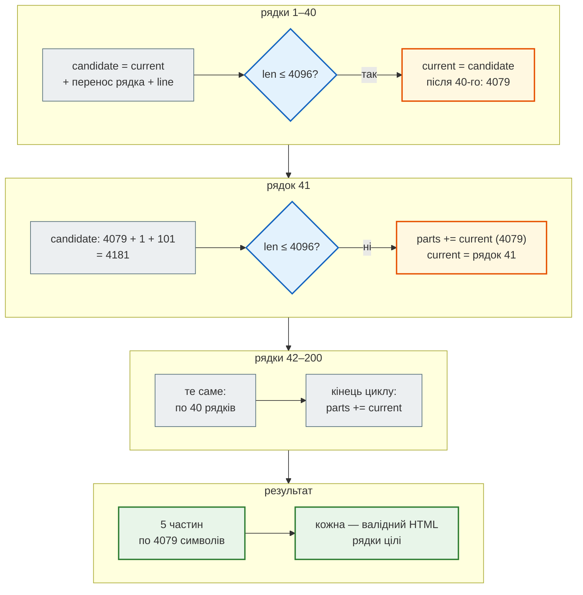

# Відповідь у HTML: екранування і 4096

> Крок 9 · розділ 2 з 4. Код: [`news_hub/bot/formatting.py`](https://github.com/NikoriakViktor/news_hub/blob/main/steps/09_telegram_bot/news_hub/bot/formatting.py), [`tests/unit/test_bot_formatting.py`](https://github.com/NikoriakViktor/news_hub/blob/main/steps/09_telegram_bot/tests/unit/test_bot_formatting.py).
> Теорія: [Частина IX. Інтеграції](../../09_integrations/README.md).

## Задача { #task }

Бот відповідає з `parse_mode=HTML` (`DefaultBotProperties` у `create_bot`): `<b>`, `<i>`, `<a href>`. Telegram розбирає розмітку сам і **відхиляє все повідомлення**, якщо в ньому `<`, `>` чи `&` стоять поза тегом. А в текст бота потрапляє чуже: ім'я з профілю користувача, заголовок новини з rbc.ua, ключове слово підписки.

Треба, щоб жоден такий текст не робив бота німим, і щоб довга відповідь (дайджест, сповіщення з десятками новин) не впиралась у ліміт Telegram — 4096 символів на повідомлення.

## Проблема: ім'я без екранування { #problem }

Найпростіше привітання — f-рядок з іменем:

```python
await message.answer(f"Привіт, <b>{user.first_name}</b>!")
```

`first_name` — те, що користувач написав у профілі. Справжній вивід цього рядка проти двійника для трьох імен:

```text
'Олена': надіслано
'<Олена>': TelegramBadRequest: Telegram server says - Bad Request: can't parse entities: unexpected character at byte offset 11
'Tom & Jerry': TelegramBadRequest: Telegram server says - Bad Request: can't parse entities: unsupported entity at byte offset 15
```

Користувач з `&` в імені **ніколи** не отримає відповіді, і ні він, ні ми про це не дізнаємося: у чаті тиша, у журналі — виняток. Той самий ризик у кожному заголовку новини: «Бюджет & податки», «ціна < 100 грн».

Правила HTML Telegram, як їх перевіряє двійник (`html_error` у `tests/telegram_twin.py`; `None` — розмітка правильна). Запуск з папки кроку:

```python
from tests.telegram_twin import html_error

for text in ("5 < 7", "Олена & Ко", "<script>x</script>", "<b>без кінця", "<b><i>навхрест</b></i>",
             "<b>жирний</b> і <i>курсив</i>", "5 &lt; 7 &amp;&amp; 7 &gt; 5"):
    print(f"{text!r:32} → {html_error(text)}")
```

```text
'5 < 7'                          → Bad Request: can't parse entities: unexpected character at byte offset 2
'Олена & Ко'                     → Bad Request: can't parse entities: unsupported entity at byte offset 6
'<script>x</script>'             → Bad Request: can't parse entities: unsupported start tag "script" at byte offset 0
'<b>без кінця'                   → Bad Request: can't parse entities: can't find end tag corresponding to start tag "b"
'<b><i>навхрест</b></i>'         → Bad Request: can't parse entities: can't find end tag corresponding to start tag "b"
'<b>жирний</b> і <i>курсив</i>'  → None
'5 &lt; 7 &amp;&amp; 7 &gt; 5'   → None
```

Дозволені теги — лише з документації Bot API: `b`, `strong`, `i`, `em`, `u`, `ins`, `s`, `strike`, `del`, `span`, `tg-spoiler`, `a`, `tg-emoji`, `code`, `pre`, `blockquote`. Сутності — `&lt;`, `&gt;`, `&amp;`, `&quot;` і числові `&#…;`.

## Зміна 1: `esc` і `link` { #escape }

```python title="news_hub/bot/formatting.py"
def esc(text: str) -> str:
    """Текст → безпечний для HTML Telegram: & < > (лапки поза атрибутом не потрібні)."""
    return html.escape(text, quote=False)


def link(url: str, title: str) -> str:
    return f'<a href="{html.escape(url, quote=True)}">{esc(title)}</a>'
```

| Запис | Що робить |
|---|---|
| `html.escape(text, quote=False)` | `&` → `&amp;`, `<` → `&lt;`, `>` → `&gt;`; лапки лишаються: поза атрибутом вони не ламають розмітку |
| `html.escape(url, quote=True)` | в атрибуті `href="…"` лапка `"` закрила б атрибут, тому тут екрануються й лапки |
| `link(...)` | URL і текст посилання екрануються **окремо**, кожен за своїм правилом |

```python
>>> esc("<Олена & Ко>")
'&lt;Олена &amp; Ко&gt;'
>>> link('https://example.com/?q="x"&a=1', "<Заголовок>")
'<a href="https://example.com/?q=&quot;x&quot;&amp;a=1">&lt;Заголовок&gt;</a>'
```

Правило для всього проєкту (воно записане і в `CLAUDE.md` кроку): **усе, що прийшло ззовні** — ім'я, заголовок, ключове слово, текст помилки — іде в текст лише через `esc` або `link`. Свою розмітку (`<b>`, `<i>`) пишемо самі навколо вже екранованого тексту:

```python title="news_hub/bot/handlers.py (фрагмент)"
async def cmd_start(message: Message) -> None:
    name = message.from_user.first_name if message.from_user else "друже"
    await message.answer(f"Привіт, <b>{esc(name)}</b>! Я бот новинного агрегатора news_hub.\n\n{HELP}")
```

У сталих текстах `<` пишемо одразу як `&lt;`: `"/subscribe &lt;слово&gt; — сповіщати про новини з цим словом"`.

## Результат: ім'я з `<` і `&` { #result }

Той самий `/start` через webhook FastAPI (uvicorn, двійник, `POST /_twin/say` з `"first_name": "<Олена & Ко>"`) — двійник прийняв повідомлення:

```text
Привіт, <b>&lt;Олена &amp; Ко&gt;</b>! Я бот новинного агрегатора news_hub.

<b>Команди</b>
/news [N] — останні новини (до 10)
/digest — дайджест: тема й тональність за аналізом LLM
/subscribe &lt;слово&gt; — сповіщати про новини з цим словом
/unsubscribe &lt;слово&gt; — скасувати
/subscriptions — мої підписки
/help — ця довідка
```

У Telegram користувач побачить «Привіт, **<Олена & Ко>**!» — Telegram сам перетворить `&lt;` назад на `<`.

Двійник відхиляє невалідний HTML, тому **кожна** відповідь, яку він прийняв у тестах, — ще й перевірка розмітки. Тест на це:

```python title="tests/integration/test_bot.py"
async def test_start_escapes_user_name(telegram: BotHarness) -> None:
    """Ім'я в Telegram може містити будь-що — у HTML-повідомлення воно йде екранованим."""
    [reply] = await telegram.say("/start", first_name="<Олена & Ко>")
    assert "<b>&lt;Олена &amp; Ко&gt;</b>" in reply
    assert "/subscribe &lt;слово&gt;" in reply
```

## Зміна 2: довге повідомлення — різати між рядками { #split }

Telegram приймає до 4096 символів (`MAX_MESSAGE = 4096`). Стартовий шаблон бота різав довгий текст кожні 4000 символів:

```python title="стартовий шаблон бота: split_long_message"
    return [text[i: i + MAX_MESSAGE_LEN] for i in range(0, len(text), MAX_MESSAGE_LEN)]
```

Розріз може припасти всередину `<b>…</b>` чи `&amp;`. Перевірка на 400 рядках `<b>NNN</b> Олена &amp; Ко` (те саме робить тест `test_old_split_cuts_inside_markup`):

```python
text = "\n".join(f"<b>{number:03}</b> Олена &amp; Ко" for number in range(400))
chunks = [text[i: i + 4000] for i in range(0, len(text), 4000)]
print("частин:", len(chunks), [len(chunk) for chunk in chunks])
print("помилки:", [html_error(chunk) for chunk in chunks])
print("кінець частини 2:", repr(chunks[1][-12:]))
```

```text
частин: 3 [4000, 4000, 2399]
помилки: [None, "Bad Request: can't parse entities: unsupported entity at byte offset 3999", None]
кінець частини 2: '</b> Олена &'
```

Друга частина закінчується на `&` — половина `&amp;`. Telegram відхилить її, і користувач отримає першу й третю частини без середини.

Бот складає повідомлення з **рядків**, і кожен рядок — цілий HTML (його ми склали самі через `esc`/`link`). Тому ділимо лише між рядками:

```python title="news_hub/bot/formatting.py"
def split_message(lines: list[str], limit: int = MAX_MESSAGE) -> list[str]:
    """Рядки → частини ≤ limit, розріз лише між рядками. Рядок, довший за limit, обрізається як текст."""
    parts: list[str] = []
    current = ""
    for line in lines:
        if len(line) > limit:
            line = line[: limit - 1] + "…"          # лише для рядків без розмітки (ми їх такими не складаємо)
        candidate = f"{current}\n{line}" if current else line
        if len(candidate) > limit:
            parts.append(current)
            current = line
        else:
            current = candidate
    if current:
        parts.append(current)
    return parts
```

Покроково на 200 рядках по 101 символу (`<b>000</b> я…я`):



Перевірка (те саме робить тест `test_split_only_between_lines`):

```python
from news_hub.bot.formatting import split_message

lines = [f"<b>{number:03}</b> " + "я" * 90 for number in range(200)]
parts = split_message(lines)
print("частин:", len(parts), [len(part) for part in parts])
print("усі валідні:", all(html_error(part) is None for part in parts))
print("нічого не загубилось:", "\n".join(parts).split("\n") == lines)
```

```text
частин: 5 [4079, 4079, 4079, 4079, 4079]
усі валідні: True
нічого не загубилось: True
```

Склей частини назад — отримаєш ті самі 200 рядків: жоден не розрізаний.

Один рядок, довший за ліміт, обрізається до 4096 символів з `…` в кінці. Це безпечно лише для рядка без розмітки — тому бот довгих рядків з розміткою не складає: один рядок = одна новина.

Відповідає частинами `answer_lines` у `handlers.py`: кожна частина — окреме `message.answer(part, disable_web_page_preview=True)`. `disable_web_page_preview` прибирає прев'ю першого посилання: у списку з десяти новин воно лише займає екран.

## Правило { #rule }

!!! tip "Правило"
    Усе, що прийшло ззовні, — у текст лише через `esc` (текст) або `link` (URL і назва). Повідомлення складай з рядків, кожен — цілий HTML, і ділі його `split_message` між рядками, ніколи зрізом рядка `text[i:i+N]`. Перевіряй тестом з `<` і `&` у даних, а не лише зі «звичайним» ім'ям.

**Далі:** [Підписки і сповіщення](subscriptions_notify.md) — повідомлення, які бот надсилає сам, без команди.
