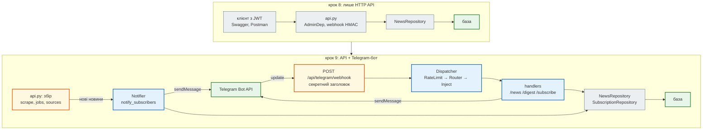

# Крок 9. Telegram-бот

> **Код кроку:** [`steps/09_telegram_bot`](https://github.com/NikoriakViktor/news_hub/tree/main/steps/09_telegram_bot).
>
> **Передумови:** [Крок 8. Безпека: JWT, SSRF, webhook](../08_security/index.md) — запис лише адміну, секрети webhook порівнюються `compare_digest`.

## Де ми зараз { #where }

Після кроку 8 агрегатор збирає новини з rbc.ua і RSS-джерел, зберігає їх у базі, аналізує моделлю (тема, тональність) і пускає до запису лише адміна з JWT. Зовнішній планувальник запускає збір підписаним webhook.

Але щоб дізнатися, що нового, треба самому відкрити `GET /api/news`. Новина про бюджет з'явилась у базі, а людина, якій вона потрібна, про це не знає.

## Проблема { #problem }

Потрібен канал, у якому новини **приходять самі**. Telegram-бот підходить: користувач пише `/news` і бачить останні новини прямо в чаті, `/digest` — тему й тональність за аналізом LLM (крок 7), а `/subscribe бюджет` — і нова новина про бюджет прийде, щойно агрегатор її збере.

Бот — ще один **вхід** у той самий застосунок, тому він має:

- читати ту саму базу тим самим `NewsRepository` і аналізувати тим самим `analyze_news` — без свого SQL і своєї логіки;
- не ламатися на чужому тексті: ім'я користувача чи заголовок новини з `<` або `&` не повинні робити бота німим;
- поважати ліміти Telegram і не стукати в чат, який заблокував бота;
- приймати update від Telegram так само обережно, як webhook кроку 8: секрет, `compare_digest`, швидка відповідь;
- тестуватися без мережі й без справжнього токена.

Що знадобиться з попередніх кроків: HTTP-запит і JSON ([Частина I](../../01_http_and_rest/README.md)); `async`/`await` ([Частина IV](../../04_async/README.md)); `Depends` і `lifespan` (крок 2); `BackgroundTasks` і rate limit на Redis (крок 4); тести з локальним aiohttp-сервером (крок 5); `analyze_news` (крок 7); секрет webhook і `compare_digest` (крок 8).

## Що додаємо { #what }

| Що | Де | Розділ |
|---|---|---|
| бот на aiogram 3: `create_bot`, `create_dispatcher`, `build_router()`, middleware ліміту й сесії бази; двійник Telegram Bot API для тестів | `news_hub/bot/factory.py`, `handlers.py`, `middlewares.py`, `tests/telegram_twin.py` | [Бот над `news_hub`](bot_structure.md) |
| відповіді в HTML: `esc`, `link`, `split_message` (≤ 4096, розріз між рядками) | `news_hub/bot/formatting.py` | [HTML: екранування і 4096](html_replies.md) |
| таблиця `subscriptions`, `/subscribe`, сповіщення після кожного збору; 403 і 429 | `tables.py`, `repository.py`, `migrations/versions/0004_…`, `notify.py`, `jobs.py` | [Підписки і сповіщення](subscriptions_notify.md) |
| polling (`python -m news_hub.bot`) і `POST /api/telegram/webhook` у FastAPI; налаштування зі змінних середовища | `news_hub/bot/__main__.py`, `settings.py`, `api.py` | [Polling і webhook](polling_webhook.md) |

## Архітектура: було → стало { #architecture }



- **Один застосунок — два входи.** HTTP API і бот користуються тими самими репозиторіями, `analyze_news`, `RateLimiter` (крок 4) і `verify_secret_token` з `webhooks.py` (крок 8). У боті немає свого SQL.
- **Бот вмикається змінною середовища.** Без `BOT_TOKEN` бота немає, і API працює як у кроці 8 — це перевіряє тест `test_without_bot_nothing_breaks`.
- **Сповіщення — наслідок збору.** Кожен шлях збору (`POST /api/scrape`, `/api/scrape/jobs`, підписаний webhook кроку 8, `/api/sources/{id}/fetch`, адмінська `/scrape` у боті) передає щойно вставлені новини в `notify_subscribers`.

## Файли кроку { #files }

| Файл | Що в ньому | Новий? |
|---|---|---|
| [`news_hub/bot/factory.py`](https://github.com/NikoriakViktor/news_hub/blob/main/steps/09_telegram_bot/news_hub/bot/factory.py) | `create_bot` (з `TELEGRAM_API_URL`), `create_dispatcher`, меню команд `COMMANDS`, ліміт 20 повідомлень за 60 с | новий |
| [`news_hub/bot/handlers.py`](https://github.com/NikoriakViktor/news_hub/blob/main/steps/09_telegram_bot/news_hub/bot/handlers.py) | `/start`, `/help`, `/news [N]`, `/digest`, `/subscribe`, `/unsubscribe`, `/subscriptions`, `/scrape`; `build_router()` | новий |
| [`news_hub/bot/middlewares.py`](https://github.com/NikoriakViktor/news_hub/blob/main/steps/09_telegram_bot/news_hub/bot/middlewares.py) | `RateLimitMiddleware` (outer), `InjectMiddleware` (inner: сесія бази на update, COMMIT) | новий |
| [`news_hub/bot/formatting.py`](https://github.com/NikoriakViktor/news_hub/blob/main/steps/09_telegram_bot/news_hub/bot/formatting.py) | `esc`, `link`, `split_message`, `MAX_MESSAGE = 4096`, `normalize_keyword`, `matches` | новий |
| [`news_hub/bot/settings.py`](https://github.com/NikoriakViktor/news_hub/blob/main/steps/09_telegram_bot/news_hub/bot/settings.py) | `BotSettings`, `load_bot_settings`: `BOT_TOKEN`, `TELEGRAM_*`, `BOT_ADMIN_IDS` | новий |
| [`news_hub/bot/__main__.py`](https://github.com/NikoriakViktor/news_hub/blob/main/steps/09_telegram_bot/news_hub/bot/__main__.py) | режим polling: `python -m news_hub.bot` | новий |
| [`news_hub/notify.py`](https://github.com/NikoriakViktor/news_hub/blob/main/steps/09_telegram_bot/news_hub/notify.py) | `build_messages`, `notify_subscribers` (403 → видалити підписки, 429 → `retry_after`), `Notifier` | новий |
| [`news_hub/api.py`](https://github.com/NikoriakViktor/news_hub/blob/main/steps/09_telegram_bot/news_hub/api.py) | `start_bot` у `lifespan`, `NotifierDep` у збору, `POST /api/telegram/webhook` | змінений |
| [`news_hub/repository.py`](https://github.com/NikoriakViktor/news_hub/blob/main/steps/09_telegram_bot/news_hub/repository.py) | `insert_new` → `list[NewNews]`, `latest`, `SubscriptionRepository` | змінений |
| [`news_hub/tables.py`](https://github.com/NikoriakViktor/news_hub/blob/main/steps/09_telegram_bot/news_hub/tables.py), [`migrations/versions/0004_subscriptions_table.py`](https://github.com/NikoriakViktor/news_hub/blob/main/steps/09_telegram_bot/migrations/versions/0004_subscriptions_table.py) | таблиця `subscriptions` (`chat_id` — `BigInteger`, унікальна пара «чат + слово») | змінений / новий |
| [`news_hub/jobs.py`](https://github.com/NikoriakViktor/news_hub/blob/main/steps/09_telegram_bot/news_hub/jobs.py) | `run_scrape_job(..., notify)` — розсилка після COMMIT | змінений |
| [`tests/telegram_twin.py`](https://github.com/NikoriakViktor/news_hub/blob/main/steps/09_telegram_bot/tests/telegram_twin.py) | двійник Telegram Bot API на aiohttp: записує виклики, правила HTML, 401 / 403 / 429 / 409 | новий |
| [`tests/unit/test_bot_formatting.py`](https://github.com/NikoriakViktor/news_hub/blob/main/steps/09_telegram_bot/tests/unit/test_bot_formatting.py) | 33 тести: HTML, розріз, слова підписки, налаштування | новий |
| [`tests/integration/test_bot.py`](https://github.com/NikoriakViktor/news_hub/blob/main/steps/09_telegram_bot/tests/integration/test_bot.py), [`test_notify.py`](https://github.com/NikoriakViktor/news_hub/blob/main/steps/09_telegram_bot/tests/integration/test_notify.py), [`test_telegram_webhook.py`](https://github.com/NikoriakViktor/news_hub/blob/main/steps/09_telegram_bot/tests/integration/test_telegram_webhook.py) | 10 + 6 + 7 тестів: команди, розсилка через API, webhook | нові |
| [`tests/integration/test_admin_api.py`](https://github.com/NikoriakViktor/news_hub/blob/main/steps/09_telegram_bot/tests/integration/test_admin_api.py) | `PUBLIC` += `("POST", "/api/telegram/webhook")` з поясненням | змінений |
| `requirements.txt` | `aiogram>=3.15` | змінений |

## Порядок читання { #reading-order }

1. [Бот над `news_hub`: фабрики, роутер, залежності](bot_structure.md) — з чого складається бот і як він дістає базу.
2. [Відповідь у HTML: екранування і 4096](html_replies.md) — чому бот мовчить на `<Олена>` і як цього не допустити.
3. [Підписки і сповіщення](subscriptions_notify.md) — хто що отримує після збору; 403 і 429.
4. [Polling і webhook у FastAPI](polling_webhook.md) — як update потрапляє до бота в розробці й на сервері.
5. [Контрольна точка](checkpoint.md) — тести, практика, самоперевірка.

Теорія до кроку — [Частина IX. Інтеграції: AI, LLM, Telegram](../../09_integrations/README.md) і [Залежності: `Depends` і `lifespan`](../../03_fastapi_core/dependencies.md).

## Запуск { #run }

З папки кроку `steps/09_telegram_bot`:

```bash
pip install -r requirements.txt
pytest -q                           # 335 passed, 2 deselected
mypy --strict news_hub              # Success: no issues found in 26 source files
alembic upgrade head                # … Running upgrade 0003 -> 0004, subscriptions — …
```

Без мережі й токена — бот проти двійника Telegram (три термінали):

```bash
python -m tests.telegram_twin --port 8081                  # «Telegram» на 127.0.0.1:8081
REDIS_URL=fakeredis:// BOT_TOKEN=123456:TEST-TOKEN TELEGRAM_API_URL=http://127.0.0.1:8081 \
    BOT_ADMIN_IDS=1001 python -m news_hub.bot              # бот у режимі polling
curl -X POST localhost:8081/_twin/say -d '{"text": "/news", "chat_id": 1001}'   # «користувач» пише боту
curl 'localhost:8081/_twin/sent?chat_id=1001'                                   # що відповів бот
```

Зі справжнім ботом — токен від @BotFather (`/newbot`) у `BOT_TOKEN`, без `TELEGRAM_API_URL`. Токен — секрет: лише в змінних середовища, ніколи в коді чи git. Режим webhook на сервері — у розділі [Polling і webhook](polling_webhook.md#webhook-run).

## Порівняння з кроком 8 { #diff }

```bash
git diff --no-index --stat steps/08_security steps/09_telegram_bot
git diff --no-index steps/08_security/news_hub steps/09_telegram_bot/news_hub
```

`--no-index` порівнює папки на диску, а не в git, тож якщо ти вже запускав тести, у `--stat` потраплять і файли `__pycache__/*.pyc` — їх можна пропустити. Підсумок: `1425 insertions(+), 32 deletions(-)`; найбільші зміни — `tests/telegram_twin.py` (247 рядків), `bot/handlers.py` (166), `api.py` (100), `notify.py` (97).

## Що далі { #next }

[Крок 10. Docker-образ](../10_docker/index.md): тепер у застосунку є API, база, Redis і бот, і все це запускається кількома командами з десятком змінних середовища. Крок 10 пакує `news_hub` в образ, а `BOT_TOKEN` і секрети лишаються змінними середовища — не в образі.
