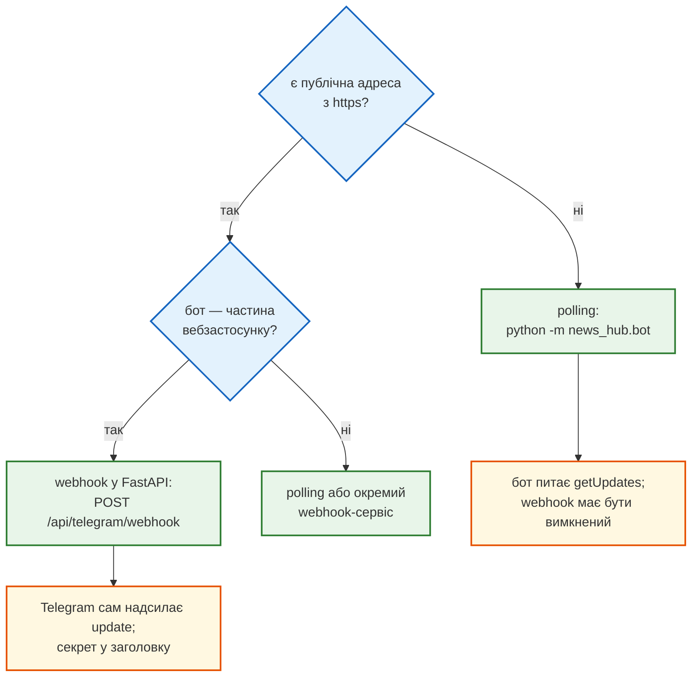
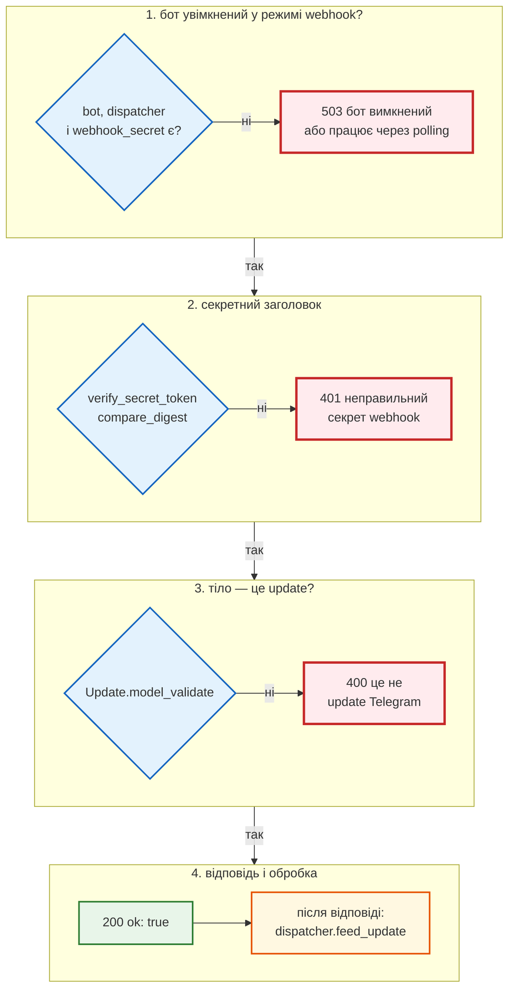
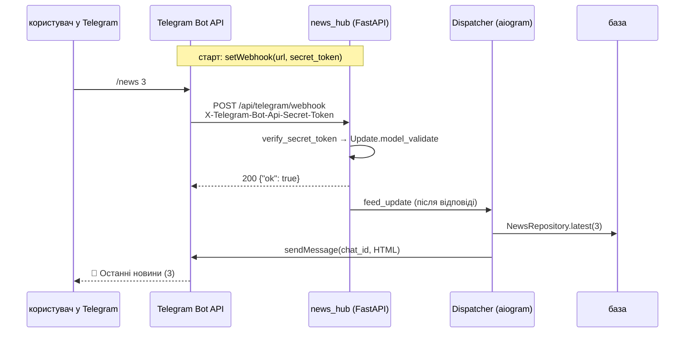

# Polling і webhook у FastAPI

> Крок 9 · розділ 4 з 4. Код: [`news_hub/api.py`](https://github.com/NikoriakViktor/news_hub/blob/main/steps/09_telegram_bot/news_hub/api.py), [`news_hub/bot/settings.py`](https://github.com/NikoriakViktor/news_hub/blob/main/steps/09_telegram_bot/news_hub/bot/settings.py), [`news_hub/bot/__main__.py`](https://github.com/NikoriakViktor/news_hub/blob/main/steps/09_telegram_bot/news_hub/bot/__main__.py), [`tests/integration/test_telegram_webhook.py`](https://github.com/NikoriakViktor/news_hub/blob/main/steps/09_telegram_bot/tests/integration/test_telegram_webhook.py).
> Теорія: [Частина IX. Інтеграції](../../09_integrations/README.md), [Частина VIII. Безпека API](../../08_security/README.md).

## Задача { #task }

Довести update від Telegram до `Dispatcher`. На машині розробника публічної адреси немає, на сервері вона є. Тому потрібні два режими, і обидва — з тим самим ботом із [розділу 1](bot_structure.md):

- **розробка:** запуск однією командою, без https і без FastAPI;
- **сервер:** бот — частина застосунку FastAPI, update приходить HTTP-запитом, і цей запит захищений так само, як webhook кроку 8.

## Два способи доставки { #modes }



| | Polling | Webhook |
|---|---|---|
| Хто ініціює | бот питає Telegram `getUpdates` («є нові?») | Telegram сам робить `POST` на нашу адресу |
| Що потрібно | лише вихід в інтернет | публічна адреса з `https://` |
| Де в `news_hub` | `python -m news_hub.bot` | `POST /api/telegram/webhook` у FastAPI |
| Одночасно | ні: поки webhook увімкнено, `getUpdates` → `409 Conflict` | |

## Зміна 1: налаштування зі змінних середовища { #settings }

```python title="news_hub/bot/settings.py"
# Telegram приймає secret_token лише з цих символів, 1–256 (https://core.telegram.org/bots/api#setwebhook)
SECRET_TOKEN = re.compile(r"^[A-Za-z0-9_-]{32,256}$")


@dataclass(frozen=True)
class BotSettings:
    token: str
    api_url: str | None = None            # двійник або локальний Bot API server; None — api.telegram.org
    webhook_url: str | None = None        # задано — webhook; ні — polling (python -m news_hub.bot)
    webhook_secret: str | None = None
    admin_ids: frozenset[int] = frozenset()


def load_bot_settings(env: Mapping[str, str] = os.environ) -> BotSettings | None:
    token = env.get("BOT_TOKEN", "")
    if not token:
        return None
    webhook_url = env.get("TELEGRAM_WEBHOOK_URL") or None
    secret = env.get("TELEGRAM_WEBHOOK_SECRET") or None
    if webhook_url:
        if not webhook_url.startswith("https://") and not env.get("TELEGRAM_API_URL"):
            raise RuntimeError("TELEGRAM_WEBHOOK_URL: Telegram надсилає webhook лише на https://")
        if secret is None or not SECRET_TOKEN.fullmatch(secret):
            raise RuntimeError("TELEGRAM_WEBHOOK_SECRET: 32–256 символів A-Z a-z 0-9 _ - "
                               "(згенеруй: python -c 'import secrets; print(secrets.token_urlsafe(48))')")
    admin_ids = frozenset(int(item) for item in env.get("BOT_ADMIN_IDS", "").replace(" ", "").split(",") if item)
    return BotSettings(token=token, api_url=env.get("TELEGRAM_API_URL") or None, webhook_url=webhook_url,
                       webhook_secret=secret, admin_ids=admin_ids)
```

| Змінна | За замовчуванням | Що робить |
|---|---|---|
| `BOT_TOKEN` | — | токен бота від @BotFather; без нього бота немає, API працює як у кроці 8 |
| `TELEGRAM_WEBHOOK_URL` | — | задано — режим webhook; лише `https://`, крім випадку з `TELEGRAM_API_URL` |
| `TELEGRAM_WEBHOOK_SECRET` | — | обов'язковий з webhook: 32–256 символів `A-Z a-z 0-9 _ -` |
| `TELEGRAM_API_URL` | api.telegram.org | інший сервер Bot API: двійник або локальний Bot API server |
| `BOT_ADMIN_IDS` | — | `user_id` через кому: кому дозволено `/scrape` у боті |

Telegram сам дозволяє `secret_token` довжиною від 1 символу; `news_hub` вимагає щонайменше 32 — як `JWT_SECRET` у кроці 8. Перевірка на старті, а не на першому update: краще застосунок, що не стартує з поясненням, ніж бот, що мовчить.

```python
from news_hub.bot.settings import load_bot_settings

print(load_bot_settings({}))
print(load_bot_settings({"BOT_TOKEN": "1:x", "BOT_ADMIN_IDS": "1001, 2002"}))
for env in ({"TELEGRAM_WEBHOOK_URL": "http://news.example/hook", "TELEGRAM_WEBHOOK_SECRET": "s" * 40},
            {"TELEGRAM_WEBHOOK_URL": "https://news.example/hook"},
            {"TELEGRAM_WEBHOOK_URL": "https://news.example/hook", "TELEGRAM_WEBHOOK_SECRET": "short"}):
    try:
        load_bot_settings({"BOT_TOKEN": "1:x", **env})
    except RuntimeError as error:
        print("RuntimeError:", error)
```

```text
None
BotSettings(token='1:x', api_url=None, webhook_url=None, webhook_secret=None, admin_ids=frozenset({1001, 2002}))
RuntimeError: TELEGRAM_WEBHOOK_URL: Telegram надсилає webhook лише на https://
RuntimeError: TELEGRAM_WEBHOOK_SECRET: 32–256 символів A-Z a-z 0-9 _ - (згенеруй: python -c 'import secrets; print(secrets.token_urlsafe(48))')
RuntimeError: TELEGRAM_WEBHOOK_SECRET: 32–256 символів A-Z a-z 0-9 _ - (згенеруй: python -c 'import secrets; print(secrets.token_urlsafe(48))')
```

Без секрету взагалі і з закоротким секретом — та сама помилка. `secrets.token_urlsafe(48)` дає 64 символи з потрібного набору.

## Зміна 2: polling для розробки { #polling }

```python title="news_hub/bot/__main__.py (фрагмент)"
async def main() -> None:
    logging.basicConfig(level=logging.INFO, format="%(asctime)s %(levelname)s %(name)s: %(message)s")
    settings = load_bot_settings()
    if settings is None:
        raise SystemExit("Задай BOT_TOKEN (від @BotFather); для двійника — ще TELEGRAM_API_URL")
    redis, llm = make_redis(), make_llm()
    bot = create_bot(settings.token, settings.api_url)
    dp = create_dispatcher(SessionFactory, redis, llm, settings.admin_ids)
    try:
        await bot.delete_webhook()
        await set_commands(bot)
        await dp.start_polling(bot)
    finally:
        await bot.session.close()
        ...
```

`delete_webhook()` — першим: Telegram не віддає update обома способами одночасно, і поки на боті висить webhook (наприклад, від сервера), `getUpdates` отримує `409`.

Наживо, з папки кроку, проти двійника (база — файл `news_hub.db` після `alembic upgrade head`, Redis — `fakeredis://`):

```bash
python -m tests.telegram_twin --port 8081
REDIS_URL=fakeredis:// BOT_TOKEN=123456:TEST-TOKEN TELEGRAM_API_URL=http://127.0.0.1:8081 \
    BOT_ADMIN_IDS=1001 python -m news_hub.bot
```

```text
2026-11-11 21:12:31,892 INFO aiogram.dispatcher: Start polling
2026-11-11 21:12:31,895 INFO aiogram.dispatcher: Run polling for bot @news_hub_bot id=123456 - 'news_hub'
```

У третьому терміналі — «користувач» 1001 (він же адмін):

```bash
curl -X POST localhost:8081/_twin/say -d '{"text": "/news", "chat_id": 1001}'
curl -X POST localhost:8081/_twin/say -d '{"text": "/scrape snapshot", "chat_id": 1001}'
curl -X POST localhost:8081/_twin/say -d '{"text": "/news 2", "chat_id": 1001}'
curl 'localhost:8081/_twin/sent?chat_id=1001'
```

Кожен `/_twin/say` відповідає `{"mode": "polling", "queued": N}` — скільки update чекає в черзі, поки бот їх не забрав. `/_twin/sent` повертає JSON-список; тут — по рядку на повідомлення:

```text
'Новин поки немає.'
'Зібрано: 168, нових: 168, відхилено: 0; сповіщено чатів: 0'
'📰 <b>Останні новини</b> (2)\n\n• <a href="https://www.rbc.ua/ukr/news/katar-vryatue-peregovori-ssha-ta-iranu-vens-1778281213.html">Катар спасет переговоры США и Ирана? Вэнс встретился с главным посредником</a> <i>Новини</i>\n• <a href="https://www.rbc.ua/ukr/news/putina-zashkalyue-paranoya-ohorona-znimae-1778285162.html">У Путина зашкаливает паранойя: охрана снимает с чиновников РФ даже часы</a> <i>Новини</i>'
```

`"mode": "polling"` — двійник поставив update у чергу `getUpdates`, бот забрав його сам. `/digest` у цьому запуску відповів `LLM не налаштовано — у дайджесті лише вже проаналізовані новини.` — ключа LLM у середовищі не було (для фейкової моделі — `LLM_PROVIDER=fake`, крок 7).

## Зміна 3: webhook у FastAPI { #webhook }

З `BOT_TOKEN` застосунок збирає бота в `lifespan`, а з `TELEGRAM_WEBHOOK_URL` — ще й реєструє webhook:

```python title="news_hub/api.py (фрагмент)"
@asynccontextmanager
async def lifespan(app: FastAPI) -> AsyncIterator[None]:
    ...
    app.state.llm = make_llm()           # None — немає ключа: аналіз відповідатиме 503
    await start_bot(app)                 # крок 9: без BOT_TOKEN — бота немає, API працює як раніше
    yield
    if app.state.bot is not None:
        await app.state.bot.session.close()   # webhook НЕ видаляємо: під час перезапуску його вже міг
                                              # поставити новий процес, і Telegram перестав би надсилати update
    ...


async def start_bot(app: FastAPI) -> None:
    app.state.telegram = settings = load_bot_settings()
    app.state.bot = app.state.dispatcher = None
    if settings is None:
        return
    app.state.bot = bot = create_bot(settings.token, settings.api_url)
    app.state.dispatcher = create_dispatcher(SessionFactory, app.state.redis, app.state.llm, settings.admin_ids)
    if settings.webhook_url:
        await bot.set_webhook(settings.webhook_url, secret_token=settings.webhook_secret,
                              allowed_updates=["message"])
    await set_commands(bot)
```

`allowed_updates=["message"]` — бот обробляє лише повідомлення, тож інших update (редагування, кнопки, учасники груп) Telegram і не надсилатиме.

Сам ендпоінт:

```python title="news_hub/api.py (фрагмент)"
TELEGRAM_SECRET_HEADER = "X-Telegram-Bot-Api-Secret-Token"


@app.post("/api/telegram/webhook", tags=["telegram"], summary="Update від Telegram",
          responses={401: {"description": "секретний заголовок не збігається"},
                     503: {"description": "бот вимкнений або працює в режимі polling"}})
async def telegram_webhook(request: Request, background: BackgroundTasks) -> dict[str, bool]:
    bot, dispatcher, settings = request.app.state.bot, request.app.state.dispatcher, request.app.state.telegram
    if bot is None or dispatcher is None or settings is None or settings.webhook_secret is None:
        raise HTTPException(status.HTTP_503_SERVICE_UNAVAILABLE, detail="бот вимкнений або працює через polling")
    if not verify_secret_token(settings.webhook_secret.encode(), request.headers.get(TELEGRAM_SECRET_HEADER)):
        raise HTTPException(status.HTTP_401_UNAUTHORIZED, detail="неправильний секрет webhook")
    try:
        update = Update.model_validate(await request.json(), context={"bot": bot})
    except (ValueError, ValidationError) as error:
        raise HTTPException(status.HTTP_400_BAD_REQUEST, detail="це не update Telegram") from error
    background.add_task(dispatcher.feed_update, bot, update)
    return {"ok": True}
```

```python title="news_hub/webhooks.py (фрагмент)"
def verify_secret_token(expected: bytes, received: str | None) -> bool:
    """Для Telegram (крок 9): заголовок X-Telegram-Bot-Api-Secret-Token, порівняння без витоку часу."""
    return received is not None and hmac.compare_digest(received.encode(), expected)
```

Шлях одного запиту, покроково:



| Рішення | Чому |
|---|---|
| спершу секрет, потім розбір тіла | як webhook кроку 8: чуже тіло не розбираємо взагалі |
| секрет у **заголовку**, шлях без секрету | шлях потрапляє в журнали доступу (uvicorn, nginx) |
| `compare_digest`, а не `==` | `==` зупиняється на першому неспівпадінні, і за часом відповіді секрет можна підбирати по символу |
| `200` одразу, `feed_update` — у `BackgroundTasks` | Telegram чекає відповіді недовго і, не дочекавшись, надсилає update повторно: бот відповів би двічі |
| без `AdminDep` | у Telegram немає нашого JWT; захист — секретний заголовок. Тому шлях додано в `PUBLIC` тесту `test_admin_api.py` з поясненням |
| webhook не видаляється при зупинці | під час перезапуску новий процес уже поставив webhook; старий, прибираючи його, лишив би бота без update |

Тест кроку 8 `test_every_other_endpoint_requires_admin` спрацював, як і мав: новий `POST` без `AdminDep` зробив його червоним, доки шлях не додали в `PUBLIC` — свідомо, з коментарем:

```python title="tests/integration/test_admin_api.py (фрагмент)"
    ("POST", "/api/webhooks/scrape"),               # свій захист — підпис HMAC (test_webhooks_api.py)
    ("POST", "/api/telegram/webhook"),              # крок 9: свій захист — секретний заголовок Telegram
```

### Час у запиті { #sequence }



## Результат: webhook наживо { #webhook-run }

uvicorn з ботом, «Telegram» — двійник. `TELEGRAM_WEBHOOK_URL` на `http://` дозволено лише тому, що задано `TELEGRAM_API_URL`:

```bash
python -m tests.telegram_twin --port 8081
export REDIS_URL=fakeredis:// BOT_TOKEN=123456:TEST-TOKEN TELEGRAM_API_URL=http://127.0.0.1:8081
export TELEGRAM_WEBHOOK_URL=http://127.0.0.1:8047/api/telegram/webhook
export TELEGRAM_WEBHOOK_SECRET="$(python -c 'import secrets; print(secrets.token_urlsafe(48))')"
uvicorn news_hub.api:app --port 8047
```

Webhook зареєстрував `lifespan`, `/_twin/say` тепер не ставить update у чергу, а надсилає його на нашу адресу:

```text
$ curl -s localhost:8081/bot123456:TEST-TOKEN/getWebhookInfo
{"ok": true, "result": {"url": "http://127.0.0.1:8047/api/telegram/webhook", "has_custom_certificate": false, "pending_update_count": 0}}
$ curl -s -X POST localhost:8081/_twin/say -d '{"text": "/news 1", "chat_id": 2002}'
{"mode": "webhook", "status": 200}
$ curl -s -X POST localhost:8081/_twin/say -d '{"text": "/start", "chat_id": 2002, "first_name": "<Олена & Ко>"}'
{"mode": "webhook", "status": 200}
```

Журнал uvicorn:

```text
21:14:15 INFO news_hub: f1bd7f45 POST /api/telegram/webhook → 200 3.9 ms
21:14:15 INFO news_hub: bc7e2b33 POST /api/telegram/webhook → 200 1.6 ms
```

`200` за кілька мілісекунд — обробка йде вже після відповіді. Тому й порядок відповідей не гарантований: у цьому запуску в `/_twin/sent` першим опинилось привітання (`/start` не ходить у базу), а потім `/news 1`.

Чужі запити — повз двійник, напряму:

```text
$ curl -s -w ' %{http_code}\n' -X POST localhost:8047/api/telegram/webhook -H 'Content-Type: application/json' -d '{"update_id": 1}'
{"detail":"неправильний секрет webhook"} 401
$ curl -s -w ' %{http_code}\n' -X POST localhost:8047/api/telegram/webhook -H "X-Telegram-Bot-Api-Secret-Token: $TELEGRAM_WEBHOOK_SECRET" -H 'Content-Type: application/json' -d '{"hello": "world"}'
{"detail":"це не update Telegram"} 400
$ curl -s localhost:8081/bot123456:TEST-TOKEN/getUpdates
{"ok": false, "error_code": 409, "description": "Conflict: can't use getUpdates method while webhook is active"}
```

Зупиняємо uvicorn (Ctrl+C) — webhook лишається:

```text
$ curl -s localhost:8081/bot123456:TEST-TOKEN/getWebhookInfo
{"ok": true, "result": {"url": "http://127.0.0.1:8047/api/telegram/webhook", "has_custom_certificate": false, "pending_update_count": 0}}
$ curl -s -X POST localhost:8081/_twin/say -d '{"text": "/help", "chat_id": 2002}'
{"mode": "webhook", "error": "ClientConnectorError: Cannot connect to host 127.0.0.1:8047 ssl:default [Connect call failed ('127.0.0.1', 8047)]"}
```

Новий процес, що стартує на місці старого, отримає цей update. Перемкнутися на polling — `python -m news_hub.bot`: він сам викличе `deleteWebhook`:

```text
$ curl -s localhost:8081/bot123456:TEST-TOKEN/getWebhookInfo      # після старту python -m news_hub.bot
{"ok": true, "result": {"url": "", "has_custom_certificate": false, "pending_update_count": 0}}
$ curl -s -X POST localhost:8081/_twin/say -d '{"text": "/news 1", "chat_id": 3003}'
{"mode": "polling", "queued": 1}
```

На сервері — те саме без `TELEGRAM_API_URL` і з `TELEGRAM_WEBHOOK_URL=https://<твій домен>/api/telegram/webhook`: Telegram надсилає webhook лише на `https://`.

## Тести { #tests }

```python title="tests/integration/test_telegram_webhook.py (фрагмент)"
@pytest.mark.parametrize("headers", [{}, {"X-Telegram-Bot-Api-Secret-Token": "guess"},
                                     {"X-Telegram-Bot-Api-Secret-Token": WEBHOOK_SECRET[:-1]}])
async def test_wrong_secret_is_401(bot_api: httpx.AsyncClient, twin: TelegramTwin, headers: dict[str, str]) -> None:
    """JWT адміна в клієнті webhook не допомагає: Telegram не має токена — лише секретний заголовок."""
    response = await bot_api.post(URL, json=twin.make_update("/scrape snapshot"), headers=headers)
    assert response.status_code == 401
    assert twin.sent() == []                                             # update не дійшов до бота


async def test_lifespan_sets_webhook_and_keeps_it(twin: TelegramTwin, monkeypatch: pytest.MonkeyPatch) -> None:
    monkeypatch.setenv("BOT_TOKEN", twin.token)
    monkeypatch.setenv("TELEGRAM_API_URL", twin.url)
    monkeypatch.setenv("TELEGRAM_WEBHOOK_URL", "https://news.example/api/telegram/webhook")
    monkeypatch.setenv("TELEGRAM_WEBHOOK_SECRET", WEBHOOK_SECRET)
    async with app.router.lifespan_context(app):
        assert (twin.webhook_url, twin.webhook_secret) == ("https://news.example/api/telegram/webhook", WEBHOOK_SECRET)
        assert [method for method, _ in twin.calls] == ["setWebhook", "setMyCommands"]
    assert twin.webhook_url                                              # після зупинки webhook на місці
```

`bot_api` — клієнт адміна (`aclient` з JWT), тож перший тест перевіряє і те, що JWT тут нічого не дає. Секрет без останнього символу (`WEBHOOK_SECRET[:-1]`) — теж `401`.

```text
$ pytest -q tests/integration/test_telegram_webhook.py
7 passed
```

## Звідки взялося { #origin }

Основа — webhook зі стартового шаблону бекенду бота (`backend/api/webhook.py`, `backend/app.py`). Що змінилося:

| Було в шаблоні | Стало | Чому |
|---|---|---|
| секрет у шляху `/webhook/{SECRET}` + заголовок, порівняння `!=` | шлях без секрету; заголовок `X-Telegram-Bot-Api-Secret-Token` через `verify_secret_token` кроку 8 | шлях потрапляє в журнали; `compare_digest` — сталий час |
| `await dp.feed_update(...)` до відповіді | відповідь `200` одразу, обробка — `BackgroundTasks` | Telegram, не дочекавшись відповіді, надсилає update повторно |
| при зупинці — `await bot.delete_webhook()` | webhook лишається | інакше перезапуск лишив би бота без update |
| бот створюється завжди, `settings.validate()` вимагає `BOT_TOKEN` | без `BOT_TOKEN` бота немає — API працює як у кроці 8 | один застосунок: розробка без бота, сервер з ботом |
| — | `TELEGRAM_WEBHOOK_SECRET`: 32–256 символів `A-Z a-z 0-9 _ -`, інакше застосунок не стартує | набір символів — правило Telegram для `secret_token`; помилка краще при старті, ніж мовчазний бот |

Поглиблено: Bot API — [getUpdates](https://core.telegram.org/bots/api#getupdates), [setWebhook](https://core.telegram.org/bots/api#setwebhook), [Marvin's Patent Pending Guide to All Things Webhook](https://core.telegram.org/bots/webhooks); aiogram — [webhook](https://docs.aiogram.dev/en/latest/dispatcher/webhook.html).

## Правило { #rule }

!!! tip "Правило"
    Polling — для розробки, webhook — для сервера, ніколи одночасно. Webhook — публічний ендпоінт без JWT, тож його захист — секрет у заголовку, порівняний `compare_digest`, і перевіряється він **до** розбору тіла. Відповідай `200` одразу, обробляй після відповіді, а webhook при зупинці не видаляй.

**Далі:** [Контрольна точка](checkpoint.md) — тести кроку, практика, самоперевірка.
