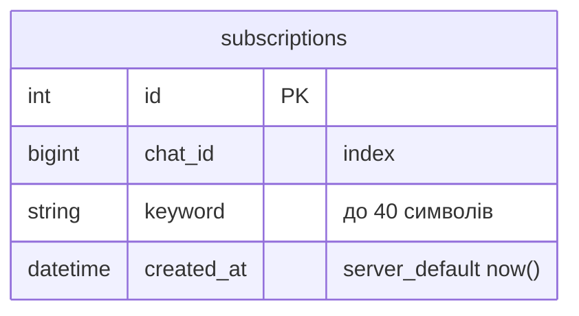
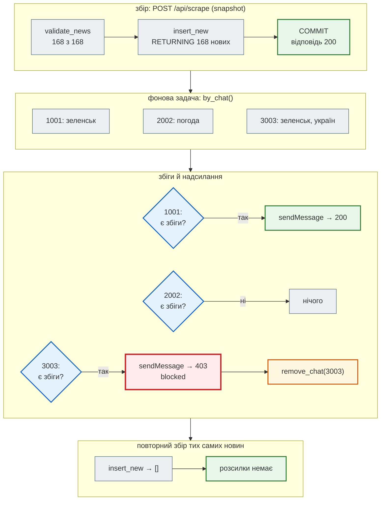

# Підписки і сповіщення

> Крок 9 · розділ 3 з 4. Код: [`news_hub/notify.py`](https://github.com/NikoriakViktor/news_hub/blob/main/steps/09_telegram_bot/news_hub/notify.py), [`repository.py`](https://github.com/NikoriakViktor/news_hub/blob/main/steps/09_telegram_bot/news_hub/repository.py), [`tables.py`](https://github.com/NikoriakViktor/news_hub/blob/main/steps/09_telegram_bot/news_hub/tables.py), [`migrations/versions/0004_subscriptions_table.py`](https://github.com/NikoriakViktor/news_hub/blob/main/steps/09_telegram_bot/migrations/versions/0004_subscriptions_table.py), [`tests/integration/test_notify.py`](https://github.com/NikoriakViktor/news_hub/blob/main/steps/09_telegram_bot/tests/integration/test_notify.py).
> Теорія: [Частина IX. Інтеграції](../../09_integrations/README.md), [Частина VI. Middleware, кеш, фонові задачі](../../06_middleware_cache_jobs/README.md).

## Задача { #task }

`/subscribe бюджет` — і нова новина зі словом «бюджет» у заголовку приходить у чат сама, щойно агрегатор її збере. Вимоги:

- одна й та сама новина не приходить двічі, навіть якщо збір запустили ще раз;
- одне повідомлення на чат з усіма збігами, а не десять повідомлень на десять новин;
- ліміти Telegram: між повідомленнями — пауза, на `429` — почекати, скільки сказали;
- користувач заблокував бота (`403`) → більше в його чат не стукаємо;
- збій розсилки не ламає збір: новини вже в базі.

## Зміна 1: таблиця `subscriptions` { #table }

```python title="news_hub/tables.py (фрагмент)"
class SubscriptionRow(Base):
    __tablename__ = "subscriptions"
    __table_args__ = (UniqueConstraint("chat_id", "keyword", name="uq_subscription_chat_keyword"),)

    id: Mapped[int] = mapped_column(primary_key=True)
    chat_id: Mapped[int] = mapped_column(BigInteger, index=True)
    keyword: Mapped[str] = mapped_column(String(40))
    created_at: Mapped[datetime] = mapped_column(DateTime(timezone=True), server_default=func.now())
```



| Рішення | Чому |
|---|---|
| `chat_id` — `BigInteger` | id груп у Telegram на кшталт `-1001234567890` не вміщаються в 32 біти. SQLite зберігає будь-яке ціле, тож різницю видно лише на PostgreSQL, де `INTEGER` — 32 біти |
| `UniqueConstraint("chat_id", "keyword")` | повторна підписка нічого не додає — це гарантує база, а не `if` у коді |
| `index=True` на `chat_id` | `/subscriptions` і `for_chat` шукають за чатом |
| `String(40)` | стільки ж, скільки дозволяє `normalize_keyword` |

Міграцію `0004` згенерував `alembic revision --autogenerate` і виправлено вручну, як `0001` і `0003`: `server_default=sa.func.now()` замість синтаксису SQLite.

```text
$ alembic upgrade head
INFO  [alembic.runtime.migration] Running upgrade  -> 0001, news table — таблиця новин агрегатора (крок 3)
INFO  [alembic.runtime.migration] Running upgrade 0001 -> 0002, llm analysis — колонки аналізу LLM у таблиці news (крок 7)
INFO  [alembic.runtime.migration] Running upgrade 0002 -> 0003, sources — RSS-джерела, які додає адмін (крок 8)
INFO  [alembic.runtime.migration] Running upgrade 0003 -> 0004, subscriptions — підписки чатів Telegram на ключові слова (крок 9)
```

`SubscriptionRepository` у `repository.py` — увесь SQL підписок: `subscribe` (`INSERT … ON CONFLICT DO NOTHING RETURNING id` → `True`, якщо підписка нова), `unsubscribe`, `for_chat`, `by_chat` (усі підписки: чат → слова), `remove_chat`.

## Зміна 2: яке слово і що з ним збігається { #keywords }

Слово підписки — одне, 2–40 символів (літери, цифри, апостроф, дефіс), без регістру:

```python title="news_hub/bot/formatting.py"
KEYWORD = re.compile(r"^[\w'’-]{2,40}$")
WORD = re.compile(r"[\w'’-]+")


def normalize_keyword(raw: str) -> str | None:
    """Одне слово 2–40 символів (літери, цифри, апостроф, дефіс), без регістру; інакше None."""
    word = raw.strip().casefold()
    return word if KEYWORD.fullmatch(word) else None


def matches(keyword: str, title: str) -> bool:
    """Слово заголовка ПОЧИНАЄТЬСЯ з ключового: «бюджет» знаходить «бюджету», але не «наддбюджет»."""
    return any(word.startswith(keyword) for word in WORD.findall(title.casefold()))
```

```python
from news_hub.bot.formatting import normalize_keyword

for raw in ["Бюджет", "  НБУ ", "кам'янське", "covid-19", "а", "два слова", "<b>", "я" * 41, ""]:
    print(f"{raw[:12]!r:15} → {normalize_keyword(raw)}")
```

```text
'Бюджет'        → бюджет
'  НБУ '        → нбу
"кам'янське"    → кам'янське
'covid-19'      → covid-19
'а'             → None
'два слова'     → None
'<b>'           → None
'яяяяяяяяяяяя'  → None
''              → None
```

`None` отримують: одна літера, два слова, `<b>` (не літери — і заодно нічого, що треба екранувати), 41 символ (`"я" * 41`, у виводі обрізано до 12) і порожній рядок. У боті `None` → `Використання: /subscribe &lt;слово&gt; — одне слово, 2–40 літер`.

Збіг — за **початком слова**. Українська змінює закінчення, тож точний збіг слова пропускав би більшість новин, а пошук підрядка будь-де давав би хибні збіги:

| Слово | Заголовок | `matches` | Чому |
|---|---|---|---|
| `бюджет` | «Уряд ухвалив бюджет на рік» | `True` | те саме слово |
| `бюджет` | «Бюджету бракує 100 млрд» | `True` | інше закінчення |
| `бюджет` | «Наддбюджетні витрати» | `False` | «бюджет» усередині слова |
| `рада` | «Верховна Рада ухвалила закон» | `True` | регістр не важливий (`casefold`) |
| `рада` | «Це зрада, кажуть експерти» | `False` | підрядок `"рада" in "зрада"` був би `True` |
| `нбу` | «НБУ знизив ставку» | `True` | |
| `газ` | «Газета вийшла вранці» | `True` | межа методу: початок слова ≠ корінь |

Останній рядок — свідомий компроміс: щоб відрізнити «газ» від «газети», потрібна морфологія, а не регулярний вираз.

## Зміна 3: коли сповіщати — лише щойно вставлені { #when }

Розсилці потрібно знати **які саме** новини нові. `add_many` з кроку 3 повертав лише кількість, тож з'явився `insert_new` — той самий `INSERT … ON CONFLICT (url) DO NOTHING`, але `RETURNING` повертає вставлені рядки:

```python title="news_hub/repository.py (фрагмент)"
    async def add_many(self, items: Iterable[NewsItem]) -> int:
        """INSERT … ON CONFLICT (url) DO NOTHING: дублікати відсіює база; повертає, скільки додано."""
        return len(await self.insert_new(items))

    async def insert_new(self, items: Iterable[NewsItem]) -> list[NewNews]:
        """Те саме, але повертає саме нові новини (RETURNING лише вставлених рядків) — для сповіщень."""
        ...
            .values(rows).on_conflict_do_nothing(index_elements=["url"]) \
            .returning(NewsRow.id, NewsRow.title, NewsRow.url)
        return [NewNews(id=row.id, title=row.title, url=row.url) for row in await self._session.execute(stmt)]
```

Дублікат база пропустила — його немає в `RETURNING`, тож повторний збір тих самих новин дає `[]` і нікого не сповіщає вдруге.

Розсилку запускає **кожен** шлях збору:

| Звідки збір | Як запускається розсилка |
|---|---|
| `POST /api/scrape`, `POST /api/sources/{id}/fetch` | `background.add_task(notifier, new)` — після відповіді, тобто вже після COMMIT сесії запиту |
| `POST /api/scrape/jobs`, `POST /api/webhooks/scrape` (крок 8) | `run_scrape_job(..., notifier)`: після COMMIT і інвалідації кешу; виняток розсилки — в журнал, статус задачі лишається `done` |
| `/scrape` у боті (адмін) | `notify_subscribers(bot, subscriptions, new)` прямо в handler; COMMIT — у `InjectMiddleware` |

У API розсилка — фонова задача зі **своєю** сесією бази (`Notifier`): сесія запиту до того часу вже закрита.

```python title="news_hub/api.py (фрагмент)"
def get_notifier(request: Request, session_factory: SessionFactoryDep) -> Notifier | None:
    """Крок 9: хто сповіщає підписників після збору; None — бот вимкнений."""
    bot = request.app.state.bot
    return Notifier(bot, session_factory) if bot is not None else None


async def scrape(request: ScrapeRequest, repo: RepoDep, scrapers: ScrapersDep, background: BackgroundTasks,
                 notifier: NotifierDep) -> ScrapeReport:
    outcome = await collect(request, scrapers)
    valid, rejected = validate_news(outcome.news)
    new = await repo.insert_new(valid)
    if notifier is not None and new:
        background.add_task(notifier, new)              # після відповіді — тобто вже після COMMIT
    ...
```

## Зміна 4: розсилка — 403, 429 і ліміти { #notify }

```python title="news_hub/notify.py"
SEND_PAUSE = 0.05            # секунд між повідомленнями: ~20 за секунду, нижче ліміту Telegram
MAX_NEWS_PER_CHAT = 20


def build_messages(keywords: Sequence[str], news: Sequence[NewNews]) -> list[str]:
    """Новини, що збіглися з будь-яким ключовим словом чату → частини повідомлення (≤ 4096)."""
    found = [item for item in news if any(matches(keyword, item.title) for keyword in keywords)]
    if not found:
        return []
    lines = [f"🔔 Нові новини за підписками ({esc(', '.join(keywords))}):", ""]
    lines += [f"• {link(item.url, item.title)}" for item in found[:MAX_NEWS_PER_CHAT]]
    if len(found) > MAX_NEWS_PER_CHAT:
        lines.append(f"… і ще {len(found) - MAX_NEWS_PER_CHAT}")
    return split_message(lines)


async def _send(bot: Bot, chat_id: int, text: str) -> None:
    try:
        await bot.send_message(chat_id, text, disable_web_page_preview=True)
    except TelegramRetryAfter as error:                     # 429: Telegram каже, скільки чекати
        await asyncio.sleep(error.retry_after)
        await bot.send_message(chat_id, text, disable_web_page_preview=True)


async def notify_subscribers(bot: Bot, subscriptions: SubscriptionRepository,
                             news: Sequence[NewNews]) -> NotifyReport:
    """Розсилка після збору. COMMIT (видалення підписок заблокованих чатів) — справа того, хто викликав."""
    report = NotifyReport()
    if not news:
        return report
    for chat_id, keywords in (await subscriptions.by_chat()).items():
        messages = build_messages(keywords, news)
        if not messages:
            continue
        report.chats += 1
        try:
            for text in messages:
                await _send(bot, chat_id, text)
                report.sent += 1
                await asyncio.sleep(SEND_PAUSE)
        except TelegramForbiddenError:
            await subscriptions.remove_chat(chat_id)
            report.blocked.append(chat_id)
            logger.info("чат %s заблокував бота — підписки видалено", chat_id)
        except TelegramAPIError as error:
            report.failed[chat_id] = f"{type(error).__name__}: {error}"
            logger.warning("сповіщення в чат %s не надіслано: %s", chat_id, error)
    ...
    return report
```

| Відповідь Telegram | Виняток aiogram | Що робимо |
|---|---|---|
| `200` | — | `report.sent += 1`, пауза `SEND_PAUSE` (0.05 с) |
| `429 Too Many Requests` з `retry_after` | `TelegramRetryAfter` | чекаємо `error.retry_after` секунд і пробуємо ще раз (один раз) |
| `403 Forbidden: bot was blocked by the user` | `TelegramForbiddenError` | `remove_chat(chat_id)` — інакше кожен збір стукав би в чат, який ніколи не відповість |
| інша помилка Bot API | `TelegramAPIError` | у `report.failed`, розсилка решті триває |

Покроково — збір знімка (168 новин), три підписники, чат 3003 заблокував бота. Ті самі дані, що в тестах `test_notify.py`:



## Результат: розсилка через API { #result }

API з ботом на двійнику — так само, як фікстура `bot_api` у тестах: тестова база (`TestDatabase` з `tests/integration/conftest.py`), токен адміна, `app.state.bot` на двійнику. Підписки 1001 → `зеленськ`, 2002 → `погода`, 3003 → `зеленськ`, `україн`; чат 3003 заблокував бота. Потім двічі `POST /api/scrape` зі знімком.

??? example "notify_demo.py — збережи в папці кроку і запусти `python notify_demo.py`"

    ```python
    import asyncio
    import httpx

    from tests.integration.conftest import TestDatabase, admin_headers   # тестова база + токен адміна
    from news_hub.api import app
    from news_hub.bot.factory import create_bot
    from news_hub.repository import SubscriptionRepository
    from tests.telegram_twin import TelegramTwin


    async def main() -> None:
        twin = TelegramTwin()
        await twin.start()
        db = TestDatabase()
        db.install()
        async with app.router.lifespan_context(app):
            await db.create_tables()
            app.state.bot = create_bot(twin.token, twin.url)        # як start_bot з BOT_TOKEN
            async with db.factory() as session:
                subscriptions = SubscriptionRepository(session)
                for chat_id, keyword in [(1001, "зеленськ"), (2002, "погода"), (3003, "зеленськ"), (3003, "україн")]:
                    await subscriptions.subscribe(chat_id, keyword)
                await session.commit()
            twin.blocked.add(3003)
            transport = httpx.ASGITransport(app=app)
            async with httpx.AsyncClient(transport=transport, base_url="http://test", headers=admin_headers()) as api:
                for attempt in (1, 2):
                    report = (await api.post("/api/scrape", json={"source": "snapshot"})).json()
                    print(f"збір {attempt}: news_saved={report['news_saved']}",
                          {chat: len(twin.sent(chat)) for chat in (1001, 2002, 3003)})
            print("помилки:", [(p["chat_id"], p["error"]) for m, p in twin.calls if m == "sendMessage" and "error" in p])
            async with db.factory() as session:
                print("підписки після:", await SubscriptionRepository(session).by_chat())
            await app.state.bot.session.close()
            app.state.bot = None
        await twin.stop()

    asyncio.run(main())
    ```

```text
21:22:34 INFO news_hub: 177e7dab POST /api/scrape → 200 28.6 ms
21:22:34 INFO news_hub: чат 3003 заблокував бота — підписки видалено
21:22:34 INFO news_hub: сповіщення: чатів 2, повідомлень 1, заблокували 1, помилок 0
21:22:34 INFO news_hub: 8adf6753 POST /api/scrape → 200 24.0 ms
збір 1: news_saved=168 {1001: 1, 2002: 0, 3003: 0}
збір 2: news_saved=0 {1001: 1, 2002: 0, 3003: 0}
помилки: [('3003', 'Forbidden: bot was blocked by the user')]
підписки після: {1001: ['зеленськ'], 2002: ['погода']}
```

Порядок рядків журналу показує `BackgroundTasks` у дії: відповідь `POST /api/scrape → 200` записана **до** розсилки.

- «чатів 2» — збіги були в 1001 і 3003; у знімку немає слова «погода».
- Підписки 3003 видалено, решта на місці.
- Повторний збір: `news_saved: 0`, і 1001 досі має **одне** сповіщення.

Що прийшло в чат (повністю — 11 новин зі словом на «зеленськ»; тут перші три):

```text
🔔 Нові новини за підписками (зеленськ):

• <a href="https://www.rbc.ua/rus/news/putina-obrazilisya-dozvil-zelenskogo-provesti-1778272356.html">У Путіна образилися на дозвіл Зеленського провести парад 9 травня</a>
• <a href="https://www.rbc.ua/rus/news/zelenskiy-dozvoliv-provedennya-paradu-moskvi-1778265521.html">Зеленський дозволив проведення параду в Москві 9 травня</a>
• <a href="https://www.rbc.ua/rus/news/zelenskogo-vpershe-vidreaguvali-zlivi-plivok-1778249746.html">У Зеленського вперше відреагували на зливи "плівок Міндіча" у ЗМІ</a>
…
```

**429.** `twin.retry_after = 1` — наступний `sendMessage` отримає `429` з `retry_after=1`:

```python title="tests/integration/test_notify.py"
async def test_retry_after_429(bot_api: httpx.AsyncClient, twin: TelegramTwin) -> None:
    await subscribe(1001, "зеленськ")
    twin.retry_after = 1                                                # перший sendMessage → 429, retry_after=1
    await bot_api.post("/api/scrape", json={"source": "snapshot"})
    sends = [params for method, params in twin.calls if method == "sendMessage"]
    assert [p.get("error", "ok")[:17] for p in sends] == ["Too Many Requests", "ok"]
    assert len(twin.sent(1001)) == 1
```

У тому самому сценарії двійник записав два виклики — `['Too Many Requests: retry after 1', 'ok']`, а звіт розсилки — `NotifyReport(chats=1, sent=1, blocked=[], failed={})`: перший виклик — `429`, через секунду — успішний, користувач отримав одне повідомлення.

**Багато збігів.** Підписка на `в`, `у`, `на`, `і` збігається з 161 заголовком зі 168. З `MAX_NEWS_PER_CHAT = 20` — одне повідомлення з 20 новинами й останнім рядком `… і ще 141`. Тест `test_many_matches_split_into_valid_messages` піднімає ліміт до 200, і тоді `build_messages` віддає 8 частин довжиною `[3934, 3911, 4017, 4063, 3964, 3943, 4068, 1267]` — кожна ≤ 4096, і двійник прийняв усі.

## Звідки взялося { #origin }

Основа — розсилка зі стартового шаблону бекенду бота (`workers/notifications.py`): `while True` → вибірка з бази → `bot.send_message` кожному → `except Exception: logger.warning`.

| Було | Стало |
|---|---|
| окремий `while True` + `sleep(3600)`, вибірка з бази щогодини | виклик **після збору**, з новинами, які щойно з'явились у базі (`insert_new`): повторний збір нікого не сповіщає вдруге |
| по повідомленню на кожен запис | одне повідомлення на чат з усіма збігами (частини ≤ 4096, не більше 20 новин) |
| `except Exception: logger.warning` | `403` → підписки чату видаляються; `429` → `retry_after` і повтор; інші помилки — у звіт, решті розсилка триває |
| підписка — тариф користувача | підписка — пара «чат + слово», `UniqueConstraint` |

Поглиблено: Telegram — [ліміти розсилки](https://core.telegram.org/bots/faq#my-bot-is-hitting-limits-how-do-i-avoid-this); aiogram — [винятки](https://docs.aiogram.dev/en/latest/api/exceptions.html).

## Правило { #rule }

!!! tip "Правило"
    Сповіщай про те, що **щойно** змінилось (`RETURNING` вставлених рядків), а не про те, що лежить у базі: тоді повторний збір нікого не турбує вдруге. Розсилку запускай після COMMIT, а відповіді Telegram обробляй за кодом: `429` — почекай `retry_after`, `403` — прибери підписки, решта — у звіт, не зупиняючи розсилку іншим.

**Далі:** [Polling і webhook у FastAPI](polling_webhook.md) — як update від користувача потрапляє в диспетчер.
