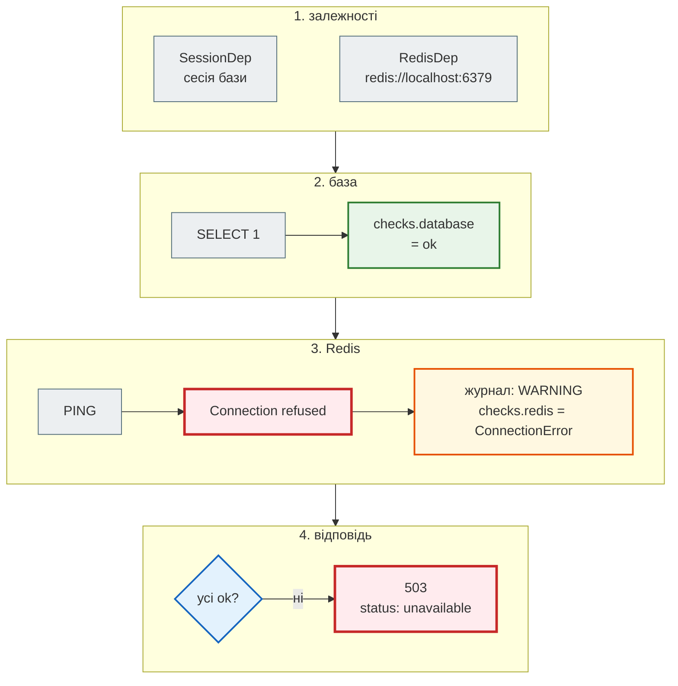
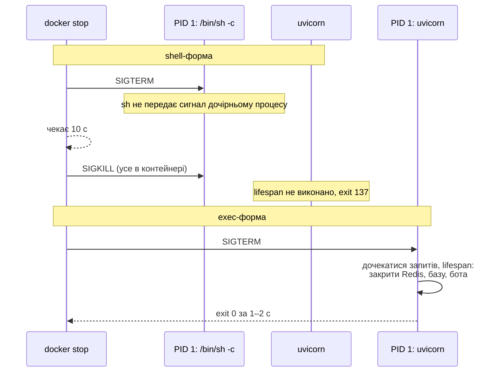

# Здоров'я і зупинка

> Крок 10 · розділ 4 з 4. Код: [`news_hub/api.py`](https://github.com/NikoriakViktor/news_hub/blob/main/steps/10_docker/news_hub/api.py), [`Dockerfile`](https://github.com/NikoriakViktor/news_hub/blob/main/steps/10_docker/Dockerfile), [`tests/integration/test_health.py`](https://github.com/NikoriakViktor/news_hub/blob/main/steps/10_docker/tests/integration/test_health.py).
> Теорія: [Частина X. Docker, Compose і CI/CD](../../10_docker_and_ci/README.md).

## Задача { #task }

Контейнер запущено. Docker бачить лише одне: процес PID 1 працює чи ні. Але процес може працювати й не відповідати, а може відповідати, коли база недоступна. І зупиняти його треба так, щоб він встиг закрити з'єднання з базою, Redis і сесію бота: це код після `yield` у `lifespan` ([крок 2](../02_fastapi_basics/index.md)).

Два питання й одна вимога:

- **живий?** — процес відповідає на HTTP;
- **готовий?** — база й Redis доступні, можна слати запити;
- `docker stop` має завершувати застосунок за секунди, з кодом 0 і виконаним `lifespan`.

## Зміна 1: `/health` і `/health/ready` { #ready }

| Ендпоінт | Питання | Хто питає | Не так — що робити |
|---|---|---|---|
| `GET /health` | процес відповідає? | `HEALTHCHECK` образу | перезапустити контейнер |
| `GET /health/ready` | база й Redis доступні? | балансувальник, Compose (крок 11) | не слати запитів, почекати |

Чому не одна перевірка: якщо впала база, перезапуск API не допоможе — лише створить хвилю перезапусків. Тому `/health` бази не торкається, а `/health/ready` каже, чого саме бракує, — без адреси бази й тексту помилки (вони лише в журналі):

```python title="news_hub/api.py (фрагмент)"
@app.get("/health", tags=["system"], summary="Процес живий (liveness)")
async def health() -> dict[str, str]:
    return {"status": "ok"}


@app.get("/health/ready", tags=["system"], summary="База й Redis доступні (readiness)",
         responses={503: {"description": "база чи Redis недоступні"}})
async def ready(db: SessionDep, redis: RedisDep) -> JSONResponse:
    """Назовні — лише «ok»/назва винятку: адреса бази й текст помилки лишаються в журналі."""
    checks: dict[str, str] = {}
    try:
        await db.execute(text("SELECT 1"))
        checks["database"] = "ok"
    except Exception as error:
        logger.warning("readiness: база недоступна: %s", error)
        checks["database"] = type(error).__name__
    try:
        await redis.ping()
        checks["redis"] = "ok"
    except Exception as error:
        logger.warning("readiness: Redis недоступний: %s", error)
        checks["redis"] = type(error).__name__
    ok = all(value == "ok" for value in checks.values())
    return JSONResponse({"status": "ok" if ok else "unavailable", "checks": checks},
                        status_code=200 if ok else 503)
```

- `SessionDep`, `RedisDep` — ті самі залежності, що в інших ендпоінтах (кроки 3 і 4): перевіряємо саме ті з'єднання, якими користується застосунок.
- `except Exception` тут доречний: будь-яка помилка означає «не готовий», а її тип — підказка для людини (`OperationalError`, `ConnectionError`).
- Обидва ендпоінти — у `PUBLIC` у `tests/integration/test_admin_api.py`: Docker і балансувальник питають без токена.

Шлях запиту `GET /health/ready`, коли Redis недоступний (як у [розділі 3](user_data_env.md#localhost)):



## Результат: три випадки в тестах { #ready-tests }

```python title="tests/integration/test_health.py (фрагмент)"
MISSING_DB = "sqlite+aiosqlite:////nonexistent-dir/secret-name.db"


def test_database_down_is_503_but_process_is_alive(anon: TestClient) -> None:
    break_database()
    response = anon.get("/health/ready")
    assert response.status_code == 503
    assert response.json()["checks"] == {"database": "OperationalError", "redis": "ok"}
    assert "secret-name" not in response.text             # шлях/адреса бази — лише в журнал, не назовні
    assert anon.get("/health").status_code == 200         # liveness не залежить від бази: не перезапускати
```

```text
$ pytest -q tests/integration/test_health.py
...                                                                      [100%]
3 passed in 0.74s
```

Недоступну базу тест імітує SQLite-файлом у каталозі, якого немає; Redis — портом 1, де ніхто не слухає. Третій тест — усе доступне → `200` і `{"status": "ok", "checks": {"database": "ok", "redis": "ok"}}`.

## Зміна 2: `HEALTHCHECK` без curl { #healthcheck }

```dockerfile title="Dockerfile (фрагмент)"
# «Процес живий?» — python з образу, бо curl у slim немає. /health не торкається бази (див. api.py).
HEALTHCHECK --interval=30s --timeout=5s --start-period=30s --retries=3 \
    CMD ["python", "-c", "import urllib.request; urllib.request.urlopen('http://127.0.0.1:8000/health', timeout=4)"]
```

```text
$ docker run --rm news_hub:10 which curl          # нічого, exit 1
```

| Параметр | Значення | Що означає |
|---|---|---|
| `--interval` | `30s` | перевіряти раз на 30 с |
| `--timeout` | `5s` | перевірка довша за 5 с — невдала; тому в `urlopen` `timeout=4` — менше за 5 |
| `--start-period` | `30s` | перші 30 с невдачі не рахуються: імпорт aiogram, google-genai і anthropic займає кілька секунд |
| `--retries` | `3` | `unhealthy` — після трьох невдач поспіль |

`urlopen` кидає виняток на помилку з'єднання і на код ≥ 400 → `python -c` завершується з кодом 1 → перевірка невдала. Адреса — `127.0.0.1`: перевірка виконується **всередині** контейнера.

```text
$ docker ps
NAMES     STATUS
api       Up 3 seconds (health: starting)
…
api       Up 13 seconds (healthy)
```

`healthy` з'явився раніше за 30 с: у стартовий період Docker перевіряє частіше (`--start-interval`, за замовчуванням 5 с). Тест `test_healthcheck_reports_healthy` запускає контейнер з `--health-interval=1s`, щоб не чекати.

## Зміна 3: `CMD` в exec-формі { #stop }

`docker stop` надсилає процесу з **PID 1** сигнал `SIGTERM` і чекає (за замовчуванням 10 секунд, `-t` змінює). Не завершився — `SIGKILL`, без жодного шансу прибрати за собою. Хто ж PID 1, залежить від форми `CMD`:

```dockerfile
CMD ["uvicorn", "news_hub.api:app", "--host", "0.0.0.0", "--port", "8000"]   # exec-форма: PID 1 — uvicorn
CMD uvicorn news_hub.api:app --host 0.0.0.0 --port 8000                      # shell-форма: PID 1 — /bin/sh -c
```

```text
$ docker top api
PID                 COMMAND
95284               /usr/local/bin/python3.12 /usr/local/bin/uvicorn news_hub.api:app --host 0.0.0.0 --port 8000

$ docker top api-shell-form
PID                 COMMAND
20298               /bin/sh -c uvicorn news_hub.api:app --host 0.0.0.0 --port 8000
20322               /usr/local/bin/python3.12 /usr/local/bin/uvicorn news_hub.api:app --host 0.0.0.0 --port 8000
```

`docker top` показує номери процесів з боку машини; всередині контейнера перший процес — PID 1 (`Finished server process [1]` у журналі нижче).



```text
--- exec-форма
$ time docker stop -t 10 api
real    0m1.549s
$ docker inspect -f '{{.State.ExitCode}}' api
0
$ docker logs api
INFO:     Shutting down
INFO:     Waiting for application shutdown.
INFO:     Application shutdown complete.
INFO:     Finished server process [1]

--- shell-форма
$ time docker stop -t 10 api-shell-form
real    0m10.338s
$ docker inspect -f '{{.State.ExitCode}}' api-shell-form
137
```

137 = 128 + 9 (`SIGKILL`). У журналі shell-форми немає ні `Shutting down`, ні `Application shutdown complete`: `lifespan` не виконався, з'єднання не закрито.

`-t 10` тут — те саме значення, що й за замовчуванням, записане явно (так робить і тест `test_docker_stop_is_graceful`). Якщо в налаштуваннях Docker на твоїй машині стоїть менший час очікування, застосунок можуть убити посеред коректного завершення: `exit 137` навіть з exec-формою. Перевір: `docker inspect -f '{{.Config.StopTimeout}}' api`.

## Зміна 4: один процес на контейнер { #workers }

Стартовий `Dockerfile` запускав `--workers 4`. Пам'ять трьох контейнерів через 25 с після старту:

```text
$ docker stats --no-stream
NAME      MEM USAGE / LIMIT
old1      1.009GiB / 15.48GiB      ← старий образ, --workers 4
api1      262.3MiB / 15.48GiB      ← крок 10, один процес
api2      535.9MiB / 15.48GiB      ← крок 10, -e WEB_CONCURRENCY=2
```

Кожен worker — окремий процес з усіма бібліотеками:

```text
$ docker top api2
PID                 COMMAND
22677               /usr/local/bin/python3.12 /usr/local/bin/uvicorn news_hub.api:app --host 0.0.0.0 --port 8000
22742               /usr/local/bin/python3.12 -B -c from multiprocessing.resource_tracker import main;main(6)
22743               /usr/local/bin/python3.12 -B -c from multiprocessing.spawn import spawn_main; spawn_main(tracker_fd=7, pipe_handle=9) --multiprocessing-fork
22744               /usr/local/bin/python3.12 -B -c from multiprocessing.spawn import spawn_main; spawn_main(tracker_fd=7, pipe_handle=13) --multiprocessing-fork
```

У контейнері краще **один процес на контейнер**, а масштаб — кількістю контейнерів ([крок 11](../11_compose_deploy/index.md)): тоді ліміт пам'яті, перезапуск і журнал стосуються одного процесу. Якщо все ж треба кілька — `-e WEB_CONCURRENCY=2` (uvicorn читає цю змінну сам, за замовчуванням 1), без перезбирання образу.

## Правило { #rule }

!!! tip "Правило"
    Дві перевірки: `/health` — «процес живий» (`HEALTHCHECK`, не торкається бази), `/health/ready` — «залежності доступні» (`503`, назовні лише назва помилки). `CMD` — лише в exec-формі (JSON-масив), щоб PID 1 був застосунком і `SIGTERM` запускав `lifespan`. Один процес на контейнер; більше — кількістю контейнерів.

**Далі:** [Контрольна точка](checkpoint.md) — тести образу, практика, самоперевірка.
