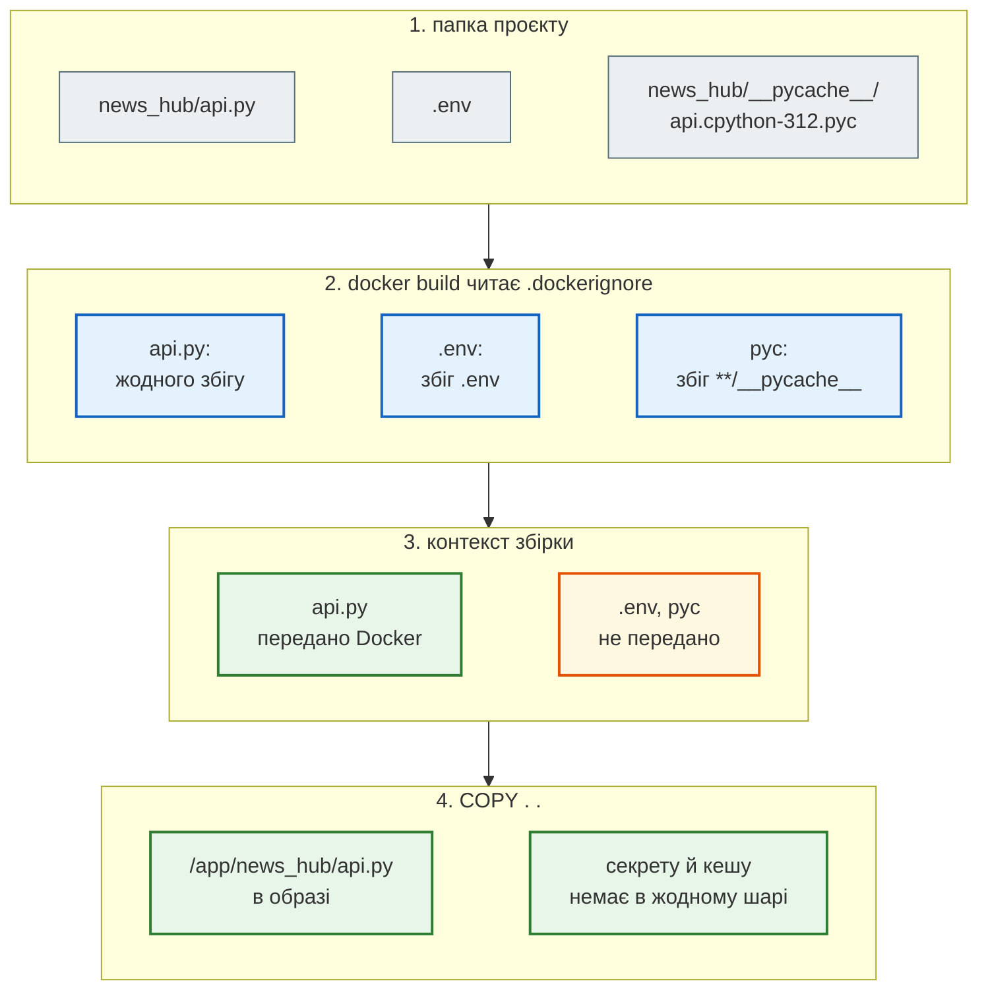

# Що потрапляє в образ

> Крок 10 · розділ 1 з 4. Код: [`.dockerignore`](https://github.com/NikoriakViktor/news_hub/blob/main/steps/10_docker/.dockerignore), [`requirements.txt`](https://github.com/NikoriakViktor/news_hub/blob/main/steps/10_docker/requirements.txt), [`requirements-dev.txt`](https://github.com/NikoriakViktor/news_hub/blob/main/steps/10_docker/requirements-dev.txt).
> Теорія: [Частина X. Docker, Compose і CI/CD](../../10_docker_and_ci/README.md).

## Docker за хвилину { #glossary }

| Слово | Що це | У News Hub |
|---|---|---|
| **образ** (image) | незмінний знімок файлової системи + команда запуску; збирається з `Dockerfile` | `news_hub:10` |
| **шар** (layer) | результат однієї інструкції `Dockerfile`; образ — стос шарів, спільні шари не дублюються | `pip install` — 214 МБ, код — 336 кБ |
| **контейнер** | запущений з образу процес зі своєю файловою системою, мережею й користувачем | `api`, `redis` |
| **том** (volume) | каталог, що живе окремо від контейнера: контейнер видалили — дані лишились | `news_data` → `/data` |
| **мережа** | контейнери в одній мережі бачать одне одного за іменем | `news`: `redis://redis:6379` |
| **реєстр** | сховище образів (Docker Hub, GHCR) | крок 12 |
| **контекст збірки** | папка, яку `docker build` пакує й віддає Docker; `COPY` бере файли лише з неї | `steps/10_docker` |

Встановлення: [Docker Desktop](https://docs.docker.com/get-started/get-docker/) (Windows, macOS) або Docker Engine (Linux). Перевірка — `docker run --rm hello-world`.

## Задача { #task }

Запакувати News Hub в образ так, щоб в образі був **застосунок** і нічого більше: ні `.env` з ключами, ні локального `.venv`, ні тестів, ні pytest.

Почнемо з `Dockerfile` стартового шаблону бекенду:

```dockerfile title="Dockerfile стартового шаблону"
FROM python:3.12-slim

WORKDIR /app

# Залежності — окремий шар (кешується)
COPY requirements.txt .
RUN pip install --no-cache-dir -r requirements.txt

# Код
COPY . .

# Не запускаємо як root
RUN adduser --disabled-password --gecos "" appuser
USER appuser

# uvicorn: 4 worker процеси, 0.0.0.0 для Docker networking
CMD ["uvicorn", "backend.app:app", "--host", "0.0.0.0", "--port", "8000", "--workers", "4"]
```

Багато чого тут уже правильно: невеликий базовий образ `slim`, залежності окремим шаром перед кодом, користувач без root, `CMD` у формі JSON-масиву. Це й лишаємо.

## Старий Dockerfile над News Hub { #old }

Беремо його без змін (лише шлях до застосунку: `news_hub.api:app`) і збираємо в папці кроку 9 — такій, як у розробника: поруч лежать `.env` з ключами й `.venv`, а `.dockerignore` ще немає.

```text
$ docker build --progress=plain -t news_hub:old .
#4 transferring context: 270.58MB 3.4s done
…
real    1m7.158s

$ docker images news_hub:old
news_hub:old  967MB

$ docker history news_hub:old
SIZE      CREATED BY
0B        CMD ["uvicorn" "news_hub.api:app" "--host" "…
0B        USER appuser
73.7kB    RUN /bin/sh -c adduser --disabled-password -…
321MB     COPY . . # buildkit
312MB     RUN /bin/sh -c pip install --no-cache-dir -r…
12.3kB    COPY requirements.txt . # buildkit

$ docker run --rm news_hub:old cat /app/.env
JWT_SECRET=local-dev-secret-do-not-ship-xxxxxxxxxxxxxxxxxxxx
GEMINI_API_KEY=AIza-FAKE-KEY-FOR-BOOK

$ docker run --rm news_hub:old pip list | grep -E "^(pytest|mypy|fakeredis) "
fakeredis          2.40.0
mypy               2.4.1
pytest             9.2.0

$ docker run --rm news_hub:old ls -A /app
.claude .coveragerc .env .venv CLAUDE.md Dockerfile README.md alembic.ini data docker-compose.yml examples migrations news_hub postman pytest.ini requirements.txt tests
```

Що бачимо:

- **секрети в образі.** `.env` скопіювався разом з кодом. Хто отримає образ (реєстр, колега, CI), той отримає й ключі;
- **шар `COPY . .` — 321 МБ**: туди потрапив локальний `.venv`, зібраний під іншу ОС і для контейнера марний. Більший `.venv` — більший образ (у прикладі `.venv` займав 306 МБ);
- **270 МБ контексту** `docker build` пакує й передає Docker при кожній збірці, ще до першої інструкції;
- **pytest, mypy, fakeredis в образі**: у кроці 9 `requirements.txt` спільний для застосунку й тестів;
- **у `/app` усе підряд**: тести, Postman, `CLAUDE.md`, `.claude/`, сам `Dockerfile`.

## Зміна 1: `.dockerignore` { #dockerignore }

`COPY . .` копіює **контекст збірки** — усю папку, крім того, що перелічено в `.dockerignore`. `.gitignore` Docker не читає.

```text title=".dockerignore"
# секрети: .env читає Compose/docker run (--env-file), в образ він не йде ніколи
.env
.env.*
!.env.example

# локальне оточення й кеші — сотні МБ, і вони під іншу ОС
.venv/
venv/
**/__pycache__
**/*.py[cod]
**/.mypy_cache
**/.pytest_cache
.coverage
htmlcov/

# локальні дані: база SQLite, дамп Redis
**/*.db
**/*.sqlite3
**/dump.rdb

# розробка: тести, IDE, git, документація для людей
tests/
.git/
.gitignore
.idea/
.vscode/
.claude/
CLAUDE.md
README.md
postman/
examples/
requirements-dev.txt
pytest.ini
.coveragerc

# самі файли збірки — зміна Dockerfile не повинна інвалідувати шар COPY . .
Dockerfile
.dockerignore
docker-compose*.yml
```

Шлях одного файлу від папки до образу:



### Шаблон рахується від кореня контексту { #root-relative }

Як у `.gitignore` з `/` на початку: `__pycache__` прибирає лише `./__pycache__`, а `news_hub/__pycache__` і `news_hub/bot/__pycache__` доїдуть в образ. У будь-якій папці — `**/__pycache__`. Перевірка — підкласти в копію проєкту кеші, як після запуску тестів, і зібрати образ з `.dockerignore`, де замість `**/__pycache__` і `**/*.py[cod]` стоять `__pycache__` і `*.py[cod]`:

```text
$ docker run --rm news_hub:wrong-ignore find /app -name __pycache__
/app/news_hub/bot/__pycache__
/app/news_hub/__pycache__
$ docker run --rm news_hub:wrong-ignore find /app -name '*.pyc'
/app/news_hub/bot/__pycache__/x.pyc
/app/news_hub/__pycache__/api.cpython-312.pyc
```

З `.dockerignore` кроку обидві команди нічого не показують. Так само перевіряє тест `test_local_files_are_not_in_the_image` — і в корені, і в підпапках.

## Зміна 2: два файли залежностей { #requirements }

Правило: **в образ — лише те, що потрібно застосунку для роботи.** Тому `requirements.txt` кроку 9 розділено на два:

```text title="requirements.txt — лише залежності роботи; вони й ідуть в образ"
pydantic>=2.9
beautifulsoup4>=4.12
…
fastapi>=0.121
uvicorn[standard]>=0.30
…
aiogram>=3.15
bcrypt>=4.0
httpx>=0.28.1
```

```text title="requirements-dev.txt — розробка й тести"
-r requirements.txt
fakeredis>=2.26
httpx2>=2.0
pytest>=8
pytest-asyncio>=0.24
pytest-cov>=5
mypy>=1.10
```

```diff title="requirements.txt: крок 9 → крок 10 (без коментарів)"
 bcrypt>=4.0
-fakeredis>=2.26
 httpx>=0.28.1
-httpx2>=2.0
-pytest>=8
-pytest-asyncio>=0.24
-pytest-cov>=5
-mypy>=1.10
```

`Dockerfile` ставить лише `requirements.txt`, а `requirements-dev.txt` ще й записано в `.dockerignore`. Локально тепер ставимо `pip install -r requirements-dev.txt` — застосунок разом з інструментами.

!!! note "А fakeredis?"
    `REDIS_URL=fakeredis://` працює лише там, де встановлено fakeredis, — у тестах і локально. В образі його немає, тому контейнеру завжди потрібен справжній Redis (`REDIS_URL=redis://…`). Це навмисно: продакшн не повинен тихо працювати на Redis у пам'яті.

## Результат { #result }

Той самий News Hub, зібраний з `Dockerfile` і `.dockerignore` кроку 10:

```text
$ docker build --no-cache --progress=plain -t news_hub:10 .
#4 transferring context: 241.66kB 0.0s done
…
#8 [4/6] RUN pip install --no-cache-dir -r requirements.txt
#8 DONE 34.9s
…
real    0m45.406s

$ docker images news_hub:10
REPOSITORY   TAG       SIZE
news_hub     10        440MB

$ docker run --rm news_hub:10 ls -A /app
alembic.ini
data
migrations
news_hub
requirements.txt

$ docker run --rm news_hub:10 python -c "import pytest"
ModuleNotFoundError: No module named 'pytest'
```

| Що | Старий Dockerfile, крок 9 | Крок 10 |
|---|---|---|
| контекст збірки | 270.58 МБ | 241.66 кБ |
| шар коду `COPY . .` | 321 МБ | 336 кБ (35 файлів) |
| шар залежностей | 312 МБ | 214 МБ |
| образ | 967 МБ | 440 МБ (з них базовий `python:3.12-slim` — 179 МБ) |
| `.env` в образі | є | немає |
| pytest, mypy, fakeredis | є | немає |

Розміри — так, як їх показує `docker images` на машині, де збирали; на іншій версії Docker цифри трохи відрізнятимуться, співвідношення — ні.

!!! warning "Видалити секрет пізніше — не допоможе"
    `RUN rm .env` у наступному рядку Dockerfile прибере файл з останнього шару, але не з попереднього: образ — стос шарів, і кожен можна дістати (`docker save`, `docker history`). Секрет не має потрапляти в жоден шар. Те саме з `ENV API_KEY=…` у Dockerfile: `docker history` і `docker inspect` покажуть його кожному ([Знайди помилку](checkpoint.md#find-bug)).

## Правило { #rule }

!!! tip "Правило"
    В образ — лише те, що потрібно застосунку для роботи. Усе локальне (`.env`, `.venv`, кеші, бази) і все для розробки (тести, pytest, mypy, IDE) — у `.dockerignore` і `requirements-dev.txt`. Шаблони в `.dockerignore` — від кореня контексту: для будь-якої папки — `**/`.

**Далі:** [Шари й кеш](layers_cache.md) — чому порядок інструкцій вирішує, скільки триває перезбирання.
