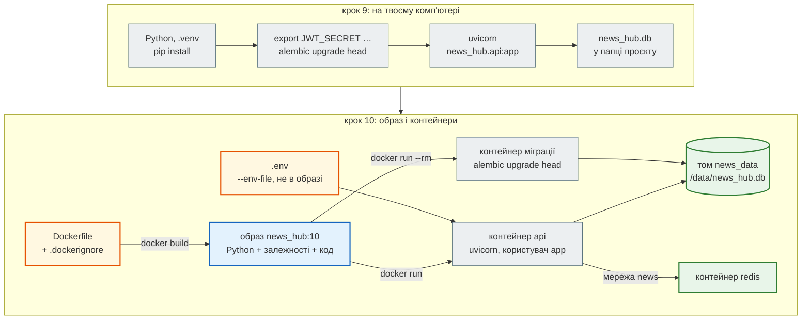

# Крок 10. Docker-образ

> **Код кроку:** [`steps/10_docker`](https://github.com/NikoriakViktor/news_hub/tree/main/steps/10_docker).
>
> **Передумови:** [Крок 9. Telegram-бот](../09_telegram_bot/index.md) — є API з базою, Redis, аналізом LLM, адміном з JWT і Telegram-ботом.

## Де ми зараз { #where }

Після кроку 9 News Hub уміє все, що планували: збирає новини, зберігає їх у базі, кешує в Redis, аналізує моделлю, пускає до запису лише адміна з токеном і відповідає в Telegram.

Але запускається він «у мене на комп'ютері». Потрібен правильний Python, `pip install -r requirements.txt`, змінні середовища (`JWT_SECRET`, `ADMIN_PASSWORD_HASH`, `REDIS_URL`, ключ LLM, `BOT_TOKEN`), `alembic upgrade head`. На сервері, у колеги чи в CI все це треба повторити, і десь неодмінно виявиться інша версія Python чи бібліотеки.

## Проблема { #problem }

Потрібен **один рецепт**, з якого на будь-якій машині з Docker виходить той самий застосунок з тими самими бібліотеками. Цей рецепт — `Dockerfile`, а результат — **образ**. І образ має:

- не містити секретів: `.env` лежить у кожного локально, і в образ він потрапити не повинен;
- не містити зайвого: локального `.venv`, тестів, pytest і mypy;
- швидко перезбиратися після зміни одного `.py`;
- працювати не від root, а дані тримати поза контейнером, щоб вони пережили нову версію образу;
- казати, чи він живий і чи готовий приймати запити;
- зупинятися коректно: закрити з'єднання, а не бути вбитим через 10 секунд.

Почнемо з `Dockerfile` стартового шаблону бекенду, зберемо його над News Hub без змін і подивимось, що вийде. Потім виправимо крок за кроком.

## Що додаємо { #what }

| Що | Де | Розділ |
|---|---|---|
| `.dockerignore`; залежності роботи окремо від залежностей розробки | `.dockerignore`, `requirements.txt`, `requirements-dev.txt` | [Що потрапляє в образ](image_contents.md) |
| порядок інструкцій: залежності — окремим шаром, код — останнім | `Dockerfile` | [Шари й кеш](layers_cache.md) |
| користувач `app` з UID 10001, SQLite на томі `/data`, `ENV` для Python; `--env-file` без лапок | `Dockerfile`, `news_hub/security.py` | [Користувач, дані й змінні середовища](user_data_env.md) |
| `/health` і `/health/ready`, `HEALTHCHECK`, `CMD` в exec-формі, один процес | `news_hub/api.py`, `Dockerfile` | [Здоров'я і зупинка](health_shutdown.md) |
| тести образу: вміст, користувач, healthcheck, `docker stop`, міграції на томі | `tests/docker/test_image.py`, `pytest.ini` | [Контрольна точка](checkpoint.md#check) |

## Архітектура: було → стало { #architecture }



- **Образ незмінний.** Python, бібліотеки й код збираються один раз і однакові всюди: на ноутбуці, в CI (крок 12), на сервері (крок 11).
- **Налаштування й секрети — при запуску.** Той самий образ отримує різні `REDIS_URL`, `DATABASE_URL`, `JWT_SECRET` через `-e` і `--env-file`.
- **Дані — на томі.** Контейнер можна видалити будь-коли; база в томі `news_data` лишається.
- **Один образ — кілька ролей.** API (`CMD` за замовчуванням), міграції (`alembic upgrade head`), бот у режимі polling (`python -m news_hub.bot`, [розібраний приклад](checkpoint.md#worked-example)).

Код застосунку майже не змінився: додався `/health/ready`, опція `--env-file` у `python -m news_hub.security` і опція `--host` у двійника Telegram.

## Файли кроку { #files }

| Файл | Що в ньому | Новий? |
|---|---|---|
| [`Dockerfile`](https://github.com/NikoriakViktor/news_hub/blob/main/steps/10_docker/Dockerfile) | `python:3.12-slim`, залежності окремим шаром, користувач `app` (UID 10001), `DATABASE_URL` на `/data`, `HEALTHCHECK` без curl, `CMD` в exec-формі | новий |
| [`.dockerignore`](https://github.com/NikoriakViktor/news_hub/blob/main/steps/10_docker/.dockerignore) | що не потрапляє в контекст збірки: `.env`, `.venv`, кеші, `*.db`, тести, файли розробки | новий |
| [`requirements.txt`](https://github.com/NikoriakViktor/news_hub/blob/main/steps/10_docker/requirements.txt) | лише залежності роботи — вони йдуть в образ | змінено: без pytest, mypy, fakeredis |
| [`requirements-dev.txt`](https://github.com/NikoriakViktor/news_hub/blob/main/steps/10_docker/requirements-dev.txt) | `-r requirements.txt` + fakeredis, httpx2, pytest, pytest-asyncio, pytest-cov, mypy | новий |
| [`news_hub/api.py`](https://github.com/NikoriakViktor/news_hub/blob/main/steps/10_docker/news_hub/api.py) | `GET /health/ready`: `SELECT 1` у базі й `PING` у Redis, інакше `503` | змінено |
| [`news_hub/security.py`](https://github.com/NikoriakViktor/news_hub/blob/main/steps/10_docker/news_hub/security.py) | `env_lines(password, quoted)`, `python -m news_hub.security --env-file` — рядки без лапок | змінено |
| [`tests/docker/test_image.py`](https://github.com/NikoriakViktor/news_hub/blob/main/steps/10_docker/tests/docker/test_image.py) | 6 тестів образу (лише `pytest -m docker`) | новий |
| [`tests/integration/test_health.py`](https://github.com/NikoriakViktor/news_hub/blob/main/steps/10_docker/tests/integration/test_health.py) | 3 тести `/health/ready`: усе доступне, база недоступна, Redis недоступний | новий |
| [`tests/unit/test_security.py`](https://github.com/NikoriakViktor/news_hub/blob/main/steps/10_docker/tests/unit/test_security.py) | + `test_env_lines_give_a_working_hash` (з лапками і без) | змінено |
| [`pytest.ini`](https://github.com/NikoriakViktor/news_hub/blob/main/steps/10_docker/pytest.ini) | маркер `docker`; `addopts = -m "not llm and not docker"` | змінено |
| [`tests/conftest.py`](https://github.com/NikoriakViktor/news_hub/blob/main/steps/10_docker/tests/conftest.py) | маркер з назви папки: + `docker` | змінено |
| [`tests/telegram_twin.py`](https://github.com/NikoriakViktor/news_hub/blob/main/steps/10_docker/tests/telegram_twin.py) | опція `--host` (0.0.0.0 — щоб до двійника дістався бот у контейнері) | змінено |
| решта `news_hub/`, `migrations/`, `docker-compose.yml` | з кроку 9 | без змін |

??? note "Структура проєкту після кроку 10"

    ```text
    news_hub/
    ├── news_hub/
    │   ├── parser.py     ← стартовий parse_rbc_news + типи: HTML → list[RawNews]
    │   ├── rss.py        ← крок 6: parse_pravda_rss — RSS «Української правди» → list[RawNews] (написав Claude Code)
    │   ├── models.py     ← NewsItem (Pydantic), validate_news, is_allowed_host (rbc.ua, pravda.com.ua, epravda.com.ua)
    │   ├── snapshot.py   ← знімок стрічки: data/rbc_news_snapshot.json → list[RawNews]
    │   ├── scraper.py    ← крок 2: сторінки rbc.ua через aiohttp — разом (gather) або по черзі
    │   ├── db.py         ← крок 3: engine, сесії, get_db (сесія й транзакція на запит)
    │   ├── tables.py     ← крок 3: NewsRow — таблиця news (SQLAlchemy 2.0)
    │   ├── repository.py ← крок 3: NewsRepository — увесь SQL; замінив NewsStore з кроку 2
    │   ├── cache.py      ← крок 4: клієнт Redis, NewsCache (cache-aside з версією)
    │   ├── middleware.py ← крок 4: X-Request-ID / X-Process-Time, rate limit → 429, інвалідація кешу
    │   ├── jobs.py       ← крок 4: фоновий збір, статус задачі в Redis; крок 7: пакетний аналіз LLM
    │   ├── llm.py        ← крок 7: LLMClient — GeminiClient (пул моделей), AnthropicClient, FakeLLM; CircuitBreaker у Redis
    │   ├── analysis.py   ← крок 7: NewsAnalysis (Pydantic), промпт, analyze_news (перевірка + 1 повтор), кеш за хешем тексту
    │   ├── security.py   ← крок 8: пароль адміна (bcrypt), JWT, require_admin (401 / 403 / 503)
    │   ├── safe_fetch.py ← крок 8: завантаження чужого URL без SSRF — схема, порт, IP після DNS, кожне перенаправлення
    │   ├── webhooks.py   ← крок 8: підпис HMAC (час + тіло), вікно 5 хв, захист від повтору
    │   ├── bot/          ← крок 9: aiogram — factory.py (Bot, Dispatcher), handlers.py (команди), middlewares.py
    │   │                   (rate limit, сесія бази на update), formatting.py (HTML, 4096), settings.py; __main__ — polling
    │   ├── notify.py     ← крок 9: нові новини → підписникам (403 — видалити підписки, 429 — retry_after)
    │   └── api.py        ← FastAPI: /api/news (+ CRUD, кеш), /stats, POST /api/scrape, /api/scrape/jobs,
    │                       POST /api/news/{id}/analyze, /api/analyze/jobs; крок 8: /api/admin/token, /api/sources,
    │                       POST /api/webhooks/scrape; запис — лише з токеном адміна; крок 9: POST /api/telegram/webhook
    ├── data/rbc_news_snapshot.json   ← 168 новин, зібраних parse_rbc_news
    ├── migrations/       ← крок 3: Alembic — версії схеми бази (0001: таблиця news; 0002: колонки аналізу LLM; 0003: таблиця sources; 0004: таблиця subscriptions)
    ├── alembic.ini
    ├── Dockerfile        ← крок 10: образ застосунку: залежності окремим шаром, користувач app,
    │                       SQLite на томі /data, HEALTHCHECK без curl, CMD у exec-формі
    ├── .dockerignore     ← крок 10: що не потрапляє в образ — .env, .venv, tests, *.db, кеші
    ├── requirements.txt  ← крок 10: лише залежності роботи (вони йдуть в образ)
    ├── requirements-dev.txt ← крок 10: + pytest, mypy, fakeredis — для розробки й тестів
    ├── docker-compose.yml ← PostgreSQL 16 (крок 3) і Redis 7 (крок 4) для розробки
    ├── postman/news_hub.postman_collection.json   ← 18 запитів з перевірками; пароль адміна — змінна adminPassword
    ├── examples/         ← before_dict.py / after_typed.py — що бачить mypy
    ├── CLAUDE.md         ← крок 6: інструкції для AI-асистента — команди, структура, правила проєкту
    ├── .claude/          ← крок 6: settings.json (дозволи), hooks/unit_tests.py (pytest -m unit після правок),
    │                       skills/add-news-source/ (/add-news-source)
    ├── pytest.ini        ← крок 5: маркери unit / integration, asyncio; крок 10: docker (лише pytest -m docker)
    ├── .coveragerc       ← крок 5: покриття гілок, concurrency = thread,greenlet (async SQLAlchemy)
    └── tests/
        ├── conftest.py   ← фікстура html("…"), маркер за папкою
        ├── factories.py  ← make_raw(**зміни) — тестова новина
        ├── fixtures/     ← збережені сторінки: справжній фрагмент rbc.ua, демо-розмітка, pravda_rss.xml (навчальний знімок RSS)
        ├── unit/         ← парсер, модель, конвеєр, скрапер під моком; test_pravda.py — специфікація для AI,
        │                   test_pravda_review.py — що знайшла рецензія його коду
        ├── integration/  ← API (TestClient і httpx.AsyncClient), CRUD, Redis, справжній get_db,
        │                   скрапер проти локального aiohttp-сервера; test_analyze_api.py — аналіз LLM через API;
        │                   крок 8: test_admin_api.py (хто може писати), test_sources_ssrf.py, test_webhooks_api.py;
        │                   крок 9: test_bot.py (команди), test_notify.py, test_telegram_webhook.py
        ├── docker/       ← крок 10: test_image.py — збірка образу, що в ньому немає, користувач, healthcheck, docker stop
        ├── telegram_twin.py ← крок 9: двійник Telegram Bot API (aiohttp): записує виклики, правила HTML, 403 / 429
        └── live/         ← крок 7: справжні виклики моделі — лише pytest -m llm (потрібен ключ і мережа)
    ```

## Порядок читання { #reading-order }

1. [Що потрапляє в образ](image_contents.md) — старий Dockerfile над News Hub, `.dockerignore`, два файли залежностей.
2. [Шари й кеш](layers_cache.md) — чому перезбирання триває секунду, а не дві хвилини.
3. [Користувач, дані й змінні середовища](user_data_env.md) — не root, том, `localhost` у контейнері, `--env-file`.
4. [Здоров'я і зупинка](health_shutdown.md) — liveness і readiness, `HEALTHCHECK`, `SIGTERM`, один процес.
5. [Контрольна точка](checkpoint.md) — тести образу, практика, самоперевірка.

Теорія до кроку — [Частина X. Docker, Compose і CI/CD](../../10_docker_and_ci/README.md).

## Запуск { #run }

З папки кроку `steps/10_docker`:

```bash
pip install -r requirements-dev.txt   # застосунок + pytest, mypy, fakeredis
pytest -q                             # 340 passed, 8 deselected (6 docker + 2 llm)
mypy --strict news_hub                # Success: no issues found in 26 source files
pytest -m docker                      # 6 passed — потрібен Docker, хвилина-дві
```

Образ і контейнери:

```bash
docker build -t news_hub:10 .
docker network create news
docker run -d --name redis --network news redis:7-alpine
docker run --rm -v news_data:/data news_hub:10 alembic upgrade head        # схема бази на томі
python -m news_hub.security --env-file      # спитає пароль → два рядки без лапок, поклади їх у .env
docker run -d --name api --network news -p 8000:8000 -v news_data:/data \
    -e REDIS_URL=redis://redis:6379/0 --env-file .env news_hub:10
curl localhost:8000/health/ready        # {"status":"ok","checks":{"database":"ok","redis":"ok"}}
docker stop api                         # SIGTERM → uvicorn завершується сам, за 1–2 с
```

- Без `DATABASE_URL` база — SQLite на томі `/data`; PostgreSQL — `-e DATABASE_URL=postgresql+asyncpg://…`.
- Порт 8000 зайнятий — `-p 8010:8000`: ліворуч порт твого комп'ютера, праворуч — контейнера.
- Кілька процесів uvicorn — `-e WEB_CONCURRENCY=2`; зазвичай краще більше контейнерів (крок 11).
- Прибрати за собою: `docker rm -f api redis`, `docker network rm news`, `docker volume rm news_data` (разом з базою).

Усе, що було до кроку 10, працює й без Docker: `uvicorn news_hub.api:app --reload`, бот `python -m news_hub.bot`, двійник Telegram `python -m tests.telegram_twin` — як у [кроці 9](../09_telegram_bot/index.md).

## Порівняння з кроком 9 { #diff }

```bash
git diff --no-index --stat steps/09_telegram_bot steps/10_docker
git diff --no-index steps/09_telegram_bot/news_hub steps/10_docker/news_hub
git diff --no-index steps/09_telegram_bot/requirements.txt steps/10_docker/requirements.txt
```

Нові файли — `Dockerfile`, `.dockerignore`, `requirements-dev.txt`, `tests/docker/`, `tests/integration/test_health.py`. У коді застосунку змінились лише `api.py` (`/health/ready`) і `security.py` (`--env-file`). Тестів стало 340 замість 335: 3 для `/health/ready` і 2 для `env_lines`; ще 6 тестів образу запускаються окремо.

## Що далі { #next }

[Крок 11. Docker Compose і деплой](../11_compose_deploy/index.md): чотири команди `docker run` у правильному порядку, мережа й том — це вже система. Крок 11 опише її одним `docker-compose.yml`: PostgreSQL замість SQLite, міграції перед API, nginx попереду, бот поруч — і перенесе на сервер.
