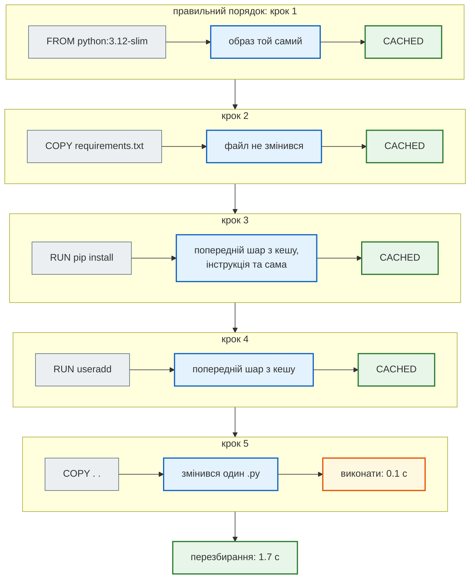
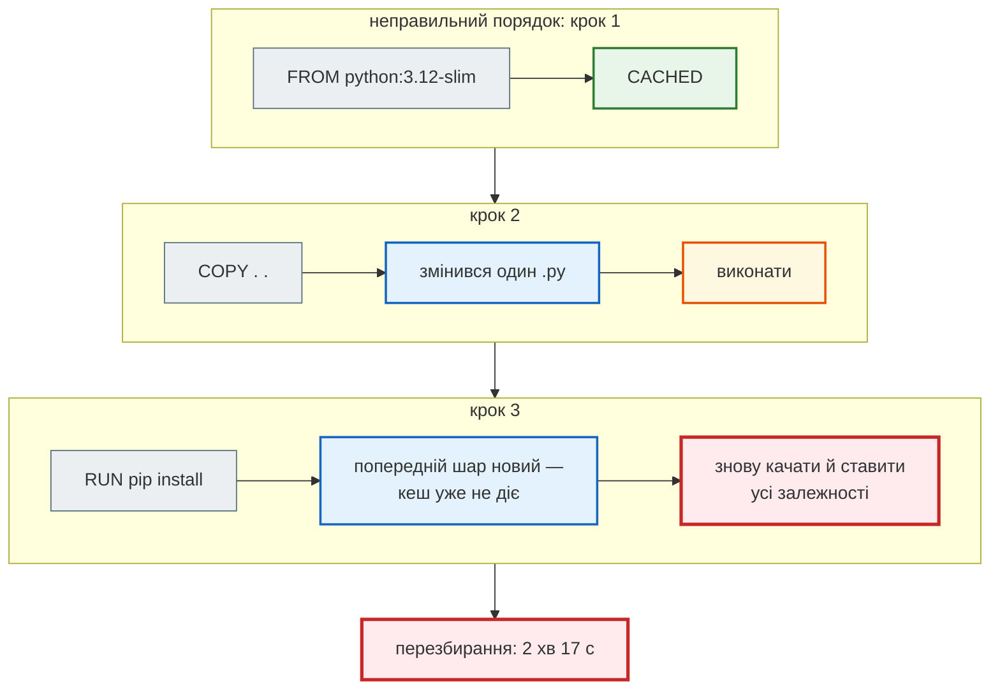

# Шари й кеш

> Крок 10 · розділ 2 з 4. Код: [`Dockerfile`](https://github.com/NikoriakViktor/news_hub/blob/main/steps/10_docker/Dockerfile).
> Теорія: [Частина X. Docker, Compose і CI/CD](../../10_docker_and_ci/README.md).

## Задача { #task }

Змінили один рядок в одному `.py` і перезбираємо образ. Це має тривати секунди, а не стільки, скільки `pip install` усіх залежностей (у вимірах цього розділу — від 35 секунд до двох хвилин, залежно від мережі).

## Як Docker використовує кеш { #how }

Docker виконує `Dockerfile` згори донизу. Для кожної інструкції він перевіряє, чи є в кеші шар, зібраний з **тих самих вхідних даних** (та сама інструкція, ті самі файли для `COPY`) поверх **того самого** попереднього шару. Є — бере готовий (`CACHED`). Немає — виконує інструкцію, і кеш для **всіх наступних** інструкцій уже не використовується.

| Інструкція | Від чого залежить її кеш |
|---|---|
| `FROM python:3.12-slim` | який саме образ під цим тегом лежить локально |
| `ENV …`, `WORKDIR /app`, `USER app` | текст інструкції |
| `COPY requirements.txt .` | вміст `requirements.txt` |
| `RUN pip install …` | текст команди й попередній шар; **не** те, що зараз лежить на PyPI |
| `COPY . .` | вміст усіх файлів контексту, тобто все, що не відсіяв `.dockerignore` |

Тому порядок: від того, що змінюється рідко (базовий образ, залежності), до того, що змінюється щодня (код).

## Зміна: залежності — до коду { #change }

```dockerfile title="Dockerfile (фрагмент)"
WORKDIR /app

# 1. Залежності — окремий шар: він перезбирається, лише коли змінився requirements.txt.
#    Тут лише залежності роботи; pytest, mypy, fakeredis — requirements-dev.txt, в образ не йдуть.
COPY requirements.txt .
RUN pip install --no-cache-dir -r requirements.txt

# 2. Користувач без root …
RUN useradd --uid 10001 --no-create-home --shell /usr/sbin/nologin app \
    && mkdir /data && chown app /data

# 3. Код — останнім: змінюється найчастіше. Власник — root, тож app не може переписати код.
#    Що НЕ копіюється (.env, .venv, tests, …) — .dockerignore.
COPY . .
```

`--no-cache-dir` — щоб pip не зберігав завантажені пакети у своєму кеші всередині шару: в образі вони вже не потрібні, а місце займають.

Стартовий `Dockerfile` уже мав цей порядок — його лишаємо. Нове в кроці 10 — `.dockerignore`: кеші `**/__pycache__`, `.pytest_cache`, `.mypy_cache` змінюються після кожного запуску тестів, і без `.dockerignore` вони інвалідували б шар `COPY . .` навіть тоді, коли код не змінився. А `Dockerfile`, `.dockerignore`, `docker-compose*.yml` в `.dockerignore` — щоб правка самого `Dockerfile` не зачіпала шар коду.

## Результат: перезбирання після зміни одного файлу { #result }

Змінили один `.py` (дописали коментар у `news_hub/models.py`) і перезібрали:

```text
$ echo "# x" >> news_hub/models.py
$ time docker build --progress=plain -t news_hub:10 .
#6 [4/6] RUN pip install --no-cache-dir -r requirements.txt
#6 CACHED
#7 [2/6] WORKDIR /app
#7 CACHED
#8 [3/6] COPY requirements.txt .
#8 CACHED
#9 [5/6] RUN useradd --uid 10001 --no-create-home --shell /usr/sbin/nologin app     && mkdir /data && chown app /data
#9 CACHED
#10 [6/6] COPY . .
#10 DONE 0.1s
real    0m1.654s
```

BuildKit друкує кроки не по порядку (`[4/6]` раніше за `[2/6]`): коли шар береться з кешу, чекати попереднього не треба. Важливо одне: усе до `COPY . .` — `CACHED`.



## А якщо навпаки { #wrong-order }

Той самий проєкт, але `COPY . .` **перед** `pip install`:

```dockerfile title="Dockerfile з неправильним порядком"
FROM python:3.12-slim
WORKDIR /app
COPY . .
RUN pip install --no-cache-dir -r requirements.txt
CMD ["uvicorn", "news_hub.api:app", "--host", "0.0.0.0", "--port", "8000"]
```

```text
$ echo "# y" >> news_hub/models.py
$ time docker build --progress=plain -t news_hub:wrong .
#6 [2/4] WORKDIR /app
#6 CACHED
#7 [3/4] COPY . .
#7 DONE 0.2s
#8 [4/4] RUN pip install --no-cache-dir -r requirements.txt
#8 DONE 127.8s
real    2m17.076s
```

Ще один вимір на тому ж порядку (у Dockerfile з [Знайди помилку](checkpoint.md#find-bug)) — 37.7 с. Розкид — від мережі: `pip install` щоразу заново качає всі пакети. А з правильним порядком мережа не потрібна взагалі.



| Порядок | Перезбирання після зміни одного `.py` |
|---|---|
| `COPY requirements.txt` → `pip install` → `COPY . .` (крок 10) | 1.654 с |
| `COPY . .` → `pip install` | 2 хв 17 с (і 37.7 с в іншому вимірі) |

## Коли кеш залежностей **має** злетіти { #when-rebuild }

- **Змінився `requirements.txt`.** `COPY requirements.txt .` отримує новий вміст → `pip install` і все після нього виконуються заново. Так і треба.
- **Треба свіжі версії без зміни `requirements.txt`.** Кеш не знає, що на PyPI вийшла нова версія: `fastapi>=0.121` у кеші лишиться тією, що встановилась першого разу. Перезібрати без кешу — `docker build --no-cache …`, або оновити базовий образ — `docker build --pull …`.
- **Новий базовий образ.** `docker pull python:3.12-slim` приніс оновлення безпеки → змінився шар `FROM` → перезбирається все.

Версії «від і вище» в `requirements.txt` (`>=`) означають, що два образи, зібрані в різні дні **без кешу**, можуть мати різні версії бібліотек. Що «від і вище» справді працює й на найменших дозволених версіях, перевіряє CI у [кроці 12](../12_ci_cd/index.md).

## Правило { #rule }

!!! tip "Правило"
    Інструкції в `Dockerfile` — від тих, що змінюються рідко, до тих, що змінюються щодня: базовий образ → залежності (`COPY requirements.txt` + `pip install`) → код (`COPY . .`). Зміна коду не повинна зачіпати шар залежностей, а `.dockerignore` не дає кешам і самому `Dockerfile` інвалідувати шар коду.

**Далі:** [Користувач, дані й змінні середовища](user_data_env.md) — від чийого імені працює контейнер і де лежить база.
