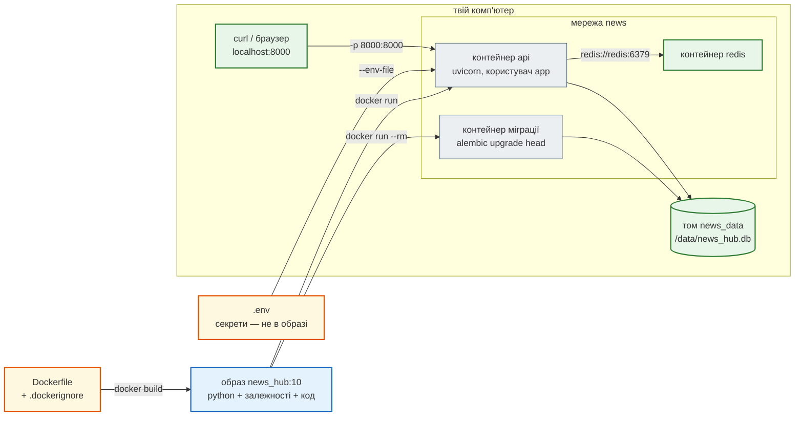
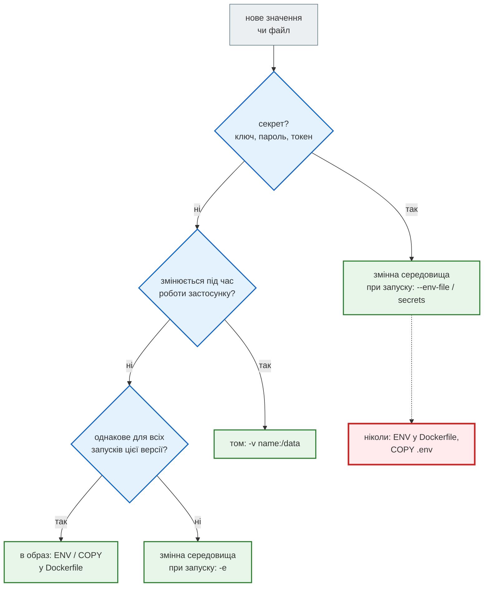

# Користувач, дані й змінні середовища

> Крок 10 · розділ 3 з 4. Код: [`Dockerfile`](https://github.com/NikoriakViktor/news_hub/blob/main/steps/10_docker/Dockerfile), [`news_hub/security.py`](https://github.com/NikoriakViktor/news_hub/blob/main/steps/10_docker/news_hub/security.py).
> Теорія: [Частина X. Docker, Compose і CI/CD](../../10_docker_and_ci/README.md).

## Задача { #task }

Образ зібрано. Тепер — від чийого імені він працює, де пише базу і як отримує налаштування:

- зламаний процес не повинен отримати root і переписати код застосунку;
- база не повинна зникати разом з контейнером;
- `REDIS_URL`, `JWT_SECRET`, ключі — при запуску, а не в образі;
- інші контейнери й твій комп'ютер мають достукатися до API.

## Зміна: `Dockerfile` кроку 10 { #dockerfile }

```dockerfile title="Dockerfile"
FROM python:3.12-slim

# Python у контейнері: .pyc не пишемо (файлова система образу — лише для читання користувачем app),
# stdout без буфера (print одразу в `docker logs`), pip без перевірки нової версії й без попередження
# «pip від root» (у контейнері це нормально: окремого системного Python, який можна зламати, тут немає).
ENV PYTHONDONTWRITEBYTECODE=1 \
    PYTHONUNBUFFERED=1 \
    PIP_DISABLE_PIP_VERSION_CHECK=1 \
    PIP_ROOT_USER_ACTION=ignore

WORKDIR /app

COPY requirements.txt .
RUN pip install --no-cache-dir -r requirements.txt

# 2. Користувач без root: зламаний процес не отримає root у контейнері.
#    Фіксований UID — щоб права на томі збігались між перезбираннями й машинами.
RUN useradd --uid 10001 --no-create-home --shell /usr/sbin/nologin app \
    && mkdir /data && chown app /data

COPY . .

USER app

# SQLite за замовчуванням — на томі /data (у /app користувач app писати не може, і дані б зникли разом
# з контейнером). PostgreSQL і Redis — через змінні середовища під час запуску, не в образі.
ENV DATABASE_URL=sqlite+aiosqlite:////data/news_hub.db

EXPOSE 8000

HEALTHCHECK --interval=30s --timeout=5s --start-period=30s --retries=3 \
    CMD ["python", "-c", "import urllib.request; urllib.request.urlopen('http://127.0.0.1:8000/health', timeout=4)"]

CMD ["uvicorn", "news_hub.api:app", "--host", "0.0.0.0", "--port", "8000"]
```

`HEALTHCHECK` і `CMD` — у [розділі 4](health_shutdown.md). Що змінилось порівняно зі стартовим `Dockerfile`:

| Було | Стало | Чому |
|---|---|---|
| `adduser … appuser` (UID — який випаде) | `useradd --uid 10001 … app` | фіксований UID: права на томі однакові після перезбирання й на іншій машині |
| користувач створений після `COPY . .` | те саме, власник коду — root | `app` не може змінити код застосунку, навіть якщо процес зламали |
| база — `news_hub.db` у `/app` (поточна папка) | `DATABASE_URL=…////data/news_hub.db`, `/data` належить `app` | у `/app` користувач без root писати не може; дані — на томі, а не в контейнері |
| — | `PYTHONUNBUFFERED=1` | `print` і журнал одразу в `docker logs`, а не блоками |
| — | `PYTHONDONTWRITEBYTECODE=1` | `.pyc` не пишуться: `/app` лише для читання, та й файлова система контейнера тимчасова |
| — | `PIP_DISABLE_PIP_VERSION_CHECK`, `PIP_ROOT_USER_ACTION` | pip не ходить у мережу по нову версію й не попереджає «від root» під час збірки |
| — | `EXPOSE 8000` | документація: який порт слухає застосунок; порт відкриває лише `-p` при запуску |
| `--workers 4` | один процес; `WEB_CONCURRENCY` за потреби | [розділ 4](health_shutdown.md#workers) |

Чотири слеші в `sqlite+aiosqlite:////data/news_hub.db`: три — частина схеми URL (`sqlite:///`), четвертий — початок абсолютного шляху `/data/…`. З трьома слешами шлях був би відносним (`data/news_hub.db` у `/app`).

## Результат: хто працює в контейнері { #user }

```text
$ docker run --rm news_hub:10 whoami
app
$ docker run --rm news_hub:10 id
uid=10001(app) gid=10001(app) groups=10001(app)
$ docker run --rm news_hub:10 ls -ld /app /app/news_hub/api.py /data
drwxr-xr-x 1 root root  4096 Nov 11 21:14 /app
-rw-r--r-- 1 root root 40719 Nov 11 21:11 /app/news_hub/api.py
drwxr-xr-x 2 app  root  4096 Nov 11 21:14 /data
$ docker run --rm news_hub:10 touch /app/news_hub/api.py
touch: cannot touch '/app/news_hub/api.py': Permission denied
$ docker run --rm news_hub:10 touch /app/news_hub.db
touch: cannot touch '/app/news_hub.db': Permission denied
$ docker run --rm news_hub:10 touch /data/probe          # exit 0
```

Код належить root і доступний `app` лише для читання; писати можна тільки в `/data`. Тому `DATABASE_URL` за замовчуванням і вказує туди: з базою в `/app` застосунок просто не зміг би створити файл.

!!! warning "Права файлів беруться з контексту збірки"
    `COPY` переносить права файлів такими, як вони лежать у папці. Якщо зібрати образ з диска Windows у WSL (`/mnt/c/…`), усі файли там мають права `777`, і в образі вийде:

    ```text
    $ docker run --rm news_hub:10 ls -l /app/news_hub/api.py
    -rwxrwxrwx 1 root root 40719 Nov 11 15:21 /app/news_hub/api.py
    $ docker run --rm news_hub:10 touch /app/news_hub/api.py   # exit 0 — app може переписати код
    ```

    Власник — root, але писати може будь-хто. Тест `test_runs_as_non_root_and_cannot_change_code` це ловить (при збірці з `/mnt/c` він червоний, з `git clone` у файлову систему Linux — зелений). У WSL збирай з копії в Linux-папці (`git clone` у `~/…`); у CI образ збирається з чистого `git checkout`, де права звичайні (`644`).

## Том: дані переживають контейнер { #volume }

Схема бази — окремим контейнером з того самого образу, на томі `news_data`:

```text
$ docker run --rm -v news_data:/data news_hub:10 alembic upgrade head
INFO  [alembic.runtime.migration] Context impl SQLiteImpl.
INFO  [alembic.runtime.migration] Will assume non-transactional DDL.
INFO  [alembic.runtime.migration] Running upgrade  -> 0001, news table — таблиця новин агрегатора (крок 3)
INFO  [alembic.runtime.migration] Running upgrade 0001 -> 0002, llm analysis — колонки аналізу LLM у таблиці news (крок 7)
INFO  [alembic.runtime.migration] Running upgrade 0002 -> 0003, sources — RSS-джерела, які додає адмін (крок 8)
INFO  [alembic.runtime.migration] Running upgrade 0003 -> 0004, subscriptions — підписки чатів Telegram на ключові слова (крок 9)
```

Контейнер з міграцією завершився й видалився (`--rm`), а таблиці лишились у томі. `-v news_data:/data` — іменований том: Docker створює його сам при першому використанні.

Збираємо новини (токен адміна — як у [кроці 8](../08_security/index.md)), видаляємо контейнер API, запускаємо новий:

```text
$ curl -X POST localhost:8000/api/scrape -H "Authorization: Bearer $TOKEN" -H 'Content-Type: application/json' -d '{"source": "snapshot"}'
{"source":"snapshot","mode":"async","total_time":0.0,"pages":[],"news_found":168,"news_valid":168,"news_saved":168,"news_total":168,"rejected":[]}
$ curl localhost:8000/api/news/count
{"count":168}
$ docker rm -f api
$ docker run -d --name api … -v news_data:/data … news_hub:10
$ curl localhost:8000/api/news/count
{"count":168}
$ docker run --rm -v news_data:/data news_hub:10 ls -l /data
-rw-r--r-- 1 app app 131072 Nov 11 21:20 news_hub.db
```

Файл бази належить `app` (UID 10001). Саме тому UID фіксований: нова версія образу з тим самим UID відкриє той самий файл.

## `localhost` у контейнері — це сам контейнер { #localhost }

Запускаємо API, а Redis працює окремо — «на `localhost`», як у [кроці 4](../04_middleware_redis/index.md):

```text
$ docker run -d --name api -p 8000:8000 -v news_data:/data news_hub:10
$ curl localhost:8000/health
{"status":"ok"} 200
$ curl localhost:8000/health/ready
{"status":"unavailable","checks":{"database":"ok","redis":"ConnectionError"}} 503
$ docker logs api
21:19:34 WARNING news_hub: readiness: Redis недоступний: Error 111 connecting to localhost:6379. Connection refused.
21:19:34 INFO news_hub: 6a1072d3 GET /health/ready → 503 12.3 ms
```

У контейнера своя мережа: `localhost` — це він сам, а Redis там немає. Контейнери бачать одне одного за **іменем** у спільній мережі:

```bash
docker network create news
docker run -d --name redis --network news redis:7-alpine
docker run -d --name api --network news -p 8000:8000 -v news_data:/data \
    -e REDIS_URL=redis://redis:6379/0 --env-file .env news_hub:10
```

```text
$ curl localhost:8000/health/ready
{"status":"ok","checks":{"database":"ok","redis":"ok"}} 200
```

`-p 8000:8000` відкриває порт контейнера для твого комп'ютера: ліворуч — порт комп'ютера, праворуч — контейнера. Саме тому uvicorn слухає `0.0.0.0`, а не `127.0.0.1`: на `127.0.0.1` всередині контейнера до нього не достукався б ніхто ззовні — ні через `-p`, ні з іншого контейнера.



| Що | Де живе | Коли змінюється |
|---|---|---|
| Python, бібліотеки, код | образ | при збиранні нової версії |
| налаштування й секрети | змінні середовища (`-e`, `--env-file`) | при запуску; той самий образ — у тестах і на сервері |
| дані | том | під час роботи; переживають контейнер і нову версію образу |

## `--env-file` бере значення буквально { #env-file }

`python -m news_hub.security` з [кроку 8](../08_security/index.md) друкує рядки для `export` у shell — з одинарними лапками, бо в bcrypt-хеші є `$`. `docker run --env-file` лапок не знімає:

```text
$ cat .env
ADMIN_PASSWORD_HASH='$2b$12$ef/LlazLBMrY…'
JWT_SECRET='NbqY16cXL0q5cYJOCDRUzTlB9tV0…'
$ docker run -d --name api --network news -p 8000:8000 -v news_data:/data \
    -e REDIS_URL=redis://redis:6379/0 --env-file .env news_hub:10
$ docker ps -a
NAMES     STATUS
api       Exited (3) 1 second ago
$ docker logs api
RuntimeError: ADMIN_PASSWORD_HASH — bcrypt-хеш ($2b$…), а не пароль; згенеруй: python -m news_hub.security

ERROR:    Application startup failed. Exiting.
```

Значення змінної — `'$2b$12$…'` разом з лапками, а це вже не bcrypt-хеш. Добре, що застосунок **впав одразу** (fail fast, крок 8), а не мовчки працював без адмінки.

Тому в кроці 10 у `security.py` з'явилась опція `--env-file` — рядки без лапок:

```python title="news_hub/security.py (фрагмент)"
def env_lines(password: str, quoted: bool = True) -> list[str]:
    """Рядки ADMIN_PASSWORD_HASH і JWT_SECRET.

    quoted=True — для `export` у shell і `.env` Compose: у хеші є `$`, одинарні лапки не дають його підставити.
    quoted=False — для `docker run --env-file` (крок 10): там значення береться буквально, разом з лапками,
    і хеш у лапках уже не хеш — застосунок не стартує.
    """
    q = "'" if quoted else ""
    return [f"ADMIN_PASSWORD_HASH={q}{hash_password(password)}{q}", f"JWT_SECRET={q}{secrets.token_urlsafe(48)}{q}"]
```

Генерувати можна й у самому образі — Python з бібліотеками вже там:

```text
$ docker run --rm -it news_hub:10 python -m news_hub.security --env-file
Пароль адміністратора:
ADMIN_PASSWORD_HASH=$2b$12$.pEbfXfaQEytBeJz0Jvgzum…
JWT_SECRET=2nzDsOgDUB7bRD16J8vcGHaQwWnMb7lBn-dN0IS…
```

З цими рядками в `.env`:

```text
$ docker ps
NAMES     STATUS
api       Up 3 seconds (health: starting)
$ curl localhost:8000/health/ready
{"status":"ok","checks":{"database":"ok","redis":"ok"}} 200
```

Тест `test_env_lines_give_a_working_hash` перевіряє обидва варіанти: з лапками `load_admin_settings` падає з `bcrypt`, без лапок — дає робочі налаштування. Compose у [кроці 11](../11_compose_deploy/index.md) читає `.env` інакше: там лапки знімаються.

## Куди що класти { #how-to-choose }



Приклади з News Hub: `GEMINI_API_KEY`, `BOT_TOKEN`, `JWT_SECRET` → при запуску (секрет); `data/rbc_news_snapshot.json`, `migrations/` → в образ; `news_hub.db` → том; `REDIS_URL`, `WEB_CONCURRENCY` → `-e` (на ноутбуці й на сервері різні). `DATABASE_URL` в образі — лише значення за замовчуванням; `-e DATABASE_URL=postgresql+asyncpg://…` його перекриває.

## Правило { #rule }

!!! tip "Правило"
    Контейнер працює від користувача без root з фіксованим UID; код належить root, писати можна лише в том з даними. Налаштування й секрети — змінними середовища при запуску, ніколи в образі. Інші контейнери — за іменем у спільній мережі, бо `localhost` у контейнері — це він сам; сервер слухає `0.0.0.0`.

**Далі:** [Здоров'я і зупинка](health_shutdown.md) — як Docker дізнається, що застосунок живий, і як зупинити його без втрат.
