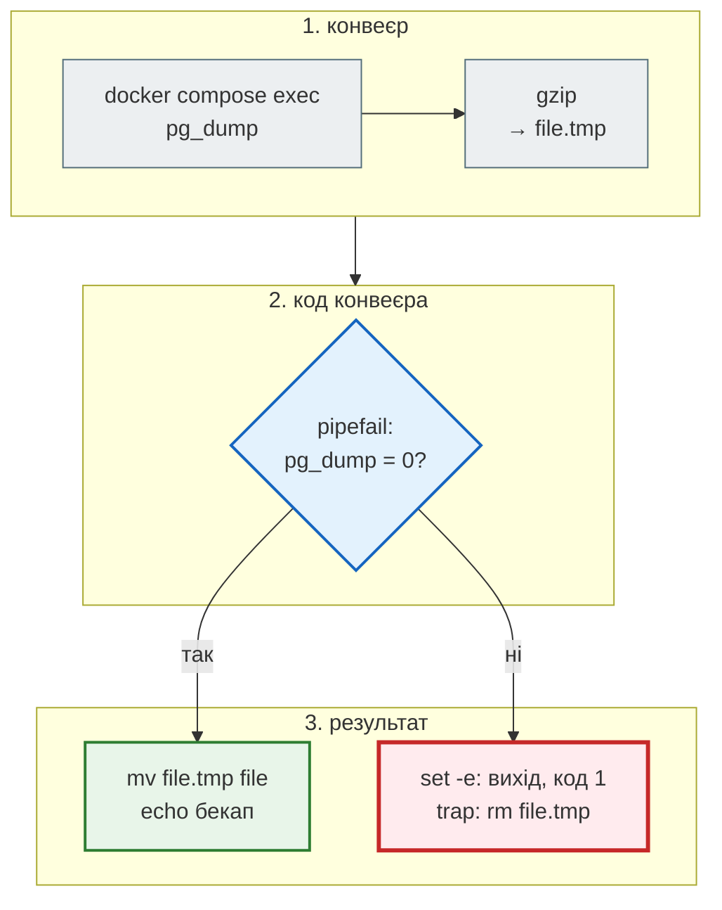

# Бекап і відновлення

> Крок 11 · розділ 6 з 6. Код: [`scripts/backup.sh`](https://github.com/NikoriakViktor/news_hub/blob/main/steps/11_compose_deploy/scripts/backup.sh), [`scripts/restore.sh`](https://github.com/NikoriakViktor/news_hub/blob/main/steps/11_compose_deploy/scripts/restore.sh).

## Задача { #task }

Дані News Hub живуть у томі `pgdata`. Том переживає перезапуск і оновлення контейнерів, але не переживе `docker compose down -v`, помилковий `DELETE /api/news`, зламаний диск чи невдалу міграцію. Потрібна копія бази, яку можна зробити однією командою (і щоночі з cron), — і, головне, **з якої реально відновлюються**.

## Зміна: `backup.sh` { #backup }

```bash title="scripts/backup.sh"
#!/usr/bin/env bash
# Бекап бази news_hub з контейнера PostgreSQL. Крок 11.
#   ./scripts/backup.sh [папка]          → backups/news_hub-20260928-101500.sql.gz
# На сервері — щоночі з cron:  15 3 * * *  cd /srv/news_hub && ./scripts/backup.sh >> backups/backup.log 2>&1
set -euo pipefail        # pipefail: без нього впалий pg_dump дав би «успішний» порожній архів

cd "$(dirname "$0")/.."
dir="${1:-backups}"
mkdir -p "$dir"
file="$dir/news_hub-$(date +%Y%m%d-%H%M%S).sql.gz"
trap 'rm -f "$file.tmp"' EXIT                   # впало посередині — недописаного файлу не лишаємо

# --clean --if-exists: у дампі є DROP перед CREATE — відновлення працює і поверх наявної бази
docker compose exec -T postgres sh -c 'pg_dump -U "$POSTGRES_USER" -d "$POSTGRES_DB" --clean --if-exists --no-owner' \
    | gzip > "$file.tmp"
mv "$file.tmp" "$file"
echo "бекап: $file ($(du -h "$file" | cut -f1))"
```

| Рядок | Навіщо |
|---|---|
| `set -euo pipefail` | `-e` — зупинитись на першій помилці; `-u` — неоголошена змінна є помилкою; `pipefail` — код конвеєра `pg_dump \| gzip` — це код **першої** команди, що впала. Без `pipefail` код конвеєра — код `gzip`, а він успішно стисне порожній вхід |
| `cd "$(dirname "$0")/.."` | скрипт працює з будь-якої поточної папки — `docker compose` має бачити `docker-compose.yml` і `.env` |
| `file.tmp`, потім `mv` | файл з правильним іменем з'являється лише тоді, коли дамп дописано повністю |
| `trap 'rm -f "$file.tmp"' EXIT` | впав `pg_dump` — тимчасовий файл видаляється, порожніх «бекапів» не лишається |
| `exec -T` | без псевдотерміналу: вивід `pg_dump` іде в конвеєр байт у байт |
| `sh -c '… "$POSTGRES_USER" …'` в одинарних лапках | змінні розкриває shell **усередині** контейнера, де вони задані, — пароль і ім'я користувача не потрапляють у скрипт |
| `--clean --if-exists --no-owner` | у дампі `DROP … IF EXISTS` перед кожним `CREATE` — відновлювати можна поверх наявної бази; без прив'язки до власника |

## Зміна: `restore.sh` { #restore }

```bash title="scripts/restore.sh"
#!/usr/bin/env bash
# Відновити базу news_hub з бекапу. Крок 11.   ./scripts/restore.sh backups/news_hub-….sql.gz
# Поточні дані в базі буде ЗАМІНЕНО даними з бекапу.
set -euo pipefail

cd "$(dirname "$0")/.."
if [[ $# -ne 1 || ! -f "$1" ]]; then
    echo "usage: scripts/restore.sh BACKUP.sql.gz" >&2
    exit 2
fi

gunzip -c "$1" | docker compose exec -T postgres sh -c 'psql -U "$POSTGRES_USER" -d "$POSTGRES_DB" -v ON_ERROR_STOP=1 -q -o /dev/null'
docker compose exec -T redis redis-cli FLUSHDB > /dev/null     # кеш стрічки й статистики — від старих даних
echo "відновлено з $1"
```

- `-v ON_ERROR_STOP=1` — перша помилка SQL зупиняє `psql` з кодом ≠ 0, а не «відновлює» половину.
- `FLUSHDB` у Redis — кеш стрічки й статистики (крок 4) зберігся від даних **до** відновлення; без очищення `GET /api/news` ще якийсь час віддавав би старе.

Покроково — що відбувається з `backup.sh`, коли база недоступна:



## Результат: бекап → «аварія» → відновлення { #result }

Новини зібрано зі знімка (168 штук), потім:

```text
$ ./scripts/backup.sh
бекап: backups/news_hub-20261111-211920.sql.gz (20K)

$ curl -X DELETE localhost:8091/api/news -H "Authorization: Bearer $TOKEN"      # «аварія»
$ curl localhost:8091/api/news/count
{"count":0}

$ ./scripts/restore.sh backups/news_hub-20261111-211920.sql.gz
відновлено з backups/news_hub-20261111-211920.sql.gz
$ curl localhost:8091/api/news/count
{"count":168}
```

Без аргументу:

```text
$ ./scripts/restore.sh; echo "код: $?"
usage: scripts/restore.sh BACKUP.sql.gz
код: 2
```

Бекап, коли база не працює:

```text
$ docker compose stop postgres && ./scripts/backup.sh; echo "код: $?"
 Container newshub-step11-bookcheck-postgres-1  Stopped
service "postgres" is not running
код: 1
$ ls backups/
news_hub-20261111-211920.sql.gz          ← лише попередній, жодного порожнього файлу
```

!!! note "Ім'я проєкту Compose"
    Скрипти викликають `docker compose exec` без `-p`, тож працюють зі стеком з ім'ям `news_hub` (ключ `name:` у
    `docker-compose.yml`). Якщо стек запущено з іншим ім'ям (`docker compose -p …`), задай його й для скриптів:
    `COMPOSE_PROJECT_NAME=<ім'я> ./scripts/backup.sh` — так їх і запускали для цієї сторінки.

## На сервері { #server }

```bash
crontab -e
# щоночі о 03:15 — рядок з коментаря backup.sh; шлях — папка стеку на сервері
15 3 * * *  cd /srv/news_hub && ./scripts/backup.sh >> backups/backup.log 2>&1
```

- `backups/` — у `.gitignore`: дампи бази в git не потрапляють. І в `.dockerignore` — в образ теж.
- Файл бекапу — **ще й на інший сервер** чи в об'єктне сховище: диск може вмерти разом з базою.
- Старі бекапи прибирати: скрипт кроку їх не видаляє.
- Періодично — відновлення на копії стеку (інше ім'я проєкту, інший `HTTP_PORT`) і перевірка даних, як вище.

## Правило { #rule }

!!! tip "Правило"
    Бекап, з якого жодного разу не відновлювались, — не бекап. Скрипт бекапу — з `set -euo pipefail` і тимчасовим файлом, щоб збій давав код ≠ 0 і **жодного** «успішного» порожнього архіву. Після відновлення — очистити кеш, що зберігся від старих даних.

**Документація:** [`pg_dump`](https://www.postgresql.org/docs/16/app-pgdump.html), [`psql`](https://www.postgresql.org/docs/16/app-psql.html).

**Далі:** [Контрольна точка](checkpoint.md) — тести, практика, самоперевірка.
