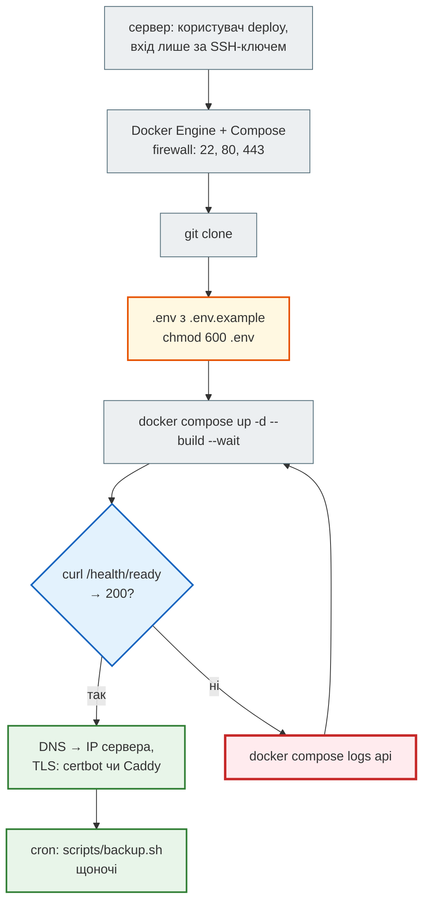
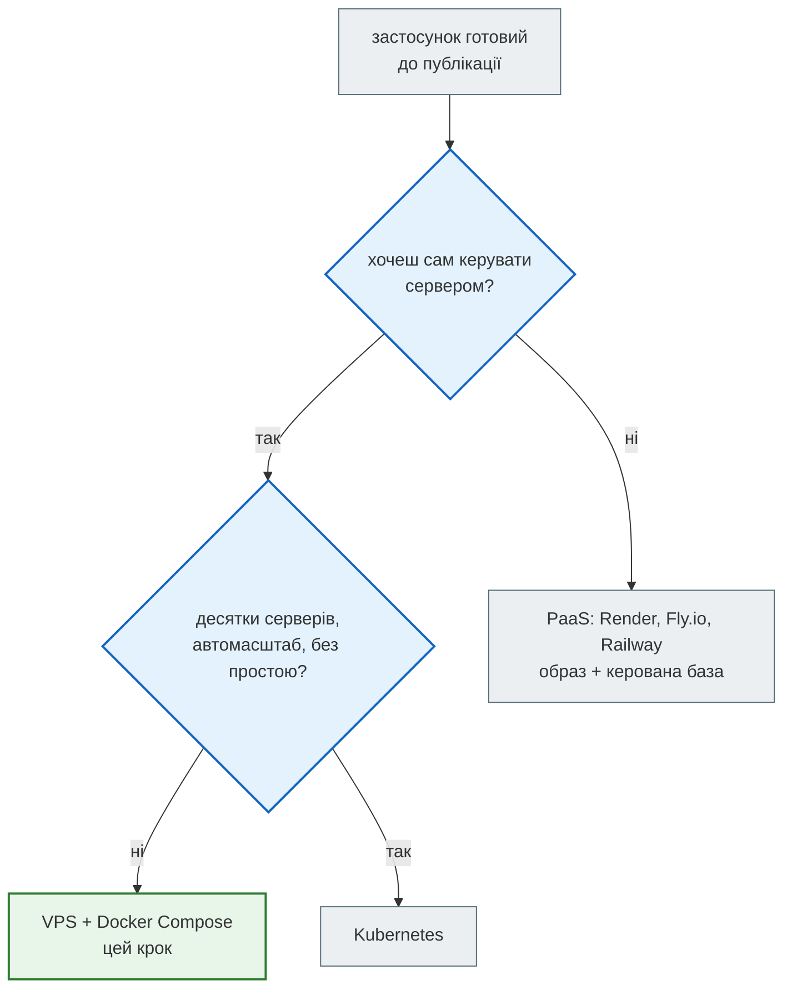

# Деплой на сервер

> Крок 11 · розділ 5 з 6. Код: [`docker-compose.yml`](https://github.com/NikoriakViktor/news_hub/blob/main/steps/11_compose_deploy/docker-compose.yml), [`docker-compose.dev.yml`](https://github.com/NikoriakViktor/news_hub/blob/main/steps/11_compose_deploy/docker-compose.dev.yml), [`nginx/nginx.conf`](https://github.com/NikoriakViktor/news_hub/blob/main/steps/11_compose_deploy/nginx/nginx.conf).

## Задача { #task }

Перенести стек на сервер у інтернеті, відкрити назовні лише те, що потрібно, оновлювати його після кожного `git pull` і, коли треба, запускати API в кількох копіях.

!!! warning "Що тут перевірено, а що ні"
    Сервер — звичайний Linux з Docker (VPS за кілька доларів на місяць). Кроки самого сервера нижче (користувач,
    SSH, firewall, DNS, сертифікат) — стандартні, але **на справжньому сервері для цієї сторінки не виконувались**.
    Усе, що стосується самого стеку (`up --wait`, оновлення і простій, репліки, порти dev-файлу), перевірено
    локально тими самими командами — виводи нижче з цих запусків.

## Сервер: від порожньої машини до `/health/ready` { #server }



```bash
# 1. на сервері (Ubuntu 24.04), від root один раз
adduser deploy && usermod -aG docker deploy      # група docker — фактично root: лише довіреним
# вхід за ключем; у /etc/ssh/sshd_config: PasswordAuthentication no
ufw allow OpenSSH && ufw allow 80,443/tcp && ufw enable

# 2. від deploy
git clone https://github.com/NikoriakViktor/news_hub.git ~/news_hub
cd ~/news_hub/steps/11_compose_deploy
cp .env.example .env && chmod 600 .env && nano .env
docker compose up -d --build --wait
curl localhost/health/ready
```

- `chmod 600 .env` — читати й писати може лише власник: у файлі пароль бази, хеш адміна, секрет JWT, токен бота.
- `up -d --build --wait` повертає код ≠ 0, якщо щось не стало healthy, — тому «зелена» команда вже означає «система працює» ([розділ 1](startup_order.md#result)).
- `HTTP_PORT` у `.env` — якщо порт 80 на сервері зайнятий іншим nginx (тоді він і проксує на `HTTP_PORT`).

!!! warning "Docker і firewall"
    `ports: ["5432:5432"]` відкриває порт **в обхід ufw**: Docker сам пише правила iptables. Тому в `docker-compose.yml` портів у бази й Redis немає зовсім, а для розробки — окремий `docker-compose.dev.yml` з адресою `127.0.0.1`. На сервері цей файл не використовують.

Що дає `docker-compose.dev.yml` (з `docker compose config`):

```text
$ docker compose -f docker-compose.yml -f docker-compose.dev.yml config --format json   # ports кожного сервісу
postgres [{'host_ip': '127.0.0.1', 'target': 5432, 'published': '5432', …}]
redis    [{'host_ip': '127.0.0.1', 'target': 6379, 'published': '6379', …}]
api      None
nginx    [{'target': 80, 'published': '8091', …}]
```

Без `host_ip` порт слухає на `0.0.0.0` — на всіх адресах сервера, як `nginx`. З `127.0.0.1` — лише на самій машині.

## HTTPS { #https }

У `nginx.conf` кроку TLS немає — він слухає лише `listen 80`. На сервері HTTPS потрібен обов'язково: Telegram надсилає webhook лише на `https://`, а пароль адміна й токен у заголовку `Authorization` по http ідуть відкритим текстом. Два типові шляхи:

| Шлях | Як |
|---|---|
| certbot на сервері | отримує сертифікат Let's Encrypt; у `nginx.conf` додається блок `listen 443 ssl` з `ssl_certificate` / `ssl_certificate_key` (файли — томом у контейнер nginx) і перенаправлення з 80 на 443 |
| Caddy перед стеком | окремий проксі, що отримує й оновлює сертифікати сам; стек слухає на `HTTP_PORT`, Caddy — на 80/443 |

Після цього `X-Forwarded-Proto $scheme` у nginx передає застосунку `https`, а `TELEGRAM_WEBHOOK_URL=https://<домен>/api/telegram/webhook`.

## Оновлення і простій { #update }

```bash
git pull && docker compose up -d --build --wait
```

Перевірка: у копії кроку змінено один рядок у `news_hub/api.py`, і та сама команда, поки кожні 0,5 с йшов запит `GET /api/news/count` через nginx:

```text
 news_hub:11  Built
 Container newshub-step11-bookcheck-postgres-1  Running
 Container newshub-step11-bookcheck-redis-1  Running
 Container newshub-step11-bookcheck-migrate-1  Recreated     ← нова версія: міграції знову, один раз
 Container newshub-step11-bookcheck-api-1  Recreated
 Container newshub-step11-bookcheck-nginx-1  Running
 …
 Container newshub-step11-bookcheck-api-1  Healthy
 Container newshub-step11-bookcheck-nginx-1  Healthy

$ sort poll.txt | uniq -c                 # коди відповідей за час оновлення
    145 200
     14 502
      1 000
```

- **Перезапускається лише змінене**: `postgres`, `redis`, `nginx` — `Running`, `migrate` і `api` — `Recreated`, бо змінився образ.
- `alembic upgrade head` на базі, де всі міграції вже є, нічого не робить і завершується з кодом 0. Нова міграція в коді — і вона виконається саме тут, один раз, до нового `api`.
- **Простій ~7 с**: поки старий `api` зупинено, а новий ще не готовий, nginx відповідає `502`. Без простою — дві копії й перезапуск по черзі або новий стек поруч і перемикання nginx (blue-green). Для навчального проєкту кілька секунд — прийнятна ціна простоти.

## Кілька копій API { #replicas }

Rate limit, кеш і статуси фонових задач News Hub зберігає в Redis (крок 4), а не в пам'яті процесу. Тож API можна запустити в кількох копіях:

```bash
docker compose up -d --scale api=2 --wait
```

```text
 Container newshub-step11-bookcheck-api-1  Healthy
 Container newshub-step11-bookcheck-api-2  Healthy
```

Але nginx визначив адресу `api` **один раз, при старті**: чотири спроби входу — усі на першу копію:

```text
401 401 401 401
api-1: 4
api-2: 0
```

```bash
docker compose exec nginx nginx -s reload        # nginx знову питає DNS Compose: api → 2 адреси
```

Після цього 40 запитів по черзі розійшлися `api-1: 21, api-2: 19`, а 40 одночасних — `20 / 20`. А ліміт входу — **один на обидві копії**:

```text
$ for i in $(seq 1 12); do curl … -X POST localhost:8091/api/admin/token …; done
401 401 401 401 401 429 429 429 429 429 429 429
api-1: 6, api-2: 6
$ docker compose exec redis redis-cli --scan --pattern 'rate:*'
rate:login:10.28.0.1
```

Запити розійшлися порівну, а шоста спроба — `429`: лічильник один, у Redis. Якби rate limit жив у словнику Python, кожна копія рахувала б свої п'ять — і з N копіями зловмисник мав би 5·N спроб.

!!! note "Чому короткий ряд може піти на одну копію"
    У nginx кілька робочих процесів (`worker_processes auto` — за кількістю ядер, у цьому запуску 16), і в кожного свій лічильник
    round-robin. Сім спроб одразу після `reload` одного разу всі потрапили на `api-2`. На довшому ряду
    розподіл вирівнюється (21 / 19 на сорока).

Чому `migrate` окремо, видно саме тут: `--scale api=2` створює дві копії `api`, а міграції виконуються один раз, до них ([розділ 1](startup_order.md#release)).

## Де запускати { #where-to-run }



Той самий образ підходить для всіх трьох: PaaS і Kubernetes запускають контейнер з тими самими змінними середовища й перевірками здоров'я (`/health` — живий, `/health/ready` — готовий). Compose на одному сервері — найпростіший варіант, де видно кожну частину системи.

## Правило { #rule }

!!! tip "Правило"
    Назовні — лише проксі (80/443); база й Redis — без `ports`, бо Docker відкриває порти в обхід firewall. Секрети — у `.env` з правами 600. Оновлення — `git pull && docker compose up -d --build --wait`, і «зелена» команда означає «працює». Копії API можливі лише тоді, коли весь спільний стан (ліміти, кеш, задачі) — у Redis чи базі, а не в пам'яті процесу.

**Документація:** [Docker: packet filtering and firewalls](https://docs.docker.com/engine/network/packet-filtering-firewalls/), [certbot](https://certbot.eff.org/).

**Далі:** [Бекап і відновлення](backup_restore.md) — що робити, коли дані зникли.
