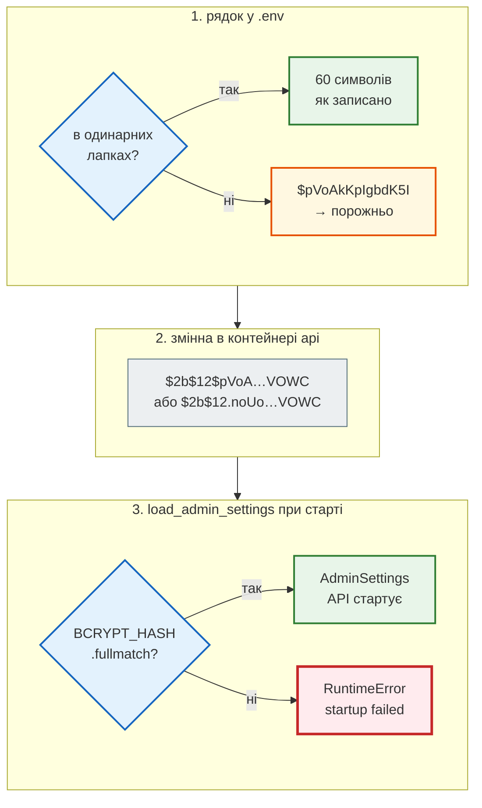

# Секрети в `.env`: `$` і лапки

> Крок 11 · розділ 3 з 6. Код: [`.env.example`](https://github.com/NikoriakViktor/news_hub/blob/main/steps/11_compose_deploy/.env.example), [`news_hub/security.py`](https://github.com/NikoriakViktor/news_hub/blob/main/steps/11_compose_deploy/news_hub/security.py), [`tests/unit/test_security.py`](https://github.com/NikoriakViktor/news_hub/blob/main/steps/11_compose_deploy/tests/unit/test_security.py).
> Теорія: [`$` у `.env`](../../02_typing_and_pydantic/settings.md#dollar).

## Задача { #task }

Пароль бази, хеш пароля адміна, секрет JWT, токен бота мають потрапити в контейнери, але **не в git** і не в образ. І те, що потрапило, має бути саме тим, що записали, до останнього символу.

## Зміна 1: `.env` поза git, обов'язкові змінні { #env-file }

Усі змінні стеку перелічено в `.env.example` — він у git, значень у ньому немає. Справжній `.env` створюють з нього і тримають лише локально й на сервері:

```bash title=".env.example (початок)"
# Скопіюй у .env і заповни: cp .env.example .env    (.env — у .gitignore і .dockerignore)
# Compose читає .env сам: і для ${ЗМІННИХ} у docker-compose.yml, і як env_file для api/bot.
# Значення з `$` (bcrypt-хеш) — ЛИШЕ в одинарних лапках: без лапок Compose підставить $змінні й зіпсує хеш.

# PostgreSQL. Пароль — без символів @ : / ? # (він стає частиною URL); згенерувати:
#   python -c "import secrets; print(secrets.token_urlsafe(24))"
POSTGRES_DB=news_hub
POSTGRES_USER=news
POSTGRES_PASSWORD=

# Адмін news_hub (крок 8): рядки дає python -m news_hub.security — уже з одинарними лапками
ADMIN_USERNAME=admin
ADMIN_PASSWORD_HASH=
JWT_SECRET=
```

Далі в ньому — ліміт невдалих входів на одне ім'я, `WEBHOOK_SECRET`, `LLM_PROVIDER`, `GEMINI_API_KEY`, змінні Telegram, `HTTP_PORT=80`, закоментовані `EDGE_SUBNET` і `NGINX_IP` і `DOCS_ENABLED`:

```bash title=".env.example (фрагменти)"
# Невдалих входів під одним іменем (з усіх адрес разом), після яких вхід закрито на вікно (секунд)
LOGIN_FAIL_LIMIT=20
LOGIN_FAIL_WINDOW=900

# Telegram (крок 9), необов'язково: без BOT_TOKEN бота немає
BOT_TOKEN=
# id адмінів у Telegram через кому (/scrape). Працює лише разом з адміном вище (JWT_SECRET і хеш пароля)
BOT_ADMIN_IDS=
TELEGRAM_WEBHOOK_URL=
TELEGRAM_WEBHOOK_SECRET=
TELEGRAM_API_URL=

# Порт nginx на сервері
HTTP_PORT=80

# Мережа edge (nginx ↔ api). Типово 172.28.0.0/24 і nginx на 172.28.0.10. Docker пише «Pool overlaps with
# other one on this address space» — ця підмережа на машині зайнята: взяти іншу, NGINX_IP — адреса з неї
#EDGE_SUBNET=10.231.9.0/24
#NGINX_IP=10.231.9.10

# /docs, /redoc і /openapi.json на сервері (Compose за замовчуванням — false)
DOCS_ENABLED=false
```

Усі вони необов'язкові: без ключа LLM аналіз відповідає `503`, без `BOT_TOKEN` бота немає. `LOGIN_FAIL_*` — лічильник невдач на ім'я з [кроку 8](../08_security/admin_jwt.md#login-lockout). Коментар над `BOT_ADMIN_IDS` — не формальність: `BOT_ADMIN_IDS` без `JWT_SECRET` і `ADMIN_PASSWORD_HASH` зупиняє старт `api` і `bot` ([крок 9](../09_telegram_bot/polling_webhook.md#bot-admins)).

**`DOCS_ENABLED` — у `docker-compose.yml`, не лише в `.env`.** Локально (`uvicorn` без змінної) `/docs` працює, як і в усіх попередніх кроках. Сервер — інша справа: Swagger і `/openapi.json` — повна карта ендпоінтів для будь-кого в інтернеті. Тому Compose вимикає їх для `api` сам, навіть якщо рядка в `.env` немає:

```yaml title="docker-compose.yml (фрагмент)"
  api:
    environment:
      <<: *app-env
      FORWARDED_ALLOW_IPS: ${NGINX_IP:-172.28.0.10}
      # /docs і /openapi.json на сервері — карта всіх ендпоінтів для будь-кого; увімкнути: DOCS_ENABLED=true у .env
      DOCS_ENABLED: ${DOCS_ENABLED:-false}
```

`${DOCS_ENABLED:-false}` — значення з `.env`, а якщо його немає — `false`. Безпечне значення — за замовчуванням; щоб увімкнути документацію на сервері, треба написати `DOCS_ENABLED=true` свідомо. Перевірка — у smoke-тесті [кроку 12](../12_ci_cd/what_to_check.md): `/docs` через nginx → `404`.

Compose читає `.env` поруч із `docker-compose.yml` **двічі**:

1. для `${ЗМІННИХ}` у самому `docker-compose.yml` (`${POSTGRES_PASSWORD}`, `${HTTP_PORT:-80}`);
2. як `env_file: .env` — змінні середовища процесу в контейнерах `migrate`, `api`, `bot`.

Пароль бази тепер не у файлі, а обов'язковий:

```yaml
POSTGRES_PASSWORD: ${POSTGRES_PASSWORD:?задай POSTGRES_PASSWORD у .env}
```

Перевірка: `.env` — щойно скопійований `.env.example`, пароль порожній:

```text
$ cp .env.example .env && docker compose config > /dev/null; echo "exit=$?"
Error while interpolating x-app.environment.DATABASE_URL: required variable POSTGRES_PASSWORD is missing a value: задай POSTGRES_PASSWORD у .env
exit=1
```

| Запис | Немає змінної або порожня |
|---|---|
| `${VAR}` | порожній рядок і попередження |
| `${VAR:-news}` | значення за замовчуванням `news` |
| `${VAR:?текст}` | помилка з цим текстом — нічого не запускається |

Пароль бази стає частиною `DATABASE_URL` (`postgresql+asyncpg://news:<пароль>@postgres:5432/…`), тому в ньому не має бути `@ : / ? #` — звідси `secrets.token_urlsafe`, що дає лише літери, цифри, `-` і `_`.

## Проблема: `$` у хеші bcrypt { #dollar }

Рядки для адміна дає `python -m news_hub.security` (крок 8). Хеш bcrypt складається з трьох частин через `$`:

```text
ADMIN_PASSWORD_HASH='$2b$12$pVoAkKpIgbdK5I.noUozvudJuEs4IKmrH31LRUW.eCx2XdVhcVOWC'
JWT_SECRET='CN4Pm7MPiVP7ayN6g6lrqdWqI7YbOQ56Y7yaHljINGHxM0Y2PR38ONyfLzdoFEPq'
```

(Це рядки одноразового перевірочного стеку; свої згенеруй самостійно, чужий секрет JWT дає змогу випустити токен адміна.) `$2b` — алгоритм, `$12` — вартість (2¹² ітерацій), далі 53 символи солі й хешу. Що буде, якщо записати хеш у `.env` **без лапок**? `docker compose config` показує, що отримає контейнер:

```text
$ grep HASH .env
ADMIN_PASSWORD_HASH=$2b$12$pVoAkKpIgbdK5I.noUozvudJuEs4IKmrH31LRUW.eCx2XdVhcVOWC
$ docker compose config | grep -E "warn|ADMIN_PASSWORD_HASH"
level=warning msg="The \"pVoAkKpIgbdK5I\" variable is not set. Defaulting to a blank string."
      ADMIN_PASSWORD_HASH: $$2b$$12.noUozvudJuEs4IKmrH31LRUW.eCx2XdVhcVOWC
```

Compose прочитав `$pVoAkKpIgbdK5I` як змінну (ім'я — до першого символу, що не літера, цифра чи `_`, тут — до `.`), такої змінної немає — підставив порожнечу. `$2b` і `$12` вціліли: ім'я змінної не може починатися з цифри. У виводі `config` `$$` — це запис одного `$`. Отже, контейнер отримав `$2b$12.noUozvud…` — 45 символів замість 60. Скільки саме зникне, залежить від солі: якщо в ній немає `.` і `/`, від хешу лишиться лише `$2b$12`.

З одинарними лапками — нічого не підставлено:

```text
      ADMIN_PASSWORD_HASH: $$2b$$12$$pVoAkKpIgbdK5I.noUozvudJuEs4IKmrH31LRUW.eCx2XdVhcVOWC
```

| Інструмент | Лапки | `$змінна` |
|---|---|---|
| `export X='…'` у bash | знімає | в одинарних — ні, у подвійних і без лапок — підставляє |
| `.env` для Compose | знімає | в одинарних — ні, у подвійних і без лапок — підставляє |
| `docker run --env-file` (крок 10) | **лишає** | не підставляє |

Тому `python -m news_hub.security` друкує рядки в одинарних лапках (для shell і Compose), а з `--env-file` — без лапок (для `docker run --env-file`, де лапки стали б частиною значення).

## Зміна 2: обрізаний хеш зупиняє старт { #startup-check }

У кроці 8 `load_admin_settings` перевіряв лише, що хеш «починається з `$2`». Обрізаний хеш цю перевірку проходив, застосунок стартував, а вхід адміна падав з `500` — **під час роботи**, на першому ж запиті, а не при запуску. Тепер — повний формат:

```python title="news_hub/security.py (фрагмент)"
BCRYPT_HASH = re.compile(r"\$2[aby]\$\d{2}\$[./A-Za-z0-9]{53}")     # $2b$12$ + сіль і хеш (22 + 31)
...
    if not BCRYPT_HASH.fullmatch(password_hash):
        # Крок 11: не лише «починається з $2» — Compose підставляє $змінні в .env без лапок, і обрізаний
        # хеш «$2b$12» проходив цю перевірку, а вхід відповідав 500. Тепер — помилка при старті.
        raise RuntimeError("ADMIN_PASSWORD_HASH — bcrypt-хеш ($2b$12$ + 53 символи), а не пароль і не обрізаний "
                           "рядок; у .env для Compose — в одинарних лапках; згенеруй: python -m news_hub.security")
```

`fullmatch`, а не `match`: увесь рядок має бути хешем, без хвостів і без нестачі. І тест на саме цей випадок:

```python title="tests/unit/test_security.py (фрагмент)"
def test_truncated_hash_fails_at_startup() -> None:
    """Крок 11: Compose підставляє `$змінні` у .env без лапок — від хешу лишається «$2b$12».

    Раніше це проходило перевірку «починається з $2», застосунок стартував, а вхід адміна відповідав 500.
    """
    full = bcrypt_hash("s3cret")
    truncated = full[:6]                                              # "$2b$04" — як після підстановки
    with pytest.raises(RuntimeError, match="одинарних лапках"):
        load_admin_settings({"JWT_SECRET": SECRET, "ADMIN_PASSWORD_HASH": truncated})
    assert load_admin_settings({"JWT_SECRET": SECRET, "ADMIN_PASSWORD_HASH": full}) is not None
```

Як хеш проходить шлях від `.env` до перевірки:



## Результат { #result }

```text
$ pytest -q tests/unit/test_security.py tests/integration/test_telegram_webhook.py
33 passed in 1.60s
```

І наживо: той самий `.env` без лапок, `docker compose up -d --wait`:

```text
 Container newshub-step11-bookcheck-postgres-1  Healthy
 Container newshub-step11-bookcheck-migrate-1  Exited
 Container newshub-step11-bookcheck-redis-1  Healthy
container newshub-step11-bookcheck-api-1 is unhealthy

$ docker compose logs api
api-1  | RuntimeError: ADMIN_PASSWORD_HASH — bcrypt-хеш ($2b$12$ + 53 символи), а не пароль і не обрізаний рядок; у .env для Compose — в одинарних лапках; згенеруй: python -m news_hub.security
api-1  | ERROR:    Application startup failed. Exiting.

$ docker compose ps api
api Up Less than a second (health: starting)      ← restart: unless-stopped, перезапуск по колу
```

Помилка — при запуску, з поясненням, що виправити, і до першого користувача. Повернули лапки — `up -d --wait` знову зелений, `/health/ready` → `{"status":"ok",…}`.

## Права на `.env` і де він живе { #where }

- `.env` — у `.gitignore` (новий файл кроку, разом з `backups/`) і в `.dockerignore`: в образ він не потрапляє ніколи, змінні приходять лише під час запуску.
- На сервері — `chmod 600 .env`: читати може лише власник ([Деплой](deploy.md#server)).
- Що в контейнері, видно будь-кому з доступом до Docker: `docker compose exec api env`, `docker inspect`. Доступ до Docker на сервері — фактично root, тому його мають лише довірені.

## Правило { #rule }

!!! tip "Правило"
    Секрети — у `.env` поза git, обов'язкові — через `${VAR:?пояснення}`. Значення з `$` — в одинарних лапках. І **перевіряй при старті**, що прийшло саме те, що очікуєш (повний формат, довжина), — тоді зіпсоване значення зупиняє запуск, а не ламає роботу.

**Документація:** [Compose interpolation](https://docs.docker.com/reference/compose-file/interpolation/), [змінні середовища в Compose](https://docs.docker.com/compose/how-tos/environment-variables/).

**Далі:** [Зовнішній сервіс не зупиняє старт](external_services.md) — що, коли недоступний не наш сервіс, а Telegram.
