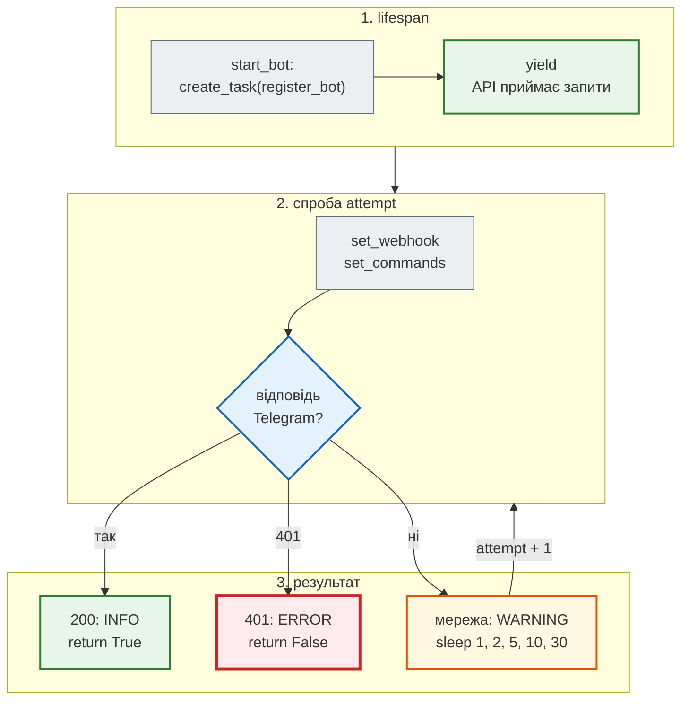

# Зовнішній сервіс не зупиняє старт

> Крок 11 · розділ 4 з 6. Код: [`news_hub/api.py`](https://github.com/NikoriakViktor/news_hub/blob/main/steps/11_compose_deploy/news_hub/api.py) (`start_bot`, `register_bot`), [`tests/integration/test_telegram_webhook.py`](https://github.com/NikoriakViktor/news_hub/blob/main/steps/11_compose_deploy/tests/integration/test_telegram_webhook.py).
> Бот і webhook — [крок 9](../09_telegram_bot/index.md).

## Задача { #task }

У `.env` задано бота: `BOT_TOKEN`, `TELEGRAM_WEBHOOK_URL`, `TELEGRAM_WEBHOOK_SECRET`. При старті API реєструє webhook у Telegram (`setWebhook`) і меню команд. А Telegram у цю мить недоступний: збій мережі, DNS, блокування на сервері — або, як у Compose з двійником, контейнер `twin` ще не запущений. API новин від цього лягти не повинен.

## Проблема: виняток у `lifespan` — старт не вдався { #problem }

У кроці 9–10 реєстрація була прямо в `lifespan`:

```python title="steps/10_docker/news_hub/api.py (фрагмент start_bot)"
    if settings.webhook_url:
        await bot.set_webhook(settings.webhook_url, secret_token=settings.webhook_secret,
                              allowed_updates=["message"])
    await set_commands(bot)
```

Перевірка: `lifespan` застосунку кроку 10 з `TELEGRAM_API_URL=http://127.0.0.1:59999` (там ніхто не слухає):

```text
aiogram.exceptions.TelegramNetworkError: HTTP Client says - ClientConnectorError: Cannot connect to host 127.0.0.1:59999 ssl:default [Connect call failed ('127.0.0.1', 59999)]
```

Виняток з `lifespan` означає для uvicorn «Application startup failed. Exiting.» У Compose це ланцюжок: процес завершився → `restart: unless-stopped` перезапускає → знову виняток → `api` ніколи не стає healthy → nginx, що чекає `service_healthy`, не стартує → **`GET /api/news` недоступний через те, що недоступний Telegram**. Новини з ботом пов'язані лише тим, що бот їх показує.

## Зміна: реєстрація — фонова задача з повторами { #change }

```python title="news_hub/api.py (фрагмент)"
async def start_bot(app: FastAPI) -> None:
    app.state.telegram = settings = load_bot_settings()
    app.state.bot = app.state.dispatcher = app.state.bot_setup = None
    if settings is None:
        return
    app.state.bot = bot = create_bot(settings.token, settings.api_url)
    app.state.dispatcher = create_dispatcher(SessionFactory, app.state.redis, app.state.llm, settings.admin_ids)
    # Крок 11: реєстрація в Telegram — у фоні. Раніше збій мережі до Telegram у lifespan зупиняв старт
    # усього API («Application startup failed»): контейнер перезапускався по колу, новини були недоступні.
    app.state.bot_setup = asyncio.create_task(register_bot(bot, settings))


TELEGRAM_RETRY_DELAYS = (1, 2, 5, 10, 30)       # секунд між спробами; далі — кожні 30 с


async def register_bot(bot: Bot, settings: BotSettings) -> bool:
    """setWebhook (якщо задано URL) і меню команд — з повторами, доки Telegram не відповість.

    Неправильний токен (401) повтор не виправить — лише запис у журнал. True — зареєстровано.
    """
    for attempt in itertools.count():
        try:
            if settings.webhook_url:
                await bot.set_webhook(settings.webhook_url, secret_token=settings.webhook_secret,
                                      allowed_updates=["message"])
            await set_commands(bot)
            logger.info("Telegram: бот зареєстрований (спроба %s)", attempt + 1)
            return True
        except TelegramUnauthorizedError:
            logger.error("Telegram: BOT_TOKEN не прийнято (401) — бот не працюватиме, API працює")
            return False
        except (TelegramAPIError, OSError) as error:
            delay = TELEGRAM_RETRY_DELAYS[min(attempt, len(TELEGRAM_RETRY_DELAYS) - 1)]
            logger.warning("Telegram недоступний (%s): повтор через %s с", error, delay)
            await asyncio.sleep(delay)
    return False                                  # недосяжно: count() нескінченний; для mypy
```

І в кінці `lifespan` — зупинити задачу разом із застосунком:

```python title="news_hub/api.py (фрагмент lifespan)"
    yield
    if app.state.bot_setup is not None:
        app.state.bot_setup.cancel()          # ще повторює реєстрацію — зупинити разом із застосунком
```

| Рішення | Чому |
|---|---|
| `asyncio.create_task(...)` | `lifespan` не чекає Telegram: `yield` настає одразу, uvicorn починає приймати запити |
| задача зберігається в `app.state.bot_setup` | на неї є посилання (інакше задачу може прибрати збирач сміття), її можна скасувати при зупинці й дочекатися в тесті |
| паузи `1, 2, 5, 10, 30`, далі — 30 с | швидко, якщо збій короткий; рідко, якщо довгий — не засипаємо журнал і Telegram |
| `TelegramUnauthorizedError` → `return False` | неправильний токен повтор не виправить: один запис `ERROR`, далі тиша |
| `except (TelegramAPIError, OSError)`, а не `except Exception` | повторюємо лише мережеві й серверні збої; помилка в нашому коді не сховається в нескінченному циклі |

Покроково — що відбувається при старті з недоступним Telegram:



## Результат { #result }

Той самий `lifespan`, але кроку 11, з тією самою мертвою адресою:

```text
21:31:16 WARNING news_hub: Telegram недоступний (HTTP Client says - ClientConnectorError: Cannot connect to host 127.0.0.1:59999 ssl:default [Connect call failed ('127.0.0.1', 59999)]): повтор через 1 с
21:31:17 WARNING news_hub: Telegram недоступний (…): повтор через 2 с
21:31:19 WARNING news_hub: Telegram недоступний (…): повтор через 5 с
started; bot_setup done: False
```

Застосунок стартував, реєстрація ще триває.

Тести — ті самі два випадки:

```python title="tests/integration/test_telegram_webhook.py (фрагмент)"
async def test_api_starts_while_telegram_is_down(monkeypatch: pytest.MonkeyPatch) -> None:
    port = free_port()                                                   # тут поки ніхто не слухає
    monkeypatch.setattr("news_hub.api.TELEGRAM_RETRY_DELAYS", (0.05,), raising=False)
    ...
    async with app.router.lifespan_context(app):
        await asyncio.sleep(0.2)                                         # кілька невдалих спроб
        assert not app.state.bot_setup.done()                            # API працює, реєстрація ще триває
        await twin.start(port=port)                                      # «Telegram» з'явився
        try:
            assert await asyncio.wait_for(app.state.bot_setup, 5) is True
            assert twin.webhook_url == "https://news.example/api/telegram/webhook"
        finally:
            await twin.stop()


async def test_wrong_token_does_not_stop_api(twin: TelegramTwin, monkeypatch: pytest.MonkeyPatch) -> None:
    """401 повтором не виправити: бот вимкнено записом у журнал, API працює далі."""
    monkeypatch.setenv("BOT_TOKEN", "999:WRONG")
    monkeypatch.setenv("TELEGRAM_API_URL", twin.url)
    async with app.router.lifespan_context(app):
        assert await asyncio.wait_for(app.state.bot_setup, 5) is False
    assert twin.webhook_url == ""
```

Паузи в тесті — `0.05` с замість `1, 2, 5…`: `monkeypatch` підмінює `TELEGRAM_RETRY_DELAYS`, тому тест іде частки секунди.

## У Compose: двійник Telegram з'являється пізніше { #twin }

Двійник Telegram Bot API з кроку 9 (`tests/telegram_twin.py`) у Compose — сервіс `twin` з профілем `twin`:

```yaml title="docker-compose.yml (фрагмент)"
  twin:
    image: news_hub:11
    profiles: [twin]
    command: ["python", "-m", "tests.telegram_twin", "--host", "0.0.0.0", "--port", "8081"]
    healthcheck:
      disable: true
    volumes:
      - ./tests:/app/tests:ro      # тестів в образі немає (.dockerignore) — підключаємо, щоб запускати pytest у контейнері
    ports:
      - "127.0.0.1:8081:8081"      # керування двійником з твого комп'ютера (лише localhost)
    networks: [backend, edge]      # backend — бот ходить до «Telegram»; edge — «Telegram» надсилає webhook на nginx
```

У `.env` для нього:

```bash
BOT_TOKEN=123456:TEST-TOKEN
TELEGRAM_API_URL=http://twin:8081
TELEGRAM_WEBHOOK_URL=http://nginx/api/telegram/webhook
TELEGRAM_WEBHOOK_SECRET=<python -c 'import secrets; print(secrets.token_urlsafe(48))'>
```

Справжній Telegram надсилає webhook лише на `https://`, і `load_bot_settings` не прийме `http://`-адресу — крім випадку, коли задано `TELEGRAM_API_URL` (інший сервер Bot API, як двійник).

Перевірка: стек з цим `.env`, але **без** `--profile twin` — «Telegram» не існує:

```text
$ docker compose up -d --wait
 Container newshub-step11-bookcheck-api-1  Healthy
 Container newshub-step11-bookcheck-nginx-1  Healthy
real    0m29.519s
$ curl localhost:8091/health/ready
{"status":"ok","checks":{"database":"ok","redis":"ok"}}

$ docker compose logs api | grep Telegram
api-1  | … WARNING news_hub: Telegram недоступний (HTTP Client says - ClientConnectorDNSError: Cannot connect to host twin:8081 ssl:default [Name or service not known]): повтор через 1 с
api-1  | … повтор через 2 с
api-1  | … повтор через 5 с
api-1  | … повтор через 10 с
```

`Name or service not known`: у мережі Compose імені `twin` ще немає. Тепер «Telegram» з'являється:

```text
$ docker compose --profile twin up -d twin
 Container newshub-step11-bookcheck-twin-1  Started
$ docker compose logs api | grep Telegram | tail -1
api-1  | 21:18:40 INFO news_hub: Telegram: бот зареєстрований (спроба 6)
```

Повний шлях webhook — через nginx, як від справжнього Telegram: «користувач» пише боту, двійник надсилає update на `http://nginx/api/telegram/webhook`:

```text
$ curl -X POST localhost:8081/_twin/say -d '{"text": "/subscribe бюджет", "chat_id": 2002}'
{"mode": "webhook", "status": 200}
$ curl 'localhost:8081/_twin/sent?chat_id=2002'
["✅ Підписка на «бюджет»"]
$ docker compose logs nginx | grep telegram
nginx-1  | 10.28.0.3 - - [11/Nov/2026:21:18:42 +0000] "POST /api/telegram/webhook HTTP/1.1" 200 11 "-" "Python/3.12 aiohttp/3.14.5" "-"
```

(Відповідь `_twin/sent` двійник повертає з `\u`-екрануванням; тут — розкодовано.)

Той самий принцип уже діє для LLM ([крок 7](../07_llm_api/index.md)): без ключа чи з лежачим провайдером API стартує, а `POST /api/news/{id}/analyze` відповідає `503`.

## Правило { #rule }

!!! tip "Правило"
    При старті застосунок чекає лише те, без чого він **не може працювати** (база, Redis — і саме їх перевіряє `/health/ready`). Сторонні сервіси (Telegram, LLM, платіжки) підключаються у фоні з повторами й паузами, що зростають, а їхня недоступність — це запис у журналі й `503` на відповідних ендпоінтах, а не «Application startup failed».

**Далі:** [Деплой на сервер](deploy.md) — як цей стек переноситься на справжню машину.
