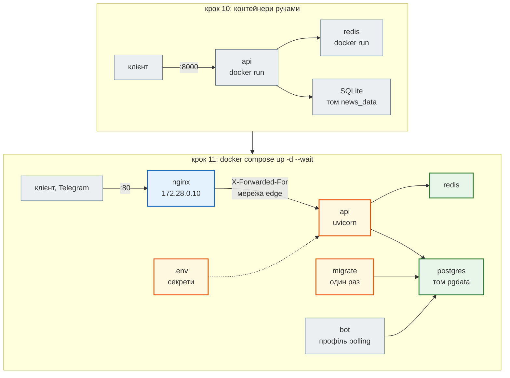

# Крок 11. Docker Compose і деплой

> **Код кроку:** [`steps/11_compose_deploy`](https://github.com/NikoriakViktor/news_hub/tree/main/steps/11_compose_deploy).
>
> **Передумови:** [Крок 10. Docker-образ](../10_docker/index.md) — є образ `news_hub`, `/health` і `/health/ready`, том `/data`, користувач без root.

## Де ми зараз { #where }

Після кроку 10 News Hub — образ. Але щоб він запрацював, довелося руками створити мережу, запустити Redis, окремим контейнером прогнати міграції, передати десяток змінних через `--env-file` і не переплутати порядок:

```bash
docker network create news
docker run -d --name redis --network news redis:7-alpine
docker run --rm -v news_data:/data news_hub:11 alembic upgrade head
docker run -d --name api --network news -p 8000:8000 -v news_data:/data \
    -e REDIS_URL=redis://redis:6379/0 --env-file .env news_hub:11
```

Це чотири команди для однієї машини розробника, і база тут — SQLite на томі. На сервері ніхто не повторюватиме їх вручну після кожного оновлення, а помилка в порядку (API раніше за міграції) з'ясовується вже на живих користувачах.

## Проблема { #problem }

Потрібен **один опис усієї системи**: які контейнери, з яких образів, у яких мережах, з якими томами й змінними, у якому порядку вони стартують і як зрозуміти, що система справді готова. І цей опис має:

- запускатися однією командою, яка або повністю працює, або каже, що саме не так;
- не тримати паролів у git;
- ставити перед API проксі (nginx) і при цьому **не губити IP клієнта**: від нього залежить rate limit входу адміна з кроку 8;
- не падати через сторонній сервіс (Telegram), якого в цю мить немає;
- переноситися на сервер, оновлюватися й мати бекап, з якого реально відновлюються.

## Що додаємо { #what }

| Що | Де | Розділ |
|---|---|---|
| уся система: `postgres`, `redis`, `migrate`, `api`, `nginx`; `depends_on` з умовами, healthchecks, профілі `polling` і `twin` | `docker-compose.yml` | [Порядок запуску: healthy, а не «запущено»](startup_order.md) |
| nginx перед API, мережі `backend` і `edge`, `FORWARDED_ALLOW_IPS` | `nginx/nginx.conf`, `docker-compose.yml` | [nginx і справжній IP клієнта](nginx_real_ip.md) |
| `.env` поза git, значення з `$` в одинарних лапках, перевірка повного bcrypt-хешу | `.env.example`, `.gitignore`, `news_hub/security.py` | [Секрети в `.env`](env_secrets.md) |
| реєстрація бота в Telegram — у фоні з повторами | `news_hub/api.py` | [Зовнішній сервіс не зупиняє старт](external_services.md) |
| сервер: firewall, `.env` з правами 600, HTTPS, оновлення, репліки; порти бази лише для розробки | `docker-compose.dev.yml` | [Деплой на сервер](deploy.md) |
| бекап і відновлення бази | `scripts/backup.sh`, `scripts/restore.sh` | [Бекап і відновлення](backup_restore.md) |

## Архітектура: було → стало { #architecture }



| Сервіс | Образ | Назовні | Скільки | Чекає |
|---|---|---|---|---|
| `nginx` | `nginx:1.27-alpine` | `${HTTP_PORT:-80}:80` | 1 | `api` healthy |
| `api` | `news_hub:11` | — | 1…N | `migrate` завершився з кодом 0, `redis` healthy |
| `migrate` | `news_hub:11` | — | один раз | `postgres` healthy |
| `bot` | `news_hub:11` | — | 1, лише `--profile polling` | `migrate`, `redis` |
| `twin` | `news_hub:11` | `127.0.0.1:8081` | лише `--profile twin` | — |
| `postgres`, `redis` | `postgres:16-alpine`, `redis:7-alpine` | — | 1 | — |

- **Назовні — лише nginx.** У бази, Redis і API в `docker-compose.yml` немає `ports` зовсім. Порти бази для розробки — окремий файл `docker-compose.dev.yml`, лише на `127.0.0.1`.
- **Дві мережі.** `backend` — api, база, Redis, міграції, бот; `edge` — nginx і api. nginx до бази не дістається навіть зсередини.
- **Випуск окремо від роботи.** Міграції — сервіс `migrate`, який один раз виконує `alembic upgrade head` і завершується. `api` можна запустити в кількох копіях без гонки міграцій.
- **Один образ — кілька ролей.** `migrate`, `api`, `bot` і `twin` запускають той самий `news_hub:11` з різною командою; спільне описано один раз YAML-якорем `x-app: &app`.

## Файли кроку { #files }

| Файл | Що в ньому | Новий? |
|---|---|---|
| [`docker-compose.yml`](https://github.com/NikoriakViktor/news_hub/blob/main/steps/11_compose_deploy/docker-compose.yml) | `x-app`, сервіси `postgres`, `redis`, `migrate`, `api`, `nginx`, `bot` (профіль `polling`), `twin` (профіль `twin`); мережі `backend`, `edge` | переписаний: у кроці 10 — лише `db` і `redis` для розробки |
| [`docker-compose.dev.yml`](https://github.com/NikoriakViktor/news_hub/blob/main/steps/11_compose_deploy/docker-compose.dev.yml) | порти `127.0.0.1:5432` і `127.0.0.1:6379` для `uvicorn --reload` на своєму комп'ютері | новий |
| [`nginx/nginx.conf`](https://github.com/NikoriakViktor/news_hub/blob/main/steps/11_compose_deploy/nginx/nginx.conf) | `upstream` на `api:8000`, `/nginx-health`, `X-Forwarded-For $remote_addr`, `client_max_body_size 1m`, `proxy_read_timeout 65s` | новий |
| [`.env.example`](https://github.com/NikoriakViktor/news_hub/blob/main/steps/11_compose_deploy/.env.example) | усі змінні стеку; правило про `$` і одинарні лапки | новий |
| [`.gitignore`](https://github.com/NikoriakViktor/news_hub/blob/main/steps/11_compose_deploy/.gitignore) | `.env`, `backups/` | новий |
| [`scripts/backup.sh`](https://github.com/NikoriakViktor/news_hub/blob/main/steps/11_compose_deploy/scripts/backup.sh), [`scripts/restore.sh`](https://github.com/NikoriakViktor/news_hub/blob/main/steps/11_compose_deploy/scripts/restore.sh) | `pg_dump` / `psql` у контейнері `postgres`, `set -euo pipefail` | нові |
| [`news_hub/api.py`](https://github.com/NikoriakViktor/news_hub/blob/main/steps/11_compose_deploy/news_hub/api.py) | `register_bot` з повторами, `TELEGRAM_RETRY_DELAYS`; версія `0.11.0` | змінений |
| [`news_hub/security.py`](https://github.com/NikoriakViktor/news_hub/blob/main/steps/11_compose_deploy/news_hub/security.py) | `BCRYPT_HASH.fullmatch` замість «починається з `$2`» | змінений |
| [`.dockerignore`](https://github.com/NikoriakViktor/news_hub/blob/main/steps/11_compose_deploy/.dockerignore) | + `nginx/`, `scripts/`, `backups/`; виняток `!.env.example` прибрано | змінений |
| [`tests/unit/test_security.py`](https://github.com/NikoriakViktor/news_hub/blob/main/steps/11_compose_deploy/tests/unit/test_security.py) | + `test_truncated_hash_fails_at_startup` | змінений |
| [`tests/integration/test_telegram_webhook.py`](https://github.com/NikoriakViktor/news_hub/blob/main/steps/11_compose_deploy/tests/integration/test_telegram_webhook.py) | + `test_api_starts_while_telegram_is_down`, `test_wrong_token_does_not_stop_api` | змінений |
| `Dockerfile` | лише тег у коментарях: `news_hub:11` | без змін по суті |

## Порядок читання { #reading-order }

1. [Порядок запуску: healthy, а не «запущено»](startup_order.md) — `depends_on` з умовами, `migrate`, healthchecks, хронологія старту.
2. [nginx і справжній IP клієнта](nginx_real_ip.md) — чому за проксі всі клієнти стають одним і як цього уникнути, не дозволивши підробити IP.
3. [Секрети в `.env`](env_secrets.md) — `${VAR:?…}`, `$` у хеші bcrypt, перевірка при старті.
4. [Зовнішній сервіс не зупиняє старт](external_services.md) — Telegram недоступний, а API працює.
5. [Деплой на сервер](deploy.md) — сервер, firewall, HTTPS, оновлення і простій, репліки, де запускати.
6. [Бекап і відновлення](backup_restore.md) — `pg_dump`, `pipefail`, перевірка відновленням.
7. [Контрольна точка](checkpoint.md) — тести, чекліст, практика, самоперевірка.

Теорія до кроку — [Частина X. Docker, Compose і CI/CD](../../10_docker_and_ci/README.md). Чому `$` у `.env` поводиться по-різному в різних інструментах — [`$` у `.env`](../../02_typing_and_pydantic/settings.md#dollar).

## Запуск { #run }

З папки кроку `steps/11_compose_deploy`:

```bash
pip install -r requirements-dev.txt
pytest -q                             # 343 passed, 8 deselected
mypy --strict news_hub                # Success: no issues found in 26 source files

cp .env.example .env                  # заповнити: POSTGRES_PASSWORD, рядки з python -m news_hub.security
docker compose up -d --build --wait   # postgres → migrate → api (healthy) → nginx
curl localhost/health/ready           # {"status":"ok","checks":{"database":"ok","redis":"ok"}}
docker compose logs -f api            # журнал
./scripts/backup.sh                   # backups/news_hub-….sql.gz
docker compose down                   # зупинити; дані лишаються в томі pgdata (down -v видалить і їх)
```

Розробка без контейнера застосунку — база й Redis з Compose, API через `uvicorn --reload`:

```bash
docker compose -f docker-compose.yml -f docker-compose.dev.yml up -d postgres redis
export DATABASE_URL=postgresql+asyncpg://news:<POSTGRES_PASSWORD>@localhost:5432/news_hub
export REDIS_URL=redis://localhost:6379/0
alembic upgrade head && uvicorn news_hub.api:app --reload
```

Бот у режимі polling — `docker compose --profile polling up -d`. З `TELEGRAM_WEBHOOK_URL` бот працює всередині `api`, окремий сервіс не потрібен. Двійник Telegram з кроку 9 — `docker compose --profile twin up -d` (налаштування — у розділі [Зовнішній сервіс не зупиняє старт](external_services.md#twin)).

!!! note "Як перевірялись виводи на сторінках кроку"
    Усі виводи — зі справжніх запусків Docker Compose v2.40 (Docker 29.1) на машині, де вже працювали інші проєкти.
    Тому стек запускався з іменем проєкту `-p newshub-step11-bookcheck` (контейнери звуться
    `newshub-step11-bookcheck-api-1`, а не `news_hub-api-1`), з `HTTP_PORT=8091` (порт 80 був зайнятий) і з
    файлом-доповненням, що міняє підмережу `edge` на `10.28.0.0/24`: `172.28.0.0/24` перетиналась з уже наявною
    мережею Docker (див. [Типові помилки](checkpoint.md#mistakes)). Тому в журналах адреса nginx — `10.28.0.10`, а не
    `172.28.0.10`. Решта файлів — без змін. Кроки на справжньому сервері не виконувались: див. [Деплой](deploy.md).

## Порівняння з кроком 10 { #diff }

```bash
git diff --no-index --stat steps/10_docker steps/11_compose_deploy
git diff --no-index steps/10_docker/docker-compose.yml steps/11_compose_deploy/docker-compose.yml
git diff --no-index steps/10_docker/news_hub steps/11_compose_deploy/news_hub
```

У коді застосунку змінилися лише два файли: `api.py` (фонова реєстрація бота) і `security.py` (повна перевірка хешу). Решта кроку — конфігурація навколо того самого образу.

## Що далі { #next }

[Крок 12. CI/CD на GitHub Actions](../12_ci_cd/index.md): те, що тут перевіряли руками, — тести, типи, збірка образу, запуск і перевірка `/health/ready` — робитиме GitHub Actions на кожен pull request.
