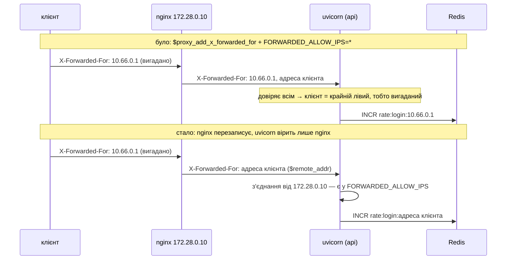
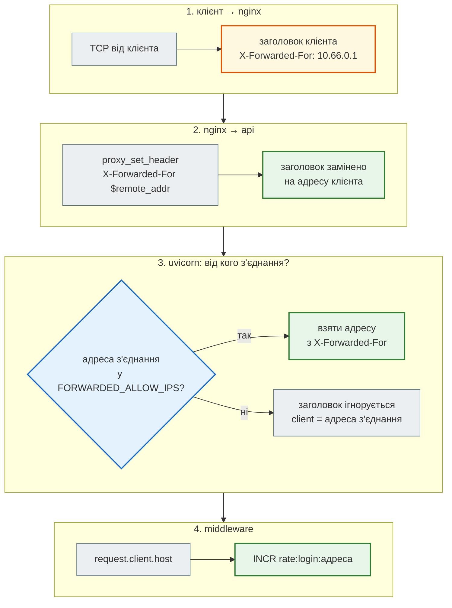

# nginx і справжній IP клієнта

> Крок 11 · розділ 2 з 6. Код: [`nginx/nginx.conf`](https://github.com/NikoriakViktor/news_hub/blob/main/steps/11_compose_deploy/nginx/nginx.conf), [`docker-compose.yml`](https://github.com/NikoriakViktor/news_hub/blob/main/steps/11_compose_deploy/docker-compose.yml) (сервіси `api`, `nginx`, мережі).
> Попередні кроки: rate limit — [крок 4](../04_middleware_redis/index.md), вхід адміна — [крок 8](../08_security/index.md).

## Задача { #task }

Поставити перед API nginx: він приймає з'єднання ззовні, а сам API назовні не відкритий. При цьому rate limit входу адміна з кроку 8 має й далі рахувати спроби **кожного клієнта окремо**:

```python title="news_hub/middleware.py (фрагмент)"
LOGIN_RATE_LIMIT = int(os.getenv("LOGIN_RATE_LIMIT", "5"))         # крок 8: спроб входу за вікно
LOGIN_RATE_WINDOW = int(os.getenv("LOGIN_RATE_WINDOW", "300"))     # секунд
...
    client = request.client.host if request.client else "unknown"
...
        key = f"rate:{action}:{client}"
```

Ключ у Redis — `rate:login:<адреса клієнта>`, а адреса — `request.client.host`: той, хто відкрив TCP-з'єднання.

## Проблема 1: усі клієнти — це nginx { #all-are-nginx }

За nginx з'єднання з API відкриває **nginx**. Справжню адресу він передає в заголовку `X-Forwarded-For`, а uvicorn уміє її звідти взяти, але лише від адрес зі списку `FORWARDED_ALLOW_IPS`. За замовчуванням там `127.0.0.1`, а nginx у Compose — інший контейнер з іншою адресою.

Перевірка: `FORWARDED_ALLOW_IPS=127.0.0.1` (як за замовчуванням), три невдалі спроби входу через nginx:

```text
401 401 401
$ docker compose exec redis redis-cli --scan --pattern 'rate:*'
rate:login:10.28.0.10                    ← адреса контейнера nginx
```

Для застосунку всі клієнти — одна адреса. Один зловмисник, п'ять неправильних паролів — і **ніхто** не може увійти п'ять хвилин.

## Проблема 2: «довіряти всім» — ліміту немає зовсім { #trust-all }

Перше, що спадає на думку, — `FORWARDED_ALLOW_IPS=*`. А в nginx за звичкою пишуть `$proxy_add_x_forwarded_for` — **дописати** адресу до того, що надіслав клієнт. Перевірка: вісім спроб, у кожній клієнт сам надсилає `X-Forwarded-For: 10.66.0.<номер>`:

```bash
for i in $(seq 1 8); do
  curl -s -o /dev/null -w "%{http_code} " -X POST localhost:8091/api/admin/token \
       -H 'Content-Type: application/json' -H "X-Forwarded-For: 10.66.0.$i" \
       -d '{"username":"admin","password":"guess'$i'"}'
done
```

```text
401 401 401 401 401 401 401 401          ← 429 так і не настав
$ docker compose exec redis redis-cli --scan --pattern 'rate:*'
rate:login:10.66.0.1
rate:login:10.66.0.2
rate:login:10.66.0.3
rate:login:10.66.0.4
rate:login:10.66.0.5
rate:login:10.66.0.6
rate:login:10.66.0.7
rate:login:10.66.0.8
```

Клієнт сам пише собі будь-яку «адресу», і кожна спроба — з «нового IP». Захист від перебору пароля обійдено одним заголовком.

## Зміна: nginx перезаписує, uvicorn вірить лише nginx { #change }

Дві речі разом. У nginx — **перезаписати** заголовок адресою того, хто підключився до nginx:

```nginx title="nginx/nginx.conf"
upstream news_hub_api {
    server api:8000;
}

server {
    listen 80;
    server_name _;

    client_max_body_size 1m;          # API приймає JSON, не файли
    server_tokens off;                # без версії nginx у заголовку Server і на сторінках помилок

    # Заголовки безпеки ставить сам застосунок (middleware.security_headers) — тут їх не дублюємо.
    # HSTS (Strict-Transport-Security) — лише в блоці `listen 443 ssl`, коли буде TLS: по http він не діє.

    # Перевірка самого nginx (healthcheck Compose): не залежить від API
    location = /nginx-health {
        access_log off;
        return 200 "ok\n";
    }

    location / {
        proxy_pass http://news_hub_api;
        proxy_http_version 1.1;
        proxy_set_header Host              $http_host;
        # Реальний IP клієнта — ПЕРЕЗАПИСУЄМО, а не дописуємо ($proxy_add_x_forwarded_for):
        # інакше клієнт сам надішле «X-Forwarded-For: будь-що» і обійде rate limit входу (крок 8).
        proxy_set_header X-Forwarded-For   $remote_addr;
        proxy_set_header X-Real-IP         $remote_addr;
        proxy_set_header X-Forwarded-Proto $scheme;
        proxy_read_timeout 65s;           # webhook Telegram чекає відповідь до 60 с
    }
}
```

У Compose — фіксована адреса nginx і довіра лише їй:

```yaml title="docker-compose.yml (фрагмент)"
  api:
    environment:
      <<: *app-env
      # Кому вірити в X-Forwarded-For: лише nginx (фіксована адреса нижче). Інакше IP клієнта підробляється.
      FORWARDED_ALLOW_IPS: ${NGINX_IP:-172.28.0.10}
    networks: [backend, edge]

  nginx:
    ports:
      - "${HTTP_PORT:-80}:80"
    networks:
      edge:
        ipv4_address: ${NGINX_IP:-172.28.0.10}    # та сама змінна, що й FORWARDED_ALLOW_IPS в api

networks:
  backend: {}                      # api, база, Redis, міграції, бот
  edge:                            # nginx ↔ api
    ipam:
      config:
        # Зайнята на машині (Pool overlaps…) — EDGE_SUBNET і NGINX_IP у .env, файли не правити
        - subnet: ${EDGE_SUBNET:-172.28.0.0/24}
```

Адреса nginx записана один раз — у змінній `NGINX_IP`, і `FORWARDED_ALLOW_IPS`, і `ipv4_address` беруть її звідти, тож розійтися вони не можуть. Типово мережа `edge` — `172.28.0.0/24`, а nginx — `172.28.0.10`. Якщо на машині цю підмережу вже займає інша мережа Docker (`Pool overlaps with other one on this address space`, див. [Типові помилки](checkpoint.md#mistakes)), у `.env` задають обидві змінні разом — `NGINX_IP` має лежати в `EDGE_SUBNET`:

```bash title=".env (фрагмент)"
EDGE_SUBNET=10.231.9.0/24
NGINX_IP=10.231.9.10
```

`docker-compose.yml` при цьому не змінюється. Без змінних `docker compose config` показує ті самі `172.28.0.10` і `172.28.0.0/24`.

`FORWARDED_ALLOW_IPS` uvicorn читає сам (це змінна середовища для параметра `--forwarded-allow-ips`), а читання заголовків проксі в нього ввімкнене за замовчуванням. Коду застосунку змінювати не довелось: `request.client.host` просто стає справжньою адресою.



Як uvicorn вибирає адресу клієнта (покроково, для запиту з кодом кроку):



## Результат { #result }

Ті самі сім спроб з вигаданим `X-Forwarded-For`, через nginx:

```text
401 401 401 401 401 429 429
$ docker compose exec redis redis-cli --scan --pattern 'rate:*'
rate:login:10.28.0.1                     ← справжня адреса клієнта
$ curl -X POST localhost:8091/api/admin/token … (правильний пароль, з того самого комп'ютера)
{"detail":"забагато запитів: 5 за 300 с; спробуй через 298 с"}
```

Запити йшли з цього ж комп'ютера, тому «справжня адреса» — шлюз мережі Docker (`10.28.0.1`: перевірка йшла в підмережі `10.28.0.0/24`, див. [примітку на початку кроку](index.md); з типовою `172.28.0.0/24` це було б `172.28.0.1`). На сервері тут буде публічний IP клієнта. Вигадані `10.66.0.x` до Redis не дійшли зовсім, і правильний пароль з **цієї** адреси теж чекає п'ять хвилин — так і має бути.

Інший клієнт (окремий контейнер у мережі `edge`) у цей самий час входить без перешкод:

```text
    inet 10.28.0.3/24 brd 10.28.0.255 scope global eth0
{"access_token":"eyJhbGciOiJIUzI1NiIsInR5cCI6IkpXVCJ9.eyJzdW…
$ docker compose exec redis redis-cli --scan --pattern 'rate:*'
rate:login:10.28.0.3
rate:login:10.28.0.1
```

А якщо той самий контейнер піде **повз nginx**, напряму на `api:8000`, і підставить заголовок сам?

```text
$ curl -X POST http://api:8000/api/admin/token -H "X-Forwarded-For: 10.77.0.$i" …   # ×3
401 401 401
$ docker compose exec redis redis-cli --scan --pattern 'rate:*'
rate:login:10.28.0.3                     ← заголовок проігноровано: 10.28.0.3 — не nginx
rate:login:10.28.0.1
```

У журналі uvicorn адреса клієнта — вже після підстановки, з портом `0` (порт клієнта nginx не передає):

```text
api-1  | INFO:     10.28.0.1:0 - "GET /health/ready HTTP/1.1" 200 OK
```

## Два шари, кожен закриває свою дірку { #two-layers }

Усі чотири поєднання перевірено на uvicorn 0.54 (версія з образу; у `requirements.txt` — `uvicorn[standard]>=0.30`):

| nginx | `FORWARDED_ALLOW_IPS` | Через nginx, вигаданий заголовок | Напряму на `api:8000`, вигаданий заголовок |
|---|---|---|---|
| `$remote_addr` (код кроку) | лише nginx | `401 ×5, 429 ×2`, ключ — справжня адреса | ігнорується, ключ — справжня адреса |
| `$proxy_add_x_forwarded_for` | лише nginx | `401 ×5, 429 ×2`, ключ — справжня адреса | ігнорується |
| `$remote_addr` | `*` | ключ — справжня адреса | **`rate:login:10.77.0.1`, `.2`, `.3` — обхід** |
| `$proxy_add_x_forwarded_for` | `*` | **8 × `401`, 8 різних ключів — обхід** | **обхід** |
| будь-який | `127.0.0.1` (за замовчуванням) | ключ — адреса nginx: усі клієнти одні | — |

- **Довіра лише nginx** закриває обхід напряму: хто дістався до `api:8000` повз nginx (інший контейнер у мережі, помилково відкритий порт), не може назвати себе ким завгодно.
- **Перезапис у nginx** гарантує, що до API доходить одна адреса — та, яку бачив nginx. Uvicorn 0.54 і з дописаним списком бере крайню праву адресу, якій не довіряє, — тому другий рядок таблиці теж працює. Але на це покладається вже не конфігурація, а поведінка конкретної версії; інші читачі заголовка (журнали, `X-Real-IP`, інший сервер замість uvicorn) можуть узяти крайню ліву — вигадану.

Тому в коді кроку — обидва шари.

## Решта `nginx.conf` { #nginx-rest }

| Рядок | Навіщо |
|---|---|
| `upstream news_hub_api { server api:8000; }` | `api` — ім'я сервісу в мережі `edge`. Адресу nginx визначає **один раз, при старті**: нову копію `api` він не побачить до `nginx -s reload` ([розділ 5](deploy.md#replicas)) |
| `proxy_set_header Host $http_host` | передати `Host` разом з портом, як його надіслав клієнт. `$host` порт відкидає: застосунок, що порівнює `Origin` з `Host` (CSRF у Django), за nginx на порту 8080 відхилятиме кожну форму |
| `X-Forwarded-Proto $scheme` | `http` чи `https` — щоб застосунок за проксі знав, як до нього прийшли ([HTTPS](deploy.md#https)) |
| `client_max_body_size 1m` | тіло більше за 1 МБ відхиляє nginx (`413`), ще до Python. `max_length` у Pydantic перевіряється вже після того, як тіло прочитано |
| `server_tokens off` | без нього nginx пише свою версію в заголовок `Server: nginx/1.x.y` і на сторінки помилок (`502`, `413`) — підказка, які відомі вразливості саме цієї версії пробувати. З ним — просто `Server: nginx` (перевіряє smoke-тест [кроку 12](../12_ci_cd/what_to_check.md)) |
| заголовків безпеки немає | `X-Content-Type-Options`, `X-Frame-Options`, CSP ставить застосунок ([крок 8](../08_security/admin_jwt.md#security-headers)) — і вони однакові з nginx і без нього, в тестах і на сервері. Дублювати їх `add_header` у nginx — два місця, які розходяться |
| HSTS — ні | `Strict-Transport-Security` браузер враховує лише на `https`; його місце — блок `listen 443 ssl` у тому, хто знімає TLS ([HTTPS](deploy.md#https)) |
| `proxy_read_timeout 65s` | webhook Telegram чекає відповідь до 60 с — nginx не має обірвати раніше |
| `location = /nginx-health` | healthcheck самого nginx, що не залежить від API: інакше nginx ставав би «unhealthy» щоразу, коли перезапускається API |

**Дві мережі — теж захист.** База й Redis — лише в `backend`, nginx — лише в `edge`. Навіть якщо nginx зламають, до `postgres:5432` з нього немає маршруту, а портів назовні в бази й Redis немає зовсім.

## Правило { #rule }

!!! tip "Правило"
    За проксі адреса клієнта — це заголовок, а заголовок може написати будь-хто. Проксі **перезаписує** `X-Forwarded-For` адресою, яку бачить сам (`$remote_addr`), а застосунок вірить цьому заголовку **лише від адреси свого проксі** (`FORWARDED_ALLOW_IPS`), ніколи `*`.

**Документація:** [nginx `ngx_http_proxy_module`](https://nginx.org/en/docs/http/ngx_http_proxy_module.html), [змінні nginx](https://nginx.org/en/docs/varindex.html), [uvicorn settings — `--proxy-headers`, `--forwarded-allow-ips`](https://www.uvicorn.org/settings/), [Compose networks](https://docs.docker.com/reference/compose-file/networks/).

**Далі:** [Секрети в `.env`](env_secrets.md) — звідки беруться пароль бази й хеш пароля адміна.
