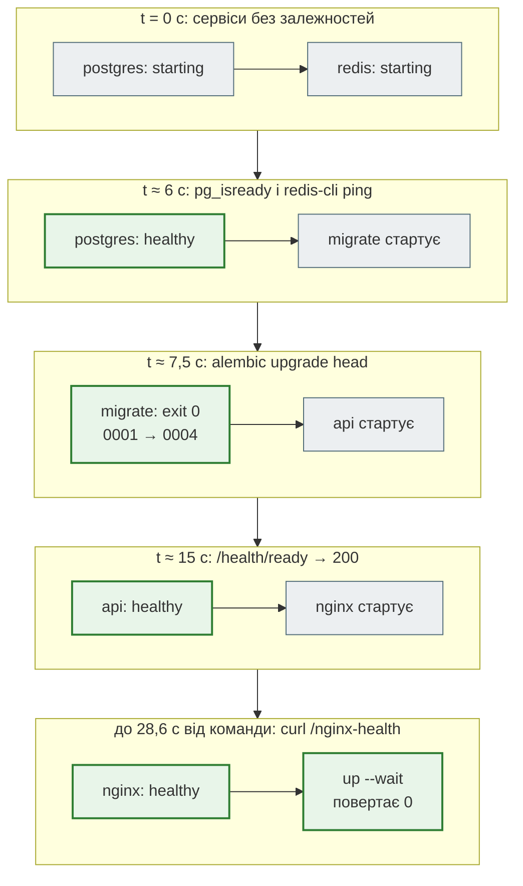

# Порядок запуску: healthy, а не «запущено»

> Крок 11 · розділ 1 з 6. Код: [`docker-compose.yml`](https://github.com/NikoriakViktor/news_hub/blob/main/steps/11_compose_deploy/docker-compose.yml).
> Теорія: [Частина X. Docker, Compose і CI/CD](../../10_docker_and_ci/README.md).

## Задача { #task }

Описати News Hub одним файлом і запускати однією командою так, щоб:

- API не приймав запитів, поки немає таблиць (міграції ще не пройшли);
- nginx не віддавав `502`, поки API стартує;
- команда запуску **чекала** готовності всієї системи і падала з причиною, якщо щось не піднялось.

## Compose за хвилину { #compose-basics }

**Docker Compose** читає `docker-compose.yml` і створює все, що там описано: контейнери, мережі, томи. Ось ключі, які трапляються в News Hub:

```yaml
services:
  api:                                  # ім'я сервісу = ім'я в мережі (redis://redis:6379)
    build: .                            # або image: nginx:1.27-alpine
    env_file: .env                      # змінні для процесу в контейнері
    environment:
      REDIS_URL: redis://redis:6379/0
    depends_on:
      redis:
        condition: service_healthy      # чекати не «запущено», а «здоровий»
    healthcheck: {test: [...], interval: 10s}
    volumes: [pgdata:/var/lib/postgresql/data]
    ports: ["80:80"]                    # відкрити назовні (лише те, що треба)
    profiles: [polling]                 # запускати лише з --profile polling
volumes:
  pgdata:
```

| Команда | Що робить |
|---|---|
| `docker compose up -d --build --wait` | зібрати образи, запустити все у фоні й чекати, доки всі стануть healthy (або впасти з причиною) |
| `docker compose ps`, `docker compose logs -f api` | стан сервісів; журнал одного |
| `docker compose exec api sh` | команда в запущеному контейнері |
| `docker compose down` / `down -v` | зупинити й видалити контейнери / і томи (дані!) |
| `docker compose config` | показати файл після підстановки змінних — перша перевірка при будь-якій помилці |

## Проблема: «запущено» ще не означає «готово» { #problem }

Найкоротший запис залежності — список: `depends_on: [api]`. Він означає лише «створи контейнер `api` раніше». Щоб побачити різницю, nginx запущено з такою залежністю (доповнення `depends_on: !override [api]` поверх файлу кроку), а `/health/ready` через nginx питали кожні 2 секунди:

```text
$ docker compose config --format json   # що вийшло з depends_on: [api]
{'api': {'condition': 'service_started', 'required': True}}

$ docker compose up -d                  # і одразу опитування localhost/health/ready
      3 t=2s: 502                        ← t = 2, 4, 6 с: nginx уже працює, uvicorn ще ні
     12 t=8s: 200
```

Список у `depends_on` — це `condition: service_started`: процес створено. nginx уже приймає з'єднання, а за ним ще нікого немає, — `502 Bad Gateway`. Те саме з базою: контейнер `postgres` «запущено» за секунду, а приймати з'єднання він починає через кілька секунд, і API без умови падає з `ConnectionRefusedError`.

Основа файлу кроку — `docker-compose.yml` стартового шаблону бекенду (сервіси `bot`, `nginx`, `postgres`, `redis`, `migrate`). У ньому були саме ці три проблеми:

| Було в шаблоні | Що з цього виходить |
|---|---|
| `depends_on: [bot]` у nginx | `502`, поки API стартує |
| healthcheck через `curl` | у `python:3.12-slim` `curl` немає (`command -v curl` в образі `news_hub:11` — порожньо, є лише `/usr/local/bin/python`): сервіс назавжди «unhealthy», і все, що чекає на нього з `service_healthy`, не стартує ніколи |
| `POSTGRES_PASSWORD: password` прямо у файлі | пароль бази — у git |

## Зміна: умови в `depends_on` і `migrate` { #change }

```yaml title="docker-compose.yml (скорочено)"
name: news_hub

x-app: &app                                  # спільне для migrate, api, bot — YAML-якір
  build: .
  image: news_hub:11
  env_file: .env
  environment: &app-env
    # Адреси сервісів — за іменами в мережі Compose, не localhost (крок 10)
    DATABASE_URL: postgresql+asyncpg://${POSTGRES_USER:-news}:${POSTGRES_PASSWORD:?задай POSTGRES_PASSWORD у .env}@postgres:5432/${POSTGRES_DB:-news_hub}
    REDIS_URL: redis://redis:6379/0
  networks: [backend]

services:
  postgres:
    image: postgres:16-alpine
    healthcheck:
      test: ["CMD-SHELL", "pg_isready -U $${POSTGRES_USER} -d $${POSTGRES_DB}"]
      interval: 5s
      timeout: 5s
      retries: 10

  redis:
    image: redis:7-alpine
    healthcheck:
      test: ["CMD", "redis-cli", "ping"]

  migrate:
    <<: *app
    command: ["alembic", "upgrade", "head"]
    healthcheck:
      disable: true                # HEALTHCHECK образу питає :8000/health — у міграцій сервера немає
    depends_on:
      postgres:
        condition: service_healthy
    restart: "no"

  api:
    <<: *app
    depends_on:
      migrate:
        condition: service_completed_successfully
      redis:
        condition: service_healthy
    healthcheck:
      # готовність (база й Redis), а не лише «процес живий» — nginx стартує, коли API справді може відповідати
      test: ["CMD", "python", "-c", "import urllib.request; urllib.request.urlopen('http://127.0.0.1:8000/health/ready', timeout=4)"]
      interval: 10s
      timeout: 5s
      retries: 5
      start_period: 60s
      start_interval: 2s

  nginx:
    image: nginx:1.27-alpine
    depends_on:
      api:
        condition: service_healthy
    healthcheck:
      test: ["CMD", "curl", "-fsS", "http://127.0.0.1/nginx-health"]   # curl в nginx:alpine є
```

Що тут відбувається:

| Запис | Що означає |
|---|---|
| `x-app: &app` і `<<: *app` | YAML-якір: `build`, `image`, `env_file`, змінні й мережа описані один раз для `migrate`, `api`, `bot`. Ключі з `x-` Compose пропускає — це місце для таких шаблонів |
| `environment: &app-env` і в `api` — `<<: *app-env` | `api` додає до спільних змінних свою (`FORWARDED_ALLOW_IPS`, [розділ 2](nginx_real_ip.md)), не повторюючи `DATABASE_URL` |
| `condition: service_healthy` | чекати, доки healthcheck сервісу поверне успіх |
| `condition: service_completed_successfully` | чекати, доки контейнер **завершиться з кодом 0**. Для одноразових задач, як `migrate` |
| `healthcheck: disable: true` | вимкнути HEALTHCHECK, успадкований з образу (крок 10): він питає `:8000/health`, а `migrate`, `bot` і `twin` порт 8000 не слухають — були б «unhealthy» завжди |
| healthcheck `api` через `python -c urllib…` | у slim-образі є лише Python; перевірка, яка справді може спрацювати |
| `/health/ready`, а не `/health` | образ (крок 10) питає `/health` — «процес живий». У Compose від `api` залежить nginx, і йому потрібна **готовність**: база й Redis відповідають |
| `start_period: 60s`, `start_interval: 2s` | перші 60 с невдалі перевірки не рахуються, і перевіряють кожні 2 с, а не 10 — API стає healthy за секунди після старту |
| `$${POSTGRES_USER}` | Compose підставляє `${…}` сам, ще до запуску. `$$` означає «залиш `$` як є»: змінну розкриє вже shell усередині контейнера `postgres`, де вона задана |
| `${POSTGRES_PASSWORD:?…}` | обов'язкова змінна: без неї `docker compose` відмовляється працювати з поясненням ([розділ 3](env_secrets.md)) |

### Випуск окремо від роботи { #release }

Міграції можна було б запускати першим рядком команди `api`: `alembic upgrade head && uvicorn …`. Так часто й роблять (`entrypoint.sh`). Але міграції — це крок **випуску** нової версії, він має виконатись один раз. Коли `api` запущено в кількох копіях ([розділ 5](deploy.md#replicas)), кожна копія почне ті самі `CREATE TABLE` одночасно — і друга впаде на дублікаті. Тому:

- `migrate` — окремий сервіс з тим самим образом: `alembic upgrade head`, `restart: "no"`, завершується;
- `api` чекає `service_completed_successfully`: впали міграції — API не стартує зовсім, а не працює зі старою схемою;
- `api` — «робота»: скільки завгодно копій, жодна не змінює схему.

Той самий поділ у Django-проєкті (`migrate` і `collectstatic` — окремий сервіс `release`, а `web` — у кількох копіях) розібрано в [Django-книзі](https://nikoriakviktor.github.io/notes_chat_app/).

## Результат: хронологія старту { #result }

```text
$ time docker compose up -d --wait
 Container newshub-step11-bookcheck-migrate-1  Exited
 Container newshub-step11-bookcheck-postgres-1  Healthy
 Container newshub-step11-bookcheck-redis-1  Healthy
 Container newshub-step11-bookcheck-api-1  Healthy
 Container newshub-step11-bookcheck-nginx-1  Healthy

real    0m28.650s

$ docker compose ps
SERVICE    STATUS                    PORTS
api        Up 19 seconds (healthy)   8000/tcp
nginx      Up 11 seconds (healthy)   0.0.0.0:8091->80/tcp, [::]:8091->80/tcp
postgres   Up 26 seconds (healthy)   5432/tcp
redis      Up 26 seconds (healthy)   6379/tcp

$ docker compose ps -a | grep migrate
migrate    Exited (0) 19 seconds ago

$ curl localhost:8091/health/ready
{"status":"ok","checks":{"database":"ok","redis":"ok"}}
```

`8000/tcp`, `5432/tcp`, `6379/tcp` без стрілки — порт є лише всередині мережі Compose; назовні відкритий тільки `nginx`. `migrate` у звичайному `ps` немає: він завершився, і це правильний стан.

Коли що стартувало (з `docker inspect`: `State.StartedAt`, `State.FinishedAt`, журнал healthcheck), від старту `postgres`:



nginx перевіряє себе раз на 10 с і без `start_interval`, тому між «nginx стартує» і «healthy» — найдовший відрізок. Уся команда — 28,6 с.

Журнал `migrate` — чотири версії схеми з кроків 3, 7, 8 і 9:

```text
$ docker compose logs migrate
migrate-1  | INFO  [alembic.runtime.migration] Running upgrade  -> 0001, news table — таблиця новин агрегатора (крок 3)
migrate-1  | INFO  [alembic.runtime.migration] Running upgrade 0001 -> 0002, llm analysis — колонки аналізу LLM у таблиці news (крок 7)
migrate-1  | INFO  [alembic.runtime.migration] Running upgrade 0002 -> 0003, sources — RSS-джерела, які додає адмін (крок 8)
migrate-1  | INFO  [alembic.runtime.migration] Running upgrade 0003 -> 0004, subscriptions — підписки чатів Telegram на ключові слова (крок 9)
```

Те саме опитування `/health/ready` кожні 2 с, що на початку сторінки, але з файлом кроку:

```text
      9 t=2s: 000                        ← nginx ще не створено: з'єднання відхилено
     31 t=20s: 200
```

Жодного `502`: nginx з'являється лише тоді, коли за ним уже є готовий API. Поки його немає, клієнт отримує «з'єднання відхилено» (`000`), а не помилку з сервера.

## Впали міграції — API не стартує { #migrate-fails }

Перевірка: команду `migrate` підмінено на `alembic upgrade 9999` — такої версії немає.

```text
$ docker compose up -d --wait
 Container newshub-step11-bookcheck-postgres-1  Healthy
 Container newshub-step11-bookcheck-redis-1  Healthy
 Container newshub-step11-bookcheck-migrate-1  service "migrate" didn't complete successfully: exit 255
service "migrate" didn't complete successfully: exit 255

$ docker compose ps -a
api Created                              ← створено, але не запущено
migrate Exited (255) Less than a second ago
nginx Created
postgres Up 7 seconds (healthy)
redis Up 7 seconds (healthy)

$ docker compose logs migrate
migrate-1  | FAILED: Can't locate revision identified by '9999'
```

Саме так і має бути: краще нічого не запустити й назвати причину, ніж запустити API над схемою, яка не збігається з кодом.

## Правило { #rule }

!!! tip "Правило"
    `depends_on` — лише з `condition`: `service_healthy` для серверів, `service_completed_successfully` для одноразових задач. Healthcheck пиши інструментом, який є в образі, і перевіряй ним **готовність**, а не те, що процес живий. Міграції — окремий одноразовий сервіс, а не перший рядок команди сервера.

**Документація:** [Compose file reference](https://docs.docker.com/reference/compose-file/), [services: `depends_on`, `healthcheck`, `profiles`](https://docs.docker.com/reference/compose-file/services/), [startup order](https://docs.docker.com/compose/how-tos/startup-order/).

**Далі:** [nginx і справжній IP клієнта](nginx_real_ip.md) — що змінюється для API, коли перед ним стоїть проксі.
