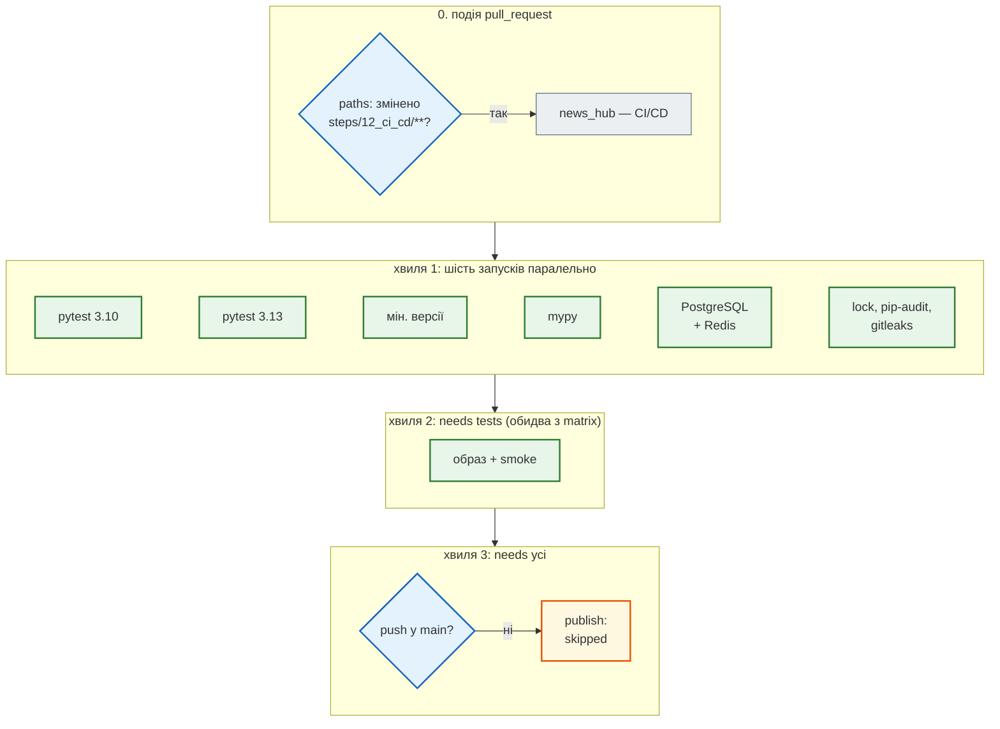
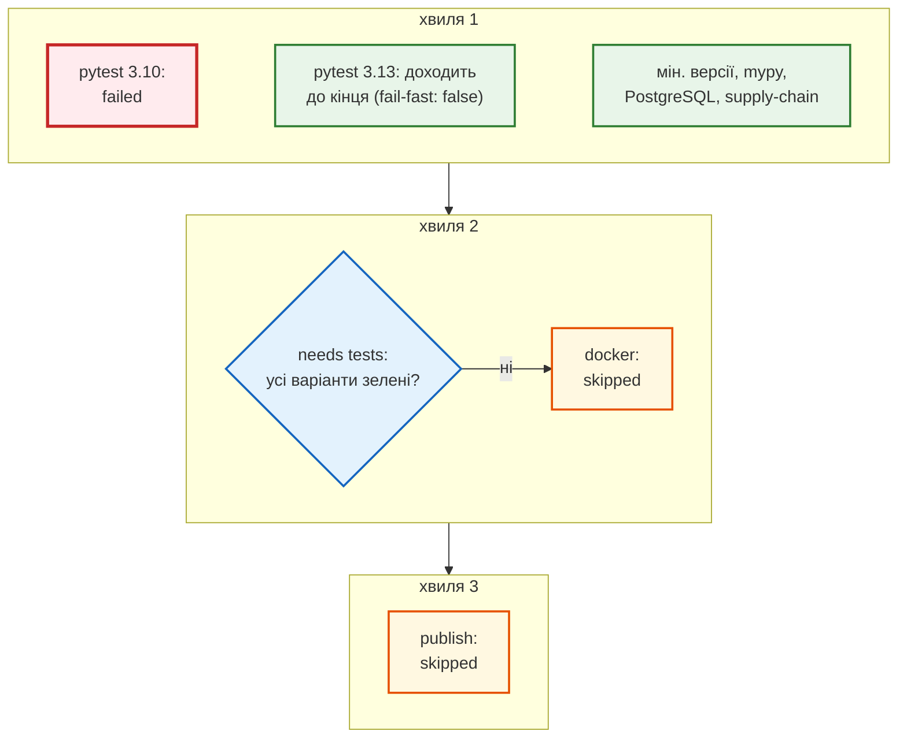

# Порядок і паралельність

> Крок 12 · розділ 3 з 4. Код: [`.github/workflows/news_hub.yml`](https://github.com/NikoriakViktor/news_hub/blob/main/.github/workflows/news_hub.yml) — `needs`, `strategy`, `timeout-minutes`.
> Теорія: [Частина X. Docker, Compose і CI/CD](../../10_docker_and_ci/README.md).

## Задача { #task }

Сім jobs, один з них — matrix на дві версії Python: вісім запусків. Якщо виконувати їх один за одним, PR чекатиме суму всіх тривалостей. Але й «усе одночасно» — погано:

- збирати образ і піднімати весь стек (найдовший job) немає сенсу, коли код уже не пройшов тести;
- публікувати образ можна лише тоді, коли пройшло **все**;
- упала одна версія Python — треба знати, що з другою, а не обірвати її на півдорозі;
- тест, що завис на мережі, не має тримати раннер годинами.

## Зміна: `needs` будує граф { #needs }

Jobs без `needs` стартують одночасно, кожен на своїй чистій машині. `needs` — «почни, коли ці jobs успішно завершились»:

```yaml title=".github/workflows/news_hub.yml (скорочено)"
jobs:
  tests:          # matrix: 3.10, 3.13 — needs немає
  min-versions:   # needs немає
  postgres:       # needs немає
  types:          # needs немає
  supply-chain:   # needs немає: lock, pip-audit, gitleaks

  docker:
    needs: tests                     # образ збираємо, лише коли код пройшов тести

  publish:
    needs: [tests, min-versions, postgres, types, supply-chain, docker]
    if: github.event_name == 'push' && github.ref == 'refs/heads/main'
```

- `docker` чекає лише `tests` — **обидва** варіанти matrix. Не чекає `min-versions`, `postgres`, `types`, `supply-chain`: це окремі обіцянки, а smoke — найдовший job, тож хай стартує якомога раніше.
- `publish` чекає всіх: образ у реєстр — лише з коміту, що пройшов усі перевірки, зокрема `supply-chain` ([розділ 2](what_to_check.md#supply-chain)): без відомих вразливостей у lock і без секретів в історії.

## Результат: хвилі { #waves }

Граф видно з самого файлу. Скрипт читає `jobs` і групує їх у хвилі: у першій — ті, що без `needs`, у кожній наступній — ті, чиї `needs` уже виконані.

```python title="waves.py"
import sys
import yaml

wf = yaml.safe_load(open(sys.argv[1], encoding="utf-8"))
jobs = wf["jobs"]
needs = {name: ([job["needs"]] if isinstance(job.get("needs"), str) else job.get("needs", [])) for name, job in jobs.items()}
done: set[str] = set()
wave = 1
while len(done) < len(jobs):
    ready = [n for n in jobs if n not in done and set(needs[n]) <= done]
    print(f"хвиля {wave}:", ", ".join(ready))
    done |= set(ready)
    wave += 1
for name, job in jobs.items():
    matrix = job.get("strategy", {}).get("matrix")
    if matrix:
        print(f"{name}: matrix {matrix} → {len(next(iter(matrix.values())))} запуски(в)")
    if "if" in job:
        print(f"{name}: if {job['if']}")
    if "permissions" in job:
        print(f"{name}: permissions {job['permissions']}")
print("workflow permissions:", wf["permissions"])
```

```text
$ python waves.py .github/workflows/news_hub.yml
хвиля 1: tests, min-versions, postgres, types, supply-chain
хвиля 2: docker
хвиля 3: publish
tests: matrix {'python': ['3.10', '3.13']} → 2 запуски(в)
publish: if github.event_name == 'push' && github.ref == 'refs/heads/main'
publish: permissions {'contents': 'read', 'packages': 'write'}
workflow permissions: {'contents': 'read'}
```

## Трасування: прогін на PR { #trace-pr }



На PR `publish` завжди `skipped`: умова `if` не виконується. Тривалість кожного job видно у вкладці **Actions** прогону; час усього прогону — це найдовший запуск хвилі 1 плюс `docker`, а не сума восьми.

## Трасування: упала одна версія Python { #trace-fail }



- **`needs` не виконано → job `skipped`**, а не «червоний»: у PR одна червона причина (`pytest · Python 3.10`), без лавини наслідків від образу й smoke.
- **`fail-fast: false`.** За замовчуванням (`fail-fast: true`) GitHub скасовує решту варіантів matrix, щойно один упав. Тоді не видно, чи проблема в одній версії Python, чи в обох. Коментар у файлі: «впала 3.10 — все одно дізнатися, що з 3.13».
- Інші jobs хвилі 1 від `tests` не залежать і доходять до кінця: за один прогін — усі незалежні причини.

## Ціна паралельності { #cost }

Кожен job — **окрема чиста машина**. Тому кроки повторюються: `actions/checkout`, `actions/setup-python`, `pip install -r requirements-dev.txt` — у `tests` (двічі), `postgres`, `types`, `docker`. Нічого з одного job в іншому немає, якщо не передати явно (артефакти, кеш).

Повтори здешевлює кеш pip:

```yaml
      - uses: actions/setup-python@v6
        with:
          python-version: ${{ matrix.python }}
          cache: pip
          cache-dependency-path: ${{ env.PROJECT }}/requirements*.txt
```

Ключ кешу — з вмісту `requirements.txt` і `requirements-dev.txt` кроку: змінив залежності — новий кеш, не змінив — `pip` бере вже завантажені пакети з кешу (`~/.cache/pip`), а не завантажує з PyPI заново. Встановлення в чисте середовище все одно відбувається в кожному job.

## `timeout-minutes` { #timeout }

| Job | `timeout-minutes` |
|---|---:|
| `tests`, `min-versions`, `postgres`, `publish` | 15 |
| `types`, `supply-chain` | 10 |
| `docker` | 20 |

Без `timeout-minutes` job може йти до шести годин — стільки дозволяє GitHub. Тест, що чекає на мережу без тайм-ауту, або `docker compose up --wait`, що не дочекався healthy, займали б раннер увесь цей час. Межа — з запасом над нормальною тривалістю; у `smoke.sh` своя, коротша: `--wait-timeout 180`.

## Правило { #rule }

!!! tip "Правило"
    Jobs — паралельно; `needs` — лише там, де справді треба чекати: дорогий job після дешевого, публікація — після всіх. `fail-fast: false` у matrix, щоб бачити всі варіанти. `timeout-minutes` на кожному job.

**Далі:** [Права, секрети, публікація](permissions_and_publish.md).
