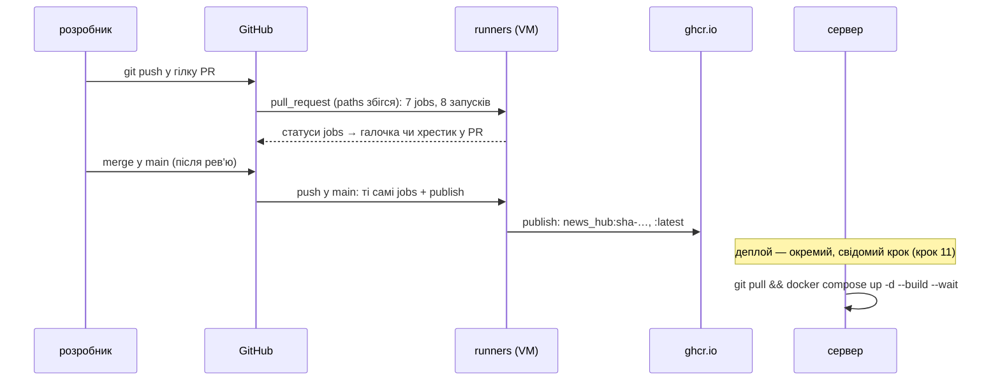
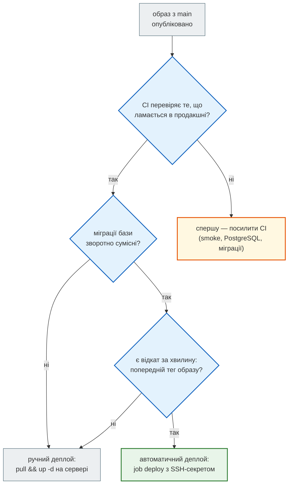

# Права, секрети, публікація

> Крок 12 · розділ 4 з 4. Код: [`.github/workflows/news_hub.yml`](https://github.com/NikoriakViktor/news_hub/blob/main/.github/workflows/news_hub.yml) — `permissions`, job `docker` (крок «.env для smoke»), job `publish`; [`scripts/make_env.py`](https://github.com/NikoriakViktor/news_hub/blob/main/steps/12_ci_cd/scripts/make_env.py).
> Теорія: [Частина X. Docker, Compose і CI/CD](../../10_docker_and_ci/README.md), [Частина VIII. Безпека](../../08_security/README.md).

## Задача { #task }

Workflow виконує код з PR — тобто код, який ще ніхто не перевірив. Він має:

- отримати лише ті права на репозиторій, які потрібні, і писати в реєстр образів лише з `main`;
- мати пароль адміна для smoke-тесту, але не показати його в журналі прогону (журнали Actions публічного репозиторію бачить кожен);
- не тримати жодного справжнього секрету у файлі workflow;
- з `main` публікувати образ так, щоб на будь-якому сервері було видно, з якого він коміту.

## Права `GITHUB_TOKEN` { #permissions }

Кожен прогін отримує тимчасовий токен `GITHUB_TOKEN`: ним `actions/checkout` читає код, ним можна писати коментарі, теги, пакети. Без блоку `permissions` його права визначає налаштування репозиторію — у старших репозиторіях це запис у весь репозиторій. Workflow Django-книги ([розділ 1](triggers.md#start)) цього блоку не має.

У `news_hub.yml` — найменше потрібне на весь workflow і окремий дозвіл одному job:

```yaml title=".github/workflows/news_hub.yml"
permissions:
  contents: read                     # найменше потрібне; публікації образу — окремий дозвіл нижче

jobs:
  ...
  publish:
    permissions:
      contents: read
      packages: write                # лише цьому job і лише на push у main
```

- `contents: read` — тести, mypy, smoke лише читають код. Навіть якщо код у PR спробує щось записати в репозиторій від імені токена, права на це немає.
- `permissions` на рівні job **замінює** блок workflow, а не доповнює його: усе, що не назване, стає `none`. Тому в `publish` `contents: read` повторено — без нього `actions/checkout` не прочитав би код.
- `packages: write` — лише `publish`, а він сам запускається лише на push у `main` (`if:` — [розділ 3](order_and_parallel.md#needs)). Код з PR до цього права не дістається.

Для порівняння, [`docs.yml`](https://github.com/NikoriakViktor/news_hub/blob/main/.github/workflows/docs.yml) має `contents: write`: `mkdocs gh-deploy` пушить зібраний сайт у гілку `gh-pages`. Право потрібне й видане свідомо; він і запускається лише на push у `main`.

## Секрети в CI { #secrets }

**Паролі тестової бази — не секрет.** `POSTGRES_PASSWORD: news` у `services` записано прямо у файлі: база живе кілька хвилин на одноразовій машині й недоступна ззовні. Коментар у файлі каже це явно.

**Пароль адміна для smoke** генерується на кожен прогін і маскується:

```yaml title="news_hub.yml → job docker"
      - name: .env для smoke — випадкові секрети, пароль адміна замасковано в журналі
        run: |
          password="$(openssl rand -hex 16)"
          echo "::add-mask::$password"
          echo "ADMIN_PASSWORD=$password" >> "$GITHUB_ENV"
          ADMIN_PASSWORD="$password" HTTP_PORT=8080 python scripts/make_env.py
      - name: smoke — увесь стек через nginx (крок 11)
        run: ./scripts/smoke.sh
```

| Рядок | Що робить |
|---|---|
| `openssl rand -hex 16` | 32 випадкові hex-символи; нового пароля немає ні в git, ні в попередніх прогонах |
| `::add-mask::$password` | команда для раннера: далі в журналі цього job значення замінюється на `***`, навіть якщо якась команда його надрукує |
| `>> "$GITHUB_ENV"` | змінна для **наступних** кроків job: кожен `run:` — окрема оболонка, і `smoke.sh` інакше не побачив би `ADMIN_PASSWORD` |
| `make_env.py` | у `.env` йде лише bcrypt-хеш пароля (`ADMIN_PASSWORD_HASH='$2b$12$…'`), випадкові `POSTGRES_PASSWORD` і `JWT_SECRET`; файл — з правами `0600` |

`make_env.py` друкує пароль адміна лише тоді, коли сам його згенерував:

```python title="scripts/make_env.py (фрагмент)"
    password = os.environ.get("ADMIN_PASSWORD") or secrets.token_urlsafe(16)
    ...
    if "ADMIN_PASSWORD" not in os.environ:
        print(f"пароль адміна: {password}")
    print(f"створено {target}")
```

У CI пароль приходить зі змінної — і в журнал не потрапляє навіть до маски. Локально:

```text
$ ADMIN_PASSWORD="$password" HTTP_PORT=18082 python scripts/make_env.py
створено …/steps/12_ci_cd/.env
$ python scripts/make_env.py
…/steps/12_ci_cd/.env уже є — не чіпаю
$ echo $?
1
```

**Справжні секрети** (ключ LLM, токен бота, SSH-ключ сервера) — лише в **Settings → Secrets and variables → Actions** і у workflow через `${{ secrets.ІМ'Я }}`; GitHub маскує їх у журналах сам. У `news_hub.yml` їх немає зовсім: тести працюють з FakeLLM і двійником Telegram, справжні виклики моделі — лише `pytest -m llm` (крок 7), який у CI не запускається. На PR із форку секрети не передаються — інакше чужий код у PR міг би їх прочитати.

## CD: образ у `ghcr.io` { #publish }

Після злиття в `main` образ з цього коміту публікується в GitHub Container Registry:

```yaml title="news_hub.yml → job publish"
  publish:
    name: публікація образу в ghcr.io
    needs: [tests, min-versions, postgres, types, supply-chain, docker]
    if: github.event_name == 'push' && github.ref == 'refs/heads/main'
    runs-on: ubuntu-latest
    timeout-minutes: 15
    permissions:
      contents: read
      packages: write                # лише цьому job і лише на push у main
    steps:
      - uses: actions/checkout@v5
      - uses: docker/login-action@v3
        with:
          registry: ghcr.io
          username: ${{ github.actor }}
          password: ${{ secrets.GITHUB_TOKEN }}   # тимчасовий токен прогону, не особистий
      - id: meta
        uses: docker/metadata-action@v5            # імена образів — у нижньому регістрі (вимога реєстру)
        with:
          # <власник>/<репозиторій>/news_hub: пакет ghcr.io належить репозиторію, який створив його першим,
          # тож у fork-ах кожен репозиторій публікує свій образ
          images: ghcr.io/${{ github.repository }}/news_hub
          tags: |
            type=sha
            type=raw,value=latest
      - uses: docker/build-push-action@v6
        with:
          context: ${{ env.PROJECT }}
          push: true
          tags: ${{ steps.meta.outputs.tags }}
          labels: ${{ steps.meta.outputs.labels }}
```

| Крок | Що робить |
|---|---|
| `docker/login-action` | вхід у `ghcr.io` тимчасовим `GITHUB_TOKEN` (з `packages: write`), а не особистим токеном: він живе лише протягом прогону |
| `docker/metadata-action` | ім'я й теги образу: `sha-<короткий хеш коміту>` і `latest`, плюс OCI-мітки (джерело, коміт) |
| `docker/build-push-action` | збирає `Dockerfile` з `steps/12_ci_cd` і пушить обидва теги |

- **Тег `sha-…`** відповідає на питання «яка версія зараз на сервері?»: кожен образ прив'язаний до коміту. `latest` зручний, але сам по собі нічого не каже й перезаписується з кожним злиттям.
- **Нижній регістр.** Реєстр приймає лише імена в нижньому регістрі, а власник репозиторію — `NikoriakViktor`. `metadata-action` переводить ім'я сам: для цього репозиторію образ — `ghcr.io/nikoriakviktor/news_hub/news_hub`. `docker push ghcr.io/NikoriakViktor/…` реєстр відхилив би.
- **Той самий коміт, але не той самий образ.** `publish` — окрема машина: він збирає образ заново з того самого коміту, а не бере зібраний у job `docker` (там образ лишився на іншій машині). `Dockerfile` той самий, і пакети теж: з кроку 12 образ ставить `requirements.lock` з `--require-hashes` — ті самі версії й ті самі файли, що в job `docker` ([розділ 2](what_to_check.md#lock)). Але базовий образ `python:3.12-slim` — тег, який з часом указує на нові збірки, і байт-у-байт образ інший. Щоб публікувати **саме** перевірений образ, його збирають один раз і передають далі (артефакт або тимчасовий тег у реєстрі) — складніше, тут цього немає.
- На PR цей job — `skipped` ([трасування](order_and_parallel.md#trace-pr)). Прогонів `publish` у цьому репозиторії на момент написання ще не було.

!!! warning "Чому в імені образу є назва репозиторію"
    Пакет у ghcr.io **належить репозиторію, який опублікував його першим**, і `GITHUB_TOKEN` іншого репозиторію не має права в нього писати. Якби образ звався просто `ghcr.io/<власник>/news_hub`, то в другому репозиторії того самого власника (fork, експериментальна копія) `publish` падав би з помилкою реєстру:

    ```text
    denied: permission_denied: write_package
    ```

    `${{ github.repository }}` в імені дає кожному репозиторію власний образ: `ghcr.io/<власник>/<репозиторій>/news_hub`. Альтернатива — дати іншому репозиторію доступ у налаштуваннях пакета (**Package settings → Manage Actions access → Add Repository → Write**), але тоді два репозиторії перезаписують той самий тег `latest`.

## Від push до реєстру { #flow }



Сервер з кроку 11 збирає образ сам (`build: .` у `docker-compose.yml`), і в кроці 12 це не змінилось. Образ у реєстрі — готовий артефакт: щоб сервер брав його замість збірки, у `docker-compose.yml` сервера `image:` має вказувати на `ghcr.io/…:sha-…`, і тоді оновлення — `docker compose pull && docker compose up -d --wait`.

## Деплоїти автоматично? { #auto-deploy }



- **CI перевіряє те, що ламається?** Без smoke, PostgreSQL і `alembic check` автоматичний деплой лише швидше доставить поломку на сервер.
- **Міграції зворотно сумісні?** Сервіс `migrate` (крок 11) змінює схему до старту нового api. Якщо стара версія api не працює з новою схемою, відкат образу не допоможе — потрібен бекап (`scripts/restore.sh`).
- **Відкат за хвилину?** Теги `sha-…` дають його: попередній тег — `up -d` з ним.

Для `news_hub` у цьому кроці — ручний деплой, як у кроці 11. Автоматичний — окремим job після `publish`, з SSH-ключем у секретах і `environment: production` (GitHub може вимагати підтвердження людиною перед цим job).

## Правило { #rule }

!!! tip "Правило"
    `permissions: contents: read` на весь workflow; право писати — лише job, якому воно потрібне, і лише на push у `main`. Справжні секрети — у Secrets, не у файлі; згенеровані в прогоні — `::add-mask::`. CD — образ з тегом коміту в реєстрі з `main`; деплой — окремий, свідомий крок.

**Далі:** [Контрольна точка](checkpoint.md).
