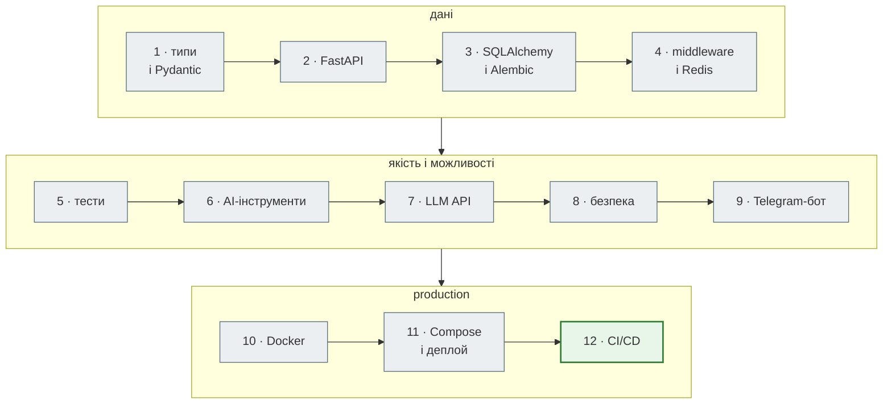

# Zero to Hero — маршрут

12 кроків від парсера до production. Кожен крок — папка `steps/NN_*` з повним робочим проєктом;
сторінка кроку пояснює, що змінилося порівняно з попереднім і чому.

| Крок | Що додається | Тестів |
|---|---|---|
| [0. Що таке API](00_first_api/index.md) | клієнт і сервер, перший API на 13 рядків, перевірка знань | — |
| [1. Типи і Pydantic](01_typing_pydantic/index.md) | анотації типів, `NewsItem`, `validate_news` | 12 |
| [2. Перший API на FastAPI](02_fastapi_basics/index.md) | `GET /api/news`, `POST /api/scrape`, `Depends`, `/docs`, Postman | 23 |
| [3. SQLAlchemy і Alembic](03_sqlalchemy_alembic/index.md) | база, репозиторій, CRUD, міграції | 32 |
| [4. Middleware, кеш і Redis](04_middleware_redis/index.md) | middleware, кеш, rate limit, фоновий збір | 41 |
| [5. Тестування API](05_api_testing/index.md) | unit / integration, фікстури, моки, фейки, покриття | 86 |
| [6. AI-інструменти](06_ai_dev_tools/index.md) | Claude Code, RSS-джерело, написане AI за тестами | 107 |
| [7. LLM API](07_llm_api/index.md) | аналіз новин Gemini / Anthropic, circuit breaker | 168 |
| [8. Безпека](08_security/index.md) | JWT адміна, SSRF, підписані webhook | 279 |
| [9. Telegram-бот](09_telegram_bot/index.md) | aiogram, підписки, polling і webhook | 335 |
| [10. Docker](10_docker/index.md) | образ, HEALTHCHECK, `/health/ready` | 340 |
| [11. Compose і деплой](11_compose_deploy/index.md) | nginx, PostgreSQL, Redis, міграції, бекап | 343 |
| [12. CI/CD](12_ci_cd/index.md) | GitHub Actions, mypy, smoke, ghcr.io | 343 |

«Тестів» — скільки проходить `pytest -q` у папці кроку (без тестів, що потребують Docker або справжнього LLM).

Ніколи не писав API? Почни з [кроку 0](00_first_api/index.md): там пояснено простими словами, що таке клієнт, сервер і API, ти запустиш перший сервер на 13 рядків і [перевіриш себе](00_first_api/readiness.md) перед кроком 1. Перед стартом — [Налаштування](../00_getting_started/local_setup.md).
